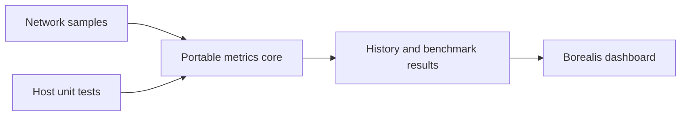

# switch-wifi: Separating network measurements from the UI

> switch-wifi is a Switch network dashboard with a Borealis interface. It separates portable metric calculations from the console application so that host…

- HTML page: https://antoineboucher.info/CV/blog/projects/notes/switch-wifi/
- Language: en
- Translation (fr): https://antoineboucher.info/CV/blog/fr/projects/notes/switch-wifi/index.md
- Published: 2026-10-23
- Updated: 2026-10-23
- Author: Antoine Boucher (https://antoineboucher.info/CV/index-en.html)

- Repository: https://github.com/antoinebou12/switch-wifi
- License: MIT
- Inspected revision: 8ff883f6925c37b14b9683f8b933a9403654d08d

## Summary

switch-wifi is a Switch network dashboard with a Borealis interface. It separates portable metric calculations from the console application so that host tests can exercise the core without requiring the Switch toolchain.

**Why it exists:** Native C++ network configuration tool interfacing directly with Switch horizon OS wlan services.

**Best fit:** Fast headless Wi-Fi network credential provisioning on Switch.

## Use cases

Nintendo Switch homebrew app that shows Wi-Fi state, benchmarks the HTTPS path and reads Bluetooth status.

- **Check the Wi-Fi link** (Switch owner, Horizon NIFM / BTM): The Dashboard tab reads link type, SSID, IPv4, gateway, DNS and 0-3 signal bars from NIFM through NetworkService, with RSSI from legacy wlan:inf only where firmware exposes it.
- **Benchmark the connection** (Switch owner, HTTPS speed server): SpeedTestEngine runs 8 HTTPS latency probes, then a 25 MiB download and a 10 MiB zero-filled upload with libcurl against speed.cloudflare.com by default, reporting median, P95 and jitter.
- **Review saved networks** (Switch owner, Horizon NIFM / BTM): The Networks tab lists basic saved-profile metadata and Horizon's allowed channels, with channel-overlap math from core/metrics; credentials are never read for display.
- **Scan Bluetooth state** (Switch owner, Horizon NIFM / BTM): BluetoothService reads BTM radio state and device counts, and runs a bounded passive BLE scan that returns at most ten unique addresses.
- **Export a diagnostics report** (Switch owner): The About tab writes sdmc:/switch-wifi-diagnostics.txt with the app version, compatibility target, network details and Bluetooth counts, without credentials.

### Scenario: Compare two router channels on a Switch

1. Build build-switch/switch-wifi.nro in the devkitpro/devkita64 container and check it with python3 scripts/verify_nro.py.
2. Copy the NRO to the SD card and launch it from the homebrew menu.
3. Open the Dashboard tab to confirm the Switch is on Wi-Fi and note the signal bars.
4. Run the Benchmark tab and read median latency, P95, jitter, download and upload speed.
5. Change the router channel, run the benchmark again and compare the history graphs.
6. Export sdmc:/switch-wifi-diagnostics.txt from the About tab to keep the result.

## Languages (GitHub Linguist bytes)

| Language | % |
| --- | ---: |
| C++ | 86.58 |
| CMake | 8.31 |
| Python | 5.11 |

## Getting started (repository commands, not run here)

### README.md · Recommended: official devkitPro container

```bash
git clone --recursive https://github.com/antoinebou12/switch-wifi.git
cd switch-wifi
```

### README.md · Recommended: official devkitPro container

```bash
docker run --rm \
  -v "$PWD:/work" -w /work \
  devkitpro/devkita64:latest \
  bash -lc 'cmake -S . -B build-switch \
    -DPLATFORM_SWITCH=ON \
    -DUSE_GLFW=ON \
    -DCMAKE_BUILD_TYPE=Release && \
    cmake --build build-switch --target switch-wifi.nro --parallel'
```

### README.md · Recommended: official devkitPro container

```bash
python3 scripts/verify_nro.py build-switch/switch-wifi.nro
```

### README.md · Native devkitPro installation

```bash
cmake -S . -B build-switch -DPLATFORM_SWITCH=ON -DUSE_GLFW=ON -DCMAKE_BUILD_TYPE=Release
cmake --build build-switch --target switch-wifi.nro --parallel
```


## Features and components

- **Portable metric core** — CMake creates switch_wifi_core from src/core/metrics.cpp. Host test targets link this library separately from Borealis. Tests cover metrics, history and benchmark behavior, with optional sanitizers.
- **Console integration** — The application target collects the src modules and links Borealis, libnx platform libraries and libcurl. Network activity and the UI therefore depend on platform services, while the numeric core can stay independent.

## Architecture

Components and connections verified in the repository.

- Network samples → Portable metrics core
- Portable metrics core → History and benchmark results
- History and benchmark results → Borealis dashboard
- Host unit tests → Portable metrics core



**One path through the code:** Start with the core library target and its tests, then inspect the network module feeding its samples. An HTTPS throughput measurement includes the chosen remote server and network path; it is not a direct reading of Wi-Fi radio capacity.

## Constraints and checks

Unavailable radio values should remain unavailable, not appear as zero. Build configuration does not prove support or accuracy on every firmware.

## Files to read

- [CMakeLists.txt](https://github.com/antoinebou12/switch-wifi/blob/main/CMakeLists.txt)
- [src/core/metrics.cpp](https://github.com/antoinebou12/switch-wifi/blob/main/src/core/metrics.cpp)
- [src/main.cpp](https://github.com/antoinebou12/switch-wifi/blob/main/src/main.cpp)


