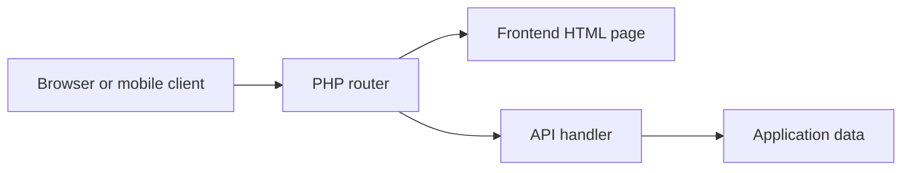

# TCH099: One PHP router for pages and API calls

> TCH099 is a teaching-oriented web project that combines static frontend pages with PHP API handlers. The route file makes the boundary visible: some…

- HTML page: https://antoineboucher.info/CV/blog/projects/notes/tch099/
- Language: en
- Translation (fr): https://antoineboucher.info/CV/blog/fr/projects/notes/tch099/index.md
- Published: 2026-10-23
- Updated: 2026-10-23
- Author: Antoine Boucher (https://antoineboucher.info/CV/index-en.html)

- Repository: https://github.com/antoinebou12/TCH099
- License: MIT
- Inspected revision: a7323c88b2ae6c12d89ef685c6a4cf4325218afc

## Summary

TCH099 is a teaching-oriented web project that combines static frontend pages with PHP API handlers. The route file makes the boundary visible: some paths return HTML files, while others dispatch to server-side scripts.

**Why it exists:** Isolated multi-container environment with bridge networking, MariaDB persistence, and web interfaces.

**Best fit:** Full-stack containerized database application reference.

## Use cases

PHP and MariaDB demo web app with an Android client, used to teach routing, sessions and Azure deployment.

- **Create an account** (Web or mobile user, MariaDB database): The signup page or SignupActivity on Android posts to /api/signup; api/signup.php calls registerUser(), which inserts the account into the Clients table created by db/1create.sql.
- **Log in with a session** (Web or mobile user, MariaDB database): login.html and LoginActivity post the username and password to /api/login; api/login.php checks them with loginUser() and opens a PHP session, and /api/logout closes it.
- **Show a random image** (Web or mobile user): random-image.html calls /api/random-image, which returns a cat picture URL from TheCatAPI or a thispersondoesnotexist.com URL depending on imageType.
- **Get a greeting by language** (Web or mobile user): /api/hello-world/$langue answers with a greeting in French, English, Spanish or German, as a minimal API example.
- **List clients as admin** (Administrator, MariaDB database): The /admin route serves admin.html only when isAdmin() is true; the page loads /api/clients, which reads the Clients table for a session whose role is admin.

### Scenario: Run the demo locally and reach the admin page

1. Fill the DB_HOST and MYSQL_* variables listed in the README, then run docker-compose up -d --build.
2. Load the schema and seed data with python3 db/db.py, or import db/1create.sql, 2contraines.sql and 3insert.sql in phpMyAdmin on port 8060.
3. Open http://localhost:8001/signup, create an account, then log in at /login.
4. With an admin account, open /admin to see the Clients table loaded from /api/clients.
5. Push to main to let .github/workflows/main_tch099antoine.yml zip the app and deploy it to the Azure Web App.

## Languages (GitHub Linguist bytes)

| Language | % |
| --- | ---: |
| HTML | 30.29 |
| PHP | 24.43 |
| Java | 24.06 |
| Jupyter Notebook | 9.1 |
| Shell | 7.27 |
| Python | 3.99 |
| Dockerfile | 0.7 |
| CSS | 0.15 |

## Verified technologies

- Docker Compose — docker-compose.yml
- MariaDB — Service image mariadb:latest in docker-compose.yml
- Azure — README and .github/workflows/README.md describe Azure deployment
- REST API — routes.php API routes

## Getting started (repository commands, not run here)

### README.md · Utilisation de Docker

```bash
docker-compose up -d --build
```

### README.md · Initialisation de la base de données

```bash
cd db
python3 -m pip install mysql-connector-python python-dotenv
python3 db.py
```

### scripts/README.md · Ubuntu/Debian

```bash
sudo usermod -aG docker $USER
newgrp docker  # or log out and back in
```

### scripts/README.md · Installing Docker Compose

```bash
sudo curl -L "https://github.com/docker/compose/releases/download/v2.20.3/docker-compose-$(uname -s)-$(uname -m)" -o /usr/local/bin/docker-compose && \
sudo chmod +x /usr/local/bin/docker-compose
```

### scripts/README.md · Verifying Installation

```bash
docker --version
docker run hello-world
docker-compose --version
```

### scripts/README.md · Automated Installation

```bash
curl -fsSL https://raw.githubusercontent.com/yourusername/docker-install/main/install-docker.sh -o install-docker.sh
chmod +x install-docker.sh
sudo ./install-docker.sh
```


## Features and components

- **Page routes** — routes.php includes router.php, maps the home and login paths to frontend files, and defines 403 and 404 pages. The /admin callback explicitly branches on isAdmin before choosing its response.
- **API handlers** — Login, signup, logout and user_details use individual API scripts. Demonstration routes include a language parameter and random-image responses. Their handlers own request processing; the router only chooses where it goes.

## Architecture

Components and connections verified in the repository.

- Browser or mobile client → PHP router
- PHP router → Frontend HTML page
- PHP router → API handler
- API handler → Application data



**One path through the code:** Compare GET /login with POST /api/login. The first selects a page; the second invokes authentication logic. Access checks belong on protected API operations as well as on the administrative page.

## Compose services

| Service | Runtime | Ports | Depends on |
| --- | --- | --- | --- |
| web | Build from Dockerfile | 8001:80 | db, startup order only |
| db | mariadb:latest | 3306:3306 |  |
| phpmyadmin | phpmyadmin/phpmyadmin | 8060:80 | db, startup order only |

## API


- `POST /api/login`
- `POST /api/signup`
- `POST /api/logout`
- `GET /api/user_details`
- `GET /api/clients`
- `GET /admin`
- `GET, POST /api/hello-world/$langue`
- `GET, POST /api/random-image`

## Constraints and checks

A route-level demonstration is not a full security review. Session handling, database queries and deployment secrets need separate inspection before public hosting.

## Files to read

- [routes.php](https://github.com/antoinebou12/TCH099/blob/main/routes.php)
- [router.php](https://github.com/antoinebou12/TCH099/blob/main/router.php)
- [README.md](https://github.com/antoinebou12/TCH099/blob/main/README.md)


