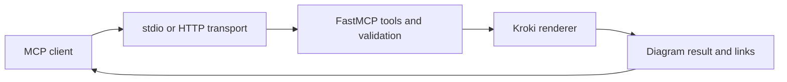

# uml-mcp: From an MCP tool call to a diagram

> uml-mcp is an MCP server that turns diagram source from a chat into SVG or PNG through Kroki and four plugins, with an in-chat viewer, a render cache and fallbacks. Demo video, request pipeline and limits from the code.

- HTML page: https://antoineboucher.info/CV/blog/projects/notes/uml-mcp/
- Language: en
- Translation (fr): https://antoineboucher.info/CV/blog/fr/projects/notes/uml-mcp/index.md
- Published: 2026-10-23
- Updated: 2026-11-06
- Author: Antoine Boucher (https://antoineboucher.info/CV/index-en.html)

- Repository: https://github.com/antoinebou12/uml-mcp
- License: MIT
- Inspected revision: ebaeac6eb6737639cd1fd5e92967408309a9a64d

## Summary

uml-mcp exposes diagram tools to MCP clients. The client supplies diagram source and options; the server validates and routes the request to rendering services, then returns diagram results and useful editor links.

**Why it exists:** Flagship Model Context Protocol (MCP) server generating PlantUML, Mermaid, and Kroki directly from LLMs (Claude, Cursor, ChatGPT) with zero local dependencies.

**Best fit:** Interactive architectural diagram generation for AI pair programming and automated design docs.

## Use cases

MCP server that lets AI assistants turn diagram source or a description into a rendered diagram inside the chat.

- **Render one diagram** (MCP client (AI chat), Kroki / PlantUML): generate_uml takes a diagram_type, the source code, a format and an optional theme, renders through Kroki (KROKI_SERVER, https://kroki.io by default) and returns the file, its URL and a playground link.
- **Validate diagram source** (MCP client (AI chat)): validate_uml checks the type, format and basic structure locally without rendering, so the assistant can fix the source before calling a renderer.
- **Render a batch of diagrams** (MCP client (AI chat), Kroki / PlantUML): generate_uml_batch renders several items with bounded concurrency and stable ordering, up to the batch_max_items setting.
- **Edit in the chat viewer** (Developer, MCP client (AI chat)): In clients that support MCP Apps, results open in ui://uml-mcp/diagram-viewer, where the user can zoom, edit the source, change theme or format and export SVG, PNG, HTML or PDF.
- **Self-host the server** (Developer, Kroki / PlantUML): uv tool install uml-mcp && uml-mcp setup installs it locally; docker-compose.yml starts the server on port 8000 with Kroki containers and an opt-in PlantUML fallback profile, and deploy/helm/uml-mcp targets Kubernetes.

### Scenario: Draw a login sequence from Cursor

1. Add the hosted endpoint https://uml-mcp.vercel.app/mcp to the MCP config, as in .cursor/mcp.json.
2. Ask the assistant: "Draw a sequence diagram of a user logging in through an API gateway."
3. The assistant calls list_diagram_types, writes Mermaid or PlantUML source and checks it with validate_uml.
4. It calls generate_uml_image; the server renders through Kroki and returns an inline PNG with render and playground links.
5. Open the playground link or the MCP App viewer to edit the source and export SVG.

## Languages (GitHub Linguist bytes)

| Language | % |
| --- | ---: |
| Python | 90.9 |
| TypeScript | 7.99 |
| Shell | 0.31 |
| CSS | 0.26 |
| Go Template | 0.23 |
| Makefile | 0.14 |
| Dockerfile | 0.11 |
| JavaScript | 0.03 |
| HTML | 0.02 |

## Getting started (repository commands, not run here)

### README.md · Quick start

```bash
git clone https://github.com/antoinebou12/uml-mcp.git
cd uml-mcp
uv sync
uv run python server.py
```

### README.md · Quick start

```bash
git remote add origin https://github.com/antoinebou12/uml-mcp.git
```

### tests/mcp-rig/README.md · Running

```bash
make mcp-rig
```

### tests/mcp-rig/README.md · Running

```bash
uvx mcp-rig@0.1.0 run tests/mcp-rig/
uvx mcp-rig@0.1.0 run tests/mcp-rig/ --tag smoke
uvx mcp-rig@0.1.0 run tests/mcp-rig/generate.yaml --case "batch*"
uvx mcp-rig@0.1.0 run tests/mcp-rig/ --server-logs   # show server stderr when debugging
```


## Features and components

- **A quiet entry point** — server.py delegates startup to mcp_core.core.server. It resolves the mcp object lazily through __getattr__, avoiding server construction and stdout output merely from importing the module. That matters when stdout carries the stdio protocol.
- **Transport and rendering** — The server supports stdio and HTTP entry paths. The core groups tool registration, configuration and Kroki integration. Rendering is a downstream operation: the MCP layer describes tools and carries their inputs and results.

## Architecture

Components and connections verified in the repository.

- MCP client → stdio or HTTP transport
- stdio or HTTP transport → FastMCP tools and validation
- FastMCP tools and validation → Kroki renderer
- Kroki renderer → Diagram result and links
- Diagram result and links → MCP client



**One path through the code:** Start at server.py, follow main into mcp_core, then inspect the registered diagram tool before its renderer. A tool invocation supplies structured arguments; it does not make arbitrary prose valid Mermaid or PlantUML.

## API


## Constraints and checks

Remote rendering transmits the diagram source. Validate the renderer endpoint and data policy before using internal architecture or other confidential material.

## Files to read

- [server.py](https://github.com/antoinebou12/uml-mcp/blob/main/server.py)
- [mcp_core/core/server.py](https://github.com/antoinebou12/uml-mcp/blob/main/mcp_core/core/server.py)
- [README.md](https://github.com/antoinebou12/uml-mcp/blob/main/README.md)


