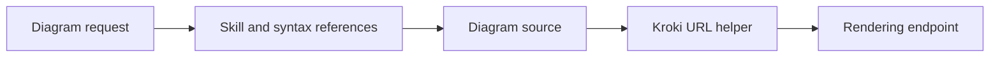

# uml-skill: Instructions with a small encoding fallback

> uml-skill packages diagram-writing instructions and a small Python helper. It is a skill bundle, not an MCP server or an image-generation model. The…

- HTML page: https://antoineboucher.info/CV/blog/projects/notes/uml-skill/
- Language: en
- Translation (fr): https://antoineboucher.info/CV/blog/fr/projects/notes/uml-skill/index.md
- Published: 2026-10-23
- Updated: 2026-10-23
- Author: Antoine Boucher (https://antoineboucher.info/CV/index-en.html)

- Repository: https://github.com/antoinebou12/uml-skill
- License: MIT
- Inspected revision: 05b27cdbe68ea3a9543b8ce8f66586b62194892a

## Summary

uml-skill packages diagram-writing instructions and a small Python helper. It is a skill bundle, not an MCP server or an image-generation model. The helper can produce a Kroki URL from diagram source.

**Why it exists:** Agent skill bundle providing direct tool definitions and prompt guides for diagram generation.

**Best fit:** Drop-in diagram generation capabilities for LLM agent frameworks.

## Use cases

Agent skill (diagramming-uml) that guides AI coding agents to write diagram source and render it via uml-mcp or Kroki.

- **Install the skill** (Developer, AI coding agent): The README lists npx @smithery/cli@latest skill add antoinebou12/uml, or copying the folder into .cursor/skills/diagramming-uml/ so the agent loads SKILL.md.
- **Plan and write diagram code** (AI coding agent): SKILL.md walks the agent through purpose, diagram type, outline and readability rules (about 25 Mermaid or 30 PlantUML nodes, labelled transitions) before it writes source.
- **Pick a diagram_type** (AI coding agent): references/DIAGRAM-TYPES.md maps intents such as sequence, swimlane, ER or architecture to a Kroki diagram_type and Mermaid or PlantUML form, to be confirmed with uml://types.
- **Render through uml-mcp** (AI coding agent, uml-mcp / Kroki): When uml-mcp is connected, the skill tells the agent to call validate_uml then generate_uml or generate_uml_batch and to return the Kroki url and playground link.
- **Build a Kroki URL offline** (Developer, uml-mcp / Kroki): Without MCP, scripts/kroki_url.py compresses the source with zlib, encodes it in base64url and prints a https://kroki.io/<backend>/<format>/... URL.

### Scenario: Get a shareable sequence diagram link

1. Install the skill with npx @smithery/cli@latest skill add antoinebou12/uml.
2. Ask the agent for a sequence diagram of a checkout flow; the skill activates on the diagram request.
3. The agent picks sequence or Mermaid sequenceDiagram from the intent table and writes the source.
4. With uml-mcp connected, it calls validate_uml and generate_uml and replies with the url, the playground link and a copy of the code.
5. Without uml-mcp, run python scripts/kroki_url.py -t mermaid diagram.mmd to get the link.

## Languages (GitHub Linguist bytes)

| Language | % |
| --- | ---: |
| Python | 100 |

## Getting started (repository commands, not run here)

### scripts/README.md · Usage

```bash
python kroki_url.py --help
```

### scripts/README.md · Usage

```bash
python kroki_url.py -t mermaid diagram.mmd
python kroki_url.py -t plantuml -f png diagram.puml
```

### scripts/README.md · Usage

```bash
Get-Content diagram.puml -Raw | python kroki_url.py -t plantuml
```

### scripts/README.md · Usage

```bash
cat diagram.puml | python kroki_url.py -t plantuml
```


## Features and components

- **Instruction layer** — SKILL.md describes the workflow and points to diagram references. An agent can use those instructions with available diagram tools. References supply syntax guidance without becoming an application runtime.
- **Encoding helper** — scripts/kroki_url.py uses standard-library compression and encoding to construct a rendering URL. Generating that URL and requesting the rendered image are separate operations.

## Architecture

Components and connections verified in the repository.

- Diagram request → Skill and syntax references
- Skill and syntax references → Diagram source
- Diagram source → Kroki URL helper
- Kroki URL helper → Rendering endpoint



**One path through the code:** Read the encoder to see how source becomes a URL-safe payload. The helper transports the source; syntax validation and visual quality still depend on the diagram language and renderer.

## Constraints and checks

A URL payload is recoverable text, not encryption. The bundle’s instructions do not guarantee that a chosen external renderer is available.

## Files to read

- [scripts/kroki_url.py](https://github.com/antoinebou12/uml-skill/blob/main/scripts/kroki_url.py)
- [README.md](https://github.com/antoinebou12/uml-skill/blob/main/README.md)


