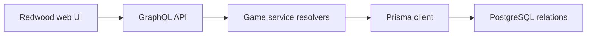

# WordsEnigma: A word game across Redwood and Prisma

> WordsEnigma is a fork with separate Redwood web and API workspaces. Its data model links users, languages, word banks, games and individual guesses.…

- HTML page: https://antoineboucher.info/CV/blog/projects/notes/wordsenigma/
- Language: en
- Translation (fr): https://antoineboucher.info/CV/blog/fr/projects/notes/wordsenigma/index.md
- Published: 2026-10-23
- Updated: 2026-10-23
- Author: Antoine Boucher (https://antoineboucher.info/CV/index-en.html)

- Repository: https://github.com/antoinebou12/WordsEnigma
- License: Unlicense
- Inspected revision: a6564499a87c1442c51ea57e5b01f954654e2180

## Summary

WordsEnigma is a fork with separate Redwood web and API workspaces. Its data model links users, languages, word banks, games and individual guesses. GraphQL services translate application operations into Prisma database calls.

**Why it exists:** TypeScript dictionary validation and game solver engine supporting multiple languages and word lengths.

**Best fit:** Algorithmic word game logic and solver heuristics.

## Use cases

RedwoodJS prototype of a multi-language Wordle, with a French word board, GraphQL API and admin CRUD on PostgreSQL.

- **Guess a five-letter word** (Player): The /phil page (MotDuJourPhilPage/App.tsx) gives six tries on a 6×5 grid, rejects words missing from the French list in data/fr.ts and colours letters and keyboard keys; the solution is hard-coded to GRAND.
- **Create an account** (Player): /signup, /login, /forgot-password and /reset-password use Redwood dbAuth (api/src/functions/auth.ts) against the User model with hashed password and salt.
- **Manage words and word banks** (Administrator): Routes under /admin, wrapped in Private roles="admin", give scaffolded CRUD pages for users, languages, words, word banks, games, try rows, letters and statistics through the GraphQL SDL services.
- **Seed French words** (Administrator, Online dictionaries): yarn seed runs scripts/seed.ts, which upserts languages and the fr word bank, then fetches definitions from fr.wiktionary.org or le-dictionnaire.com with the cheerio crawler before inserting words.
- **Track games and streaks** (Player): The Prisma schema stores each Game with its TryRow and Letter records and a Statistic row per user (games played, won, lost, streak, average); the data model is in place but the play pages do not write to it yet.

### Scenario: Run the French board locally

1. Start PostgreSQL with docker run --name=db -e POSTGRES_USER=admin -e POSTGRES_PASSWORD=admin -p 5432:5432 -d postgres, as in the root README.
2. In WordsEnigma/, run yarn install, then yarn rw prisma migrate dev to apply api/db/migrations.
3. Run yarn seed to load the languages, the fr word bank and the words.
4. Start yarn redwood dev and open http://localhost:8910/phil.
5. Type five letters, press Enter and read the colours until the word is found or the six rows are used.

## Languages (GitHub Linguist bytes)

| Language | % |
| --- | ---: |
| TypeScript | 97.12 |
| CSS | 2.22 |
| JavaScript | 0.4 |
| Dockerfile | 0.16 |
| HTML | 0.07 |
| Shell | 0.02 |

## Features and components

- **Data relationships** — schema.prisma uses PostgreSQL. A Game belongs to a user and word, references a word bank, and has try rows. Language records connect words and user settings, so multilingual behavior has a stored data model.
- **Services and persistence** — games.ts exposes list, read, create, update and delete resolvers using db.game. Relation resolvers fetch the associated user, word, bank and guesses. This layer keeps GraphQL operations close to the persistence model.

## Architecture

Components and connections verified in the repository.

- Redwood web UI → GraphQL API
- GraphQL API → Game service resolvers
- Game service resolvers → Prisma client
- Prisma client → PostgreSQL relations

**One path through the code:** Follow the game resolver into findUnique, then its relation resolvers into the linked records. These generic CRUD methods do not by themselves explain guess validation or prove that a user can access only their own games.

## Constraints and checks

The manifest targets an older Redwood and Node toolchain. Authorization and game rules need inspection beyond the generated service shape before redeployment.

## Files to read

- [WordsEnigma/package.json](https://github.com/antoinebou12/WordsEnigma/blob/main/WordsEnigma/package.json)
- [WordsEnigma/api/db/schema.prisma](https://github.com/antoinebou12/WordsEnigma/blob/main/WordsEnigma/api/db/schema.prisma)
- [WordsEnigma/api/src/services/games/games.ts](https://github.com/antoinebou12/WordsEnigma/blob/main/WordsEnigma/api/src/services/games/games.ts)

