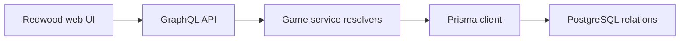

# WordsEnigma: A word game across Redwood and Prisma

> WordsEnigma is a fork with separate Redwood web and API workspaces. Its data model links users, languages, word banks, games and individual guesses.…

- HTML page: https://antoineboucher.info/CV/blog/projects/notes/wordsenigma/
- Language: en
- Translation (fr): https://antoineboucher.info/CV/blog/fr/projects/notes/wordsenigma/index.md
- Published: 2026-10-23
- Updated: 2026-10-23
- Author: Antoine Boucher (https://antoineboucher.info/CV/index-en.html)

- Repository: https://github.com/antoinebou12/WordsEnigma
- License: Unlicense
- Inspected revision: a6564499a87c1442c51ea57e5b01f954654e2180

## Summary

WordsEnigma is a fork with separate Redwood web and API workspaces. Its data model links users, languages, word banks, games and individual guesses. GraphQL services translate application operations into Prisma database calls.

**Why it exists:** TypeScript dictionary validation and game solver engine supporting multiple languages and word lengths.

**Best fit:** Algorithmic word game logic and solver heuristics.

## Languages (GitHub Linguist bytes)

| Language | % |
| --- | ---: |
| TypeScript | 97.12 |
| CSS | 2.22 |
| JavaScript | 0.4 |
| Dockerfile | 0.16 |
| HTML | 0.07 |
| Shell | 0.02 |

## Features and components

- **Data relationships** — schema.prisma uses PostgreSQL. A Game belongs to a user and word, references a word bank, and has try rows. Language records connect words and user settings, so multilingual behavior has a stored data model.
- **Services and persistence** — games.ts exposes list, read, create, update and delete resolvers using db.game. Relation resolvers fetch the associated user, word, bank and guesses. This layer keeps GraphQL operations close to the persistence model.

## Architecture

Components and connections verified in the repository.

- Redwood web UI → GraphQL API
- GraphQL API → Game service resolvers
- Game service resolvers → Prisma client
- Prisma client → PostgreSQL relations

**One path through the code:** Follow the game resolver into findUnique, then its relation resolvers into the linked records. These generic CRUD methods do not by themselves explain guess validation or prove that a user can access only their own games.

## Constraints and checks

The manifest targets an older Redwood and Node toolchain. Authorization and game rules need inspection beyond the generated service shape before redeployment.

## Files to read

- [WordsEnigma/package.json](https://github.com/antoinebou12/WordsEnigma/blob/main/WordsEnigma/package.json)
- [WordsEnigma/api/db/schema.prisma](https://github.com/antoinebou12/WordsEnigma/blob/main/WordsEnigma/api/db/schema.prisma)
- [WordsEnigma/api/src/services/games/games.ts](https://github.com/antoinebou12/WordsEnigma/blob/main/WordsEnigma/api/src/services/games/games.ts)

