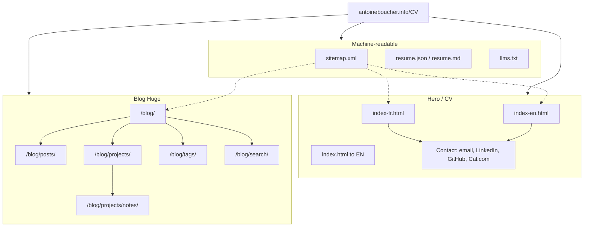

# Site map: hero and blog

Visual map of the public CV root plus Hugo blog. The deploy step merges Hugo’s blog sitemaps into root `sitemap.xml` and appends hero URLs (`scripts/deploy/merge_root_sitemap.py`).

## Diagram



## Hero URLs in root sitemap

| Path | Role |
|------|------|
| `index-en.html` / `index-fr.html` | Bilingual CV hero (Contact on page) |
| `index.html` | Synced from English |
| `/blog/` and children | Hugo posts, projects, notes, tags |

Refresh after a Hugo build:

```bash
python scripts/deploy/merge_root_sitemap.py \
  --input docs/blog/sitemap.xml \
  --output docs/sitemap.xml \
  --blog-dir docs/blog \
  --site-root https://antoineboucher.info/CV \
  --lastmod YYYY-MM-DD
```

Or run the full docs deploy path in `scripts/deploy/build_docs.py`.
