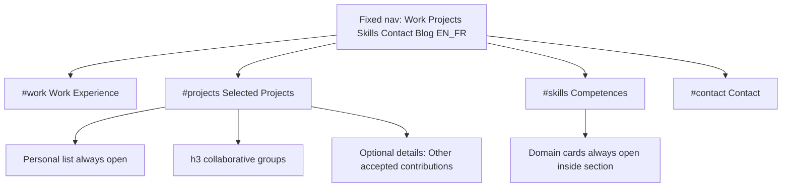

# CV index UX redesign — design spec

Date: 2026-10-24  
Surface: static CV (`index-en.html`, `index-fr.html`, synced `index.html`)  
Mode: Experience / editorial paper (preserve Fraunces + Open Sans + hero tokens)  
Approach: Editorial refinement (approved)

## Problem

A UX audit of the CV index found: navigation is Blog-only; nested `
` go beyond two levels; mint-filled cards and uneven density; experience date pills are cramped; competence strength meters are hard to trust; personal projects are hidden behind collapsed groups; the skills column is awkward on narrow viewports. Target WCAG 2.2 AA for contrast, focus, headings, and expandable panels.

## Goals

1. **P0 — Section navigation:** Work, Projects, Skills, Contact anchors with active states, alongside Blog and EN|FR.
2. **P1 — Two-level expandables:** Keep section `
`; flatten children (no subgroups, course nests, or preview nests).
3. **P1 — Surfaces:** Mix white/paper, hairline borders, restrained accent — not repeated mint-filled cards.
4. **P1 — Density:** Shared spacing, radius, and heading scale between hero and body.
5. **P1 — Experience rows:** Wider date capsules; entire job heading row clickable.
6. **Projects discovery:** Entire “Personal projects…” list always visible; collaborative/other work uses plain headings (optional single collapsed group only for “Other accepted contributions”).
7. **Competences:** Domain cards with chips and evidence lines; no percentage meters.
8. **Responsive:** Domain cards and chips wrap cleanly in the narrow right column and on mobile.
9. **A11y:** WCAG 2.2 AA (4.5:1 normal text, visible focus, clear headings, accessible expandables per W3C accordion guidance on remaining `
`).

## Non-goals

- LaTeX / PDF resume layout changes.
- Hugo blog or project-docs shell redesign.
- New standalone About pages.
- Cover-letter links on the CV index.
- Changing factual CV copy except structure/labels required by the UX change (EN/FR parity preserved).

## Decisions (locked)

| Topic | Choice |
| --- | --- |
| Accordion model | Sections stay collapsible `<details.cv-section>`; children flatten to one item layer |
| Featured / personal projects | Full personal list always visible when Selected Projects is open |
| Collaborative projects | Plain `h3` groups; optional one collapsed group for “Other accepted contributions” only |
| Competences | Domain cards (majors); subdomain chip groups; evidence “N roles · M projects” with in-page links; no meters |
| Layout approach | Keep two-column editorial paper; do not move Competences into the main column |
| Nav placement | Extend fixed top-left cluster (not a separate sticky rail under the hero) |

## Information architecture

### Section anchors

Put stable `id`s on the section `
` elements, with CSS `scroll-margin-top` so the fixed nav does not cover headings:

| Nav label (EN) | Nav label (FR) | Anchor | Section |
| --- | --- | --- | --- |
| Work | Travail | `#work` | Work Experience |
| Projects | Projets | `#projects` | Selected Projects |
| Skills | Compétences | `#skills` | Competences |
| Contact | Contact | `#contact` | Contact |

Blog and language switcher keep their current roles.

### Accordion depth (max two levels)

**Level 1 — sections:** `details.cv-section` (About, Work, Leadership, Projects, Contact, Education, Competences, …).

**Level 2 — items only where collapse still helps:**

- `details.cv-job` under Work / Leadership.
- Optional single `details` for “Other accepted contributions” under Projects (only if the lean list is long enough to warrant collapse; otherwise static).
- Certifications: static `h3` + compact list inside the Competences section (not a nested skill-group `
`).

**Remove / promote (no nested details):**

- `details.project-group` → static `h3` + body for Personal; collaborative groups → `h3`.
- `details.project-subgroup` → `h3` or plain paragraphs.
- `details.project-preview` / `details.project-nuget` → always-open panels or links.
- `details.cv-course` under teaching jobs → always-open lists or `h4` + content.
- `details.skill-group--major` / `details.skill-subgroup` → domain cards / chip groups (not expandable).

## Visual system

Reuse spine / hero tokens from [`css/design-tokens.css`](../../../css/design-tokens.css):

- Surfaces: `--hero-paper` / white fills; borders `1px solid` `--hero-rule` (or editorial rule alias).
- Accent: `--hero-accent` / `--spine-accent` for links, current nav, focus, current-job date tint only.
- Radius: `--radius-md` (7px) for job and domain cards; `--radius-sm` for chips/nav.
- Spacing: section body `--space-5`; item gap `--space-4`; shared with hero action rhythm.
- Typography: Fraunces name unchanged; section `h2` ~1.25–1.35rem; domain/job titles one step below; body Open Sans 16px / comfortable line-height.
- Project personal stack: keep hairline separators between cards (not mint panels). uml-mcp diagram stays; container matches paper surface.

### Anti-patterns (banned for this pass)

- Mint/teal filled card slabs as default background.
- Percentage / meter UI for skills.
- Nested expandable deeper than section → item.
- Purple-glow / generic AI dashboard chrome (preserve editorial CV identity).

## Component specs

### Site nav

- File: [`css/cv-site-nav.css`](../../../css/cv-site-nav.css) (+ editorial overrides in [`css/cv-editorial.css`](../../../css/cv-editorial.css)).
- Markup in both language indexes: section links before Blog pill.
- Scroll-spy sets `aria-current="location"` on the active section link.
- `:focus-visible` uses spine focus ring; text contrast ≥ 4.5:1 on paper pills.
- Mobile: flex-wrap; hit targets ≥ 44px; `scroll-margin-top` on section targets so fixed nav does not cover headings.

### Experience / Leadership job rows

- Wider `.year` (flex/min-width so range + duration are not crushed).
- Entire `summary.cv-job-summary` is the expand/collapse control.
- Chevron decorative (`aria-hidden`).
- Nested org links remain activatable; do not break keyboard expand (follow nested interactive control practices: link inside summary is acceptable in HTML; ensure focus order is clear).

### Selected Projects

1. Intro copy unchanged in meaning.
2. **Personal projects and maintained open source:** `h3` + always-visible `ul.project-list` (full current personal set, including uml-mcp).
3. **Contributions and collaborative work:** `h3` per former subgroup (Master's/research, club/community, etc.) with cards always visible.
4. **Other accepted contributions:** lean list; either static or one `details` if length warrants collapse.
5. Visual polish: clear hierarchy (personal first), consistent card spacing, flagship uml-mcp readable without hunting.

### Competences — domain cards

- One card per major in [`data/competence_domains.yaml`](../../../data/competence_domains.yaml) (Languages & formats, Application, Graphics / 3D, Data & analytics, Platform & DevOps, Quality & tests, plus Certifications treatment).
- Card structure:
  1. Domain title (`h3`)
  2. Evidence line built from existing job/project token matching (reuse logic in [`js/cv-interactions.js`](../../../js/cv-interactions.js)): e.g. `3 roles · 2 projects` / FR `3 postes · 2 projets`, with links to `#job-…` and `#project-…` when IDs exist
  3. Subdomain chip groups (label + badge chips); Intermediate (and Advanced if present) as text on the chip or a small muted label — not a bar
- Remove `.skill-meter`, `%` `skill-level` fills, and meter ARIA.
- Domains are **not** nested `
` inside Competences.
- Mobile / `col-sm-5`: full-width cards; chips wrap; no horizontal meter column.

### Accessibility

- Heading outline: `h1` hero → `h2` sections → `h3` jobs/domains/project groups → optional `h4` only if needed for courses.
- Expandables: native `
`/`
`; visible focus; do not remove summary keyboard support.
- Color is not the only active-nav or Intermediate cue.
- Respect `prefers-reduced-motion` for any new scroll-spy or hover transitions.

## Data & scripts

- Prefer editing HTML structure by hand for projects/jobs (current practice); competences HTML may stay hand-synced with YAML majors or gain a small generator later — out of scope to invent a full pipeline unless an existing generator already owns this block.
- Update evidence JS: aggregate and render at **domain card** level; drop meter span/`aria-valuenow` updates.
- After EN changes: `python scripts/html/sync_index_html.py`; keep FR parity; re-run AEO patch if nav markup is in the patched region (`generate_aeo_content.py --all` as needed).

## Verification

- Visual: desktop and ≤767px for EN and FR; personal projects visible without extra expand; domain cards readable in sidebar.
- Keyboard: tab through nav and job summaries; Enter/Space toggles; focus rings visible.
- Contrast: body and nav text ≥ 4.5:1 on paper.
- Regressions: PDF download, particles/reduced-motion, ClustrMaps toggle, uml-mcp inline SVG, EN|FR switch, Blog link.
- Optional: extend or smoke with existing Playwright/UX tooling if CV index fixtures exist; otherwise manual checklist above.

## Files to touch

- [`index-en.html`](../../../index-en.html), [`index-fr.html`](../../../index-fr.html) (+ sync `index.html`)
- [`css/cv-site-nav.css`](../../../css/cv-site-nav.css), [`css/cv-editorial.css`](../../../css/cv-editorial.css), [`css/cv-main.css`](../../../css/cv-main.css) (print/fallback as needed)
- [`js/cv-interactions.js`](../../../js/cv-interactions.js)
- [`AGENTS.md`](../../../AGENTS.md) — update “Blog pill + EN|FR” to include section anchors
- This spec; implementation plan under `docs/superpowers/plans/`

## Success criteria

- Nav reaches Work, Projects, Skills, Contact with a correct active state while scrolling.
- No expandable nesting deeper than section → item.
- Personal project cards visible whenever Selected Projects is open.
- Competences show domain cards with evidence and chips; zero skill meters.
- Surfaces use paper + border + restrained accent; spacing/radius/heading scale feel consistent with the hero.
- Job date capsules have room; full summary row toggles the job.
- WCAG 2.2 AA targets above met for the changed UI.
