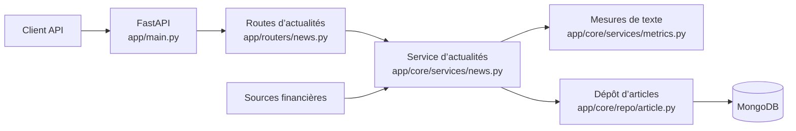

AINewsTracker transforme les actualités financières en données consultables, analysables et comparables aux données de marché. **[English version]()**

<!--more-->

Le projet est un service FastAPI avec des routes distinctes pour les actualités, les articles, les entreprises, les utilisateurs, l’amorçage des données et les stratégies de négociation. Les routes reçoivent les requêtes HTTP; les services et les dépôts prennent en charge l’analyse et le stockage.

## Du flux à l’article

Le parcours principal commence dans `app/routers/news.py`. Une route transmet le travail à `app/core/services/news.py`, qui récupère le contenu des flux et construit les articles. L’analyse de texte se trouve dans `app/core/services/metrics.py`; le dépôt d’articles enregistre ensuite le résultat dans MongoDB.



Les routes définissent l’interface HTTP, les modèles décrivent les données, les services traitent les actualités et les dépôts isolent l’accès à la base. `app/main.py` configure aussi le cache Redis.

## Analyse et backtesting

La documentation décrit l’analyse de sentiment, la classification par sujet, l’attribution de tickers et le résumé d’articles. La route de stratégie transmet les demandes de backtest à `app/core/trading/strategy.py`.

Ces étiquettes restent des données d’entrée pour une expérience. Elles ne prouvent pas qu’une actualité a causé un mouvement de marché, et un backtest historique ne garantit pas les résultats futurs.

## Surface de l’API

La documentation publiée couvre l’ingestion depuis RSS, GNews et des flux nommés; le stockage des articles et la lecture des scores; les entreprises et la recherche par ticker; ainsi que les stratégies pour une ou plusieurs entreprises. FastAPI expose sa documentation interactive sous `/api/v1/docs` sur le port local documenté `8000`.

## Exécution locale

```shell
cp .env.example .env
pip install poetry
poetry shell
poetry install
poetry run pytest
poetry run uvicorn app.main:app --reload
```

Docker Compose fournit un autre point d’entrée :

```shell
docker-compose up --build
```

## Lire l’architecture

Le GitDiagram complet montre l’enregistrement des routes, les modèles, les dépôts, les scripts d’amorçage, MongoDB, Redis et la branche de stratégie. Chaque nœud renvoie à son fichier source.

- [GitDiagram interactif](https://gitdiagram.com/algoets/ainewstracker)
- [Référence du projet AINewsTracker]()
- [Dépôt source](https://github.com/AlgoETS/AINewsTracker)
- [Documentation publiée](https://algoets.github.io/AINewsTracker/)

Le dépôt reste la référence pour la configuration, les routes actuelles et les prérequis d’installation.
