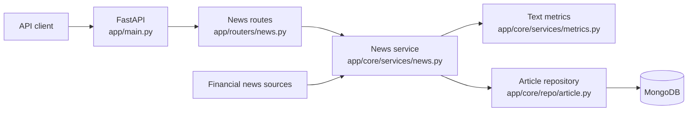

AINewsTracker turns financial news into records that can be searched, analysed and compared with market data. **[Version française]()**

<!--more-->

The project is a FastAPI service with separate routes for news, articles, companies, users, data seeding and trading strategies. Routes receive HTTP requests; services and repositories handle analysis and storage.

## From a feed to an article

The main path begins in `app/routers/news.py`. A news route dispatches work to `app/core/services/news.py`, which retrieves feed content and builds article records. Text analysis lives in `app/core/services/metrics.py`; the article repository then writes the result to MongoDB.



Routes describe the API surface, models define stored data, services perform the news work, and repositories isolate database access. `app/main.py` also configures Redis caching.

## Analysis and backtesting

The project documentation describes sentiment analysis, topic classification, ticker allocation and article summarisation. The strategy route sends backtest requests to `app/core/trading/strategy.py`.

These labels are inputs to an experiment. They do not prove that a news item caused a market move, and a historical backtest does not guarantee future performance.

## API surface

The published documentation covers news ingestion from RSS, GNews and named feeds; article storage and score lookup; company records and ticker lookup; and strategy execution for one or more companies. FastAPI exposes interactive documentation at `/api/v1/docs` on the documented local port `8000`.

## Running it locally

```shell
cp .env.example .env
pip install poetry
poetry shell
poetry install
poetry run pytest
poetry run uvicorn app.main:app --reload
```

Docker Compose provides another entry point:

```shell
docker-compose up --build
```

## Read the architecture

The complete GitDiagram includes route registrations, models, repositories, seeders, MongoDB, Redis and the trading branch. Each node links to its source file.

- [Interactive GitDiagram](https://gitdiagram.com/algoets/ainewstracker)
- [AINewsTracker project reference]()
- [Source repository](https://github.com/AlgoETS/AINewsTracker)
- [Published documentation](https://algoets.github.io/AINewsTracker/)

The repository remains the source of truth for configuration, current endpoints and setup requirements.
