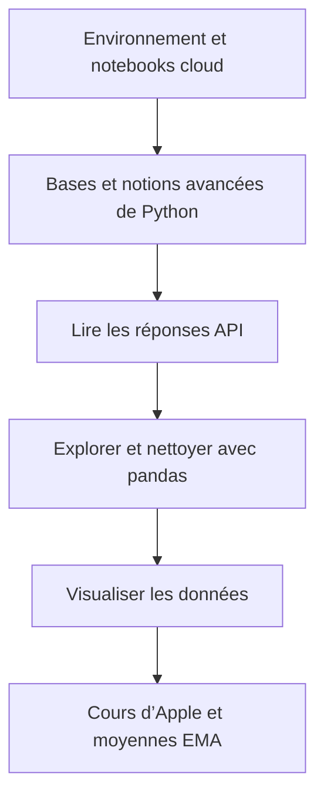



Un atelier débutant devient plus utile lorsque chaque notion sert à construire la suivante. **AlgoETS/Workshop1** passe de l’environnement Python à une réponse API, puis à un DataFrame et à un graphique. Le dernier notebook rassemble ces étapes avec le cours d’Apple et des moyennes mobiles exponentielles.

<!--more-->

## Neuf notebooks, six étapes

Le dépôt contient **neuf notebooks Jupyter** dans six dossiers numérotés : deux pour l’environnement, deux pour Python, un pour les API, un pour pandas, deux pour la visualisation et un projet final.

Ce chiffre décrit le contenu du dépôt. Il ne mesure ni la participation ni la réussite des étudiants.

## Ne pas laisser l’installation prendre toute la place

Le README propose un [point d’entrée Colab](https://colab.research.google.com/github/AlgoETS/Workshop1/blob/main/1.0-basic/1.1_python_basic.ipynb) et une installation Jupyter locale. Les deux chemins permettent de commencer à coder tout en gardant la configuration comme sujet distinct.

Les dossiers numérotés aident aussi à revenir sur une notion sans recommencer le projet complet.

## Un exercice final précis

Le code de [`5.1_project_ema.ipynb`](https://github.com/AlgoETS/Workshop1/blob/main/5.0-project/5.1_project_ema.ipynb) trace le cours de clôture d’Apple et des **EMA de 12, 26, 50, 100 et 200 jours**. C’est plus précis que la description générale d’exploration et de modélisation du README.

L’exercice relie requête, tableau, colonnes calculées et graphique légendé. Il ne démontre pas la rentabilité d’un croisement de courbes.

## Lire le graphique comme un exercice de données

Les bonnes questions sont d’abord techniques : les dates sont-elles triées ? Les valeurs manquantes ont-elles été traitées volontairement ? Pourquoi une EMA longue réagit-elle plus lentement ? Toutes les courbes utilisent-elles les mêmes observations ?

Les API, les clés et les versions de bibliothèques peuvent avoir évolué depuis l’atelier. Les notebooks sont du matériel à lire et à adapter, pas la garantie d’un environnement immédiatement reproductible.

## Passer du graphique au traitement par lots

[BatchBacktesting]() prolonge cette démarche : reprendre les indicateurs, les comparer sur plusieurs instruments et conserver les hypothèses de simulation.

Cette progression permet de comprendre les données et le code avant de tirer des conclusions d’un classement.

## Sources

- [Dépôt de l’atelier et visuel original](https://github.com/AlgoETS/Workshop1)
- [Notebook des bases Python](https://github.com/AlgoETS/Workshop1/blob/main/1.0-basic/1.1_python_basic.ipynb)
- [Code du projet EMA](https://github.com/AlgoETS/Workshop1/blob/main/5.0-project/5.1_project_ema.ipynb)
