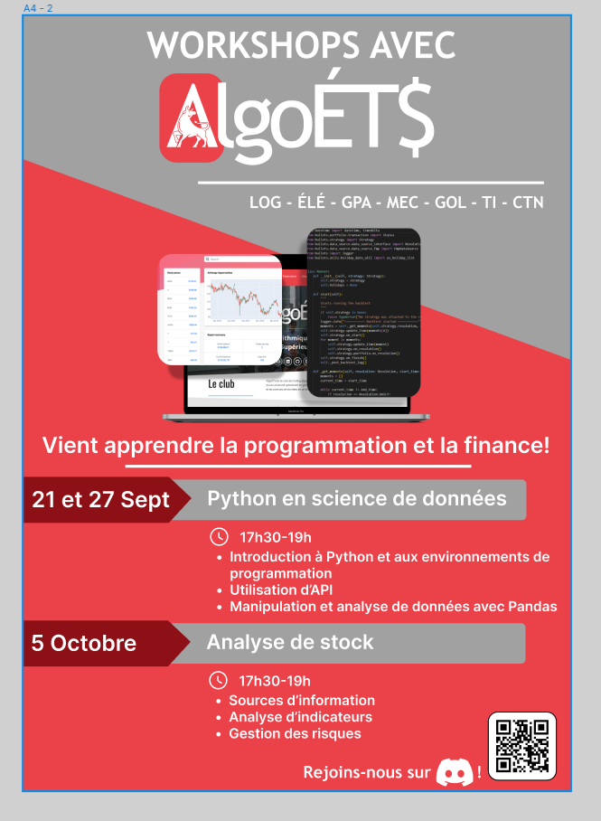
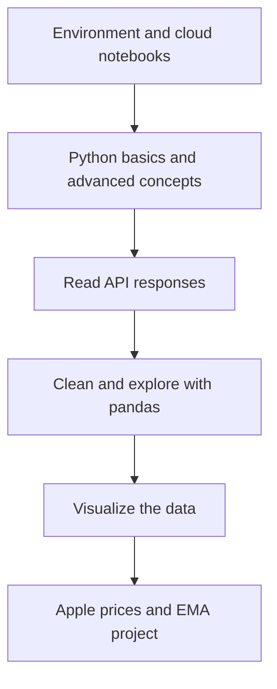



The most useful beginner workshop gives each new concept somewhere to go. **AlgoETS/Workshop1** moves from Python setup to an API response, a DataFrame, and a chart. The final notebook uses Apple price data and exponential moving averages to bring those steps together.

<!--more-->

## Nine notebooks, six stages

The repository contains **nine Jupyter notebooks** across six numbered directories: two setup notebooks, two Python notebooks, one API notebook, one pandas notebook, two visualization notebooks, and one final project.

This is a count of checked-in teaching material, not a student attendance or completion statistic.

## Keep setup from swallowing the lesson

The README links a [Colab entry point](https://colab.research.google.com/github/AlgoETS/Workshop1/blob/main/1.0-basic/1.1_python_basic.ipynb). Local Jupyter is also documented. Offering both lets learners begin with code while keeping environment setup available as its own topic.

The six-stage structure makes it possible to return to a missing concept without restarting the entire project.

## The final exercise is concrete

The code in [`5.1_project_ema.ipynb`](https://github.com/AlgoETS/Workshop1/blob/main/5.0-project/5.1_project_ema.ipynb) plots Apple closing prices with **12-, 26-, 50-, 100-, and 200-day EMA curves**. This is a more precise description than the README’s broad “advanced exploration and modeling” language.

The exercise connects a request, tabular data, indicator columns, and a labeled chart. It does not establish that any crossover makes money.

## Read the chart as a data exercise

Useful classroom questions are technical: are dates ordered correctly? Were missing values removed intentionally? Why does a longer EMA respond more slowly? Are all curves computed from the same observations?

API availability, keys, and package versions can change since the original workshop. The notebooks are teaching material to inspect and adapt, not a promise of a fresh one-command environment.

## From one chart to a batch experiment

The natural continuation is [BatchBacktesting](): the same indicator idea, now evaluated across instruments with recorded assumptions and comparable outputs.

That progression keeps the focus on understanding data and code before interpreting a leaderboard.

## Sources

- [Workshop repository and original artwork](https://github.com/AlgoETS/Workshop1)
- [Python basics notebook](https://github.com/AlgoETS/Workshop1/blob/main/1.0-basic/1.1_python_basic.ipynb)
- [EMA project code](https://github.com/AlgoETS/Workshop1/blob/main/5.0-project/5.1_project_ema.ipynb)
