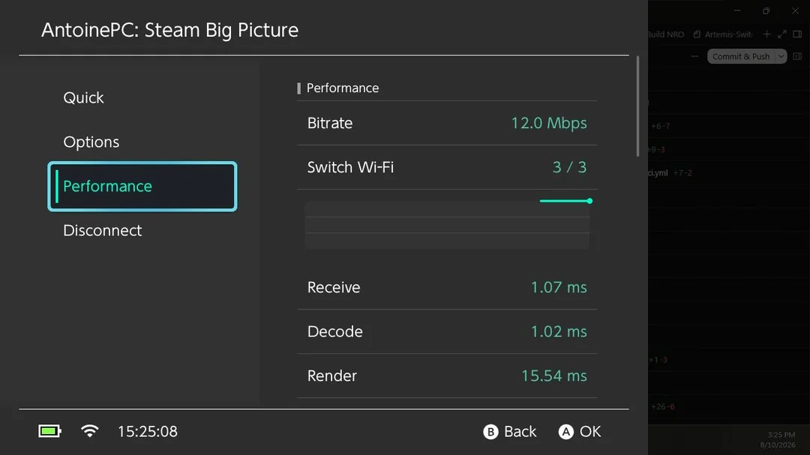
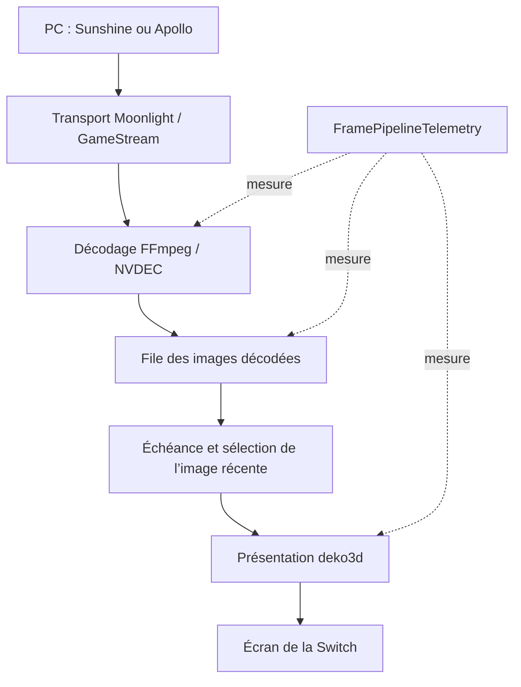



Un stream peut afficher un bon débit tout en donnant une impression de retard. **Artemis Switch** est mon fork de Moonlight-Switch pour Nintendo Switch. Je m’intéresse surtout au trajet entre la réception d’une image et son affichage : où cette image a-t-elle attendu ?

<!--more-->

## Bien séparer le client du serveur

Artemis conserve les bases de **XITRIX/Moonlight-Switch** : interface Borealis, transport Moonlight/GameStream, décodage FFmpeg/NVDEC et rendu deko3d. Sunshine et Apollo restent des serveurs sur le PC. Leur administration passe par leurs propres interfaces.

Un mauvais mode d’écran virtuel relève donc du serveur. Une file d’images décodées qui grossit relève du client. La documentation des intégrations ne signifie pas que toutes les combinaisons ont été validées sur console.

## Le trajet d’une image

Ce schéma simplifie le code du client. Il ne représente pas une mesure complète de la latence entre la manette et l’écran.

## Quand abandonner les anciennes images ?

Dans [`LowLatencyFrameSelection.hpp`](https://github.com/antoinebou12/Artemis-Switch/blob/main/app/src/streaming/LowLatencyFrameSelection.hpp), la sélection vérifie **l’échéance de la plus ancienne image avant de passer à la plus récente**. Une fois l’affichage autorisé, elle libère les images anciennes. Un retard accumulé permet aussi de contourner cette attente.

Si l’échéance suivait toujours la dernière arrivée, elle pourrait reculer sans cesse. La file recevrait des images sans jamais en présenter. Cette règle précise explique mieux le travail réalisé qu’une simple promesse de faible latence.

## Mesurer chaque étape

[`FramePipelineTelemetry.hpp`](https://github.com/antoinebou12/Artemis-Switch/blob/main/app/src/streaming/FramePipelineTelemetry.hpp) suit le décodage, l’attente en file, le pipeline client, le rendu, la soumission GPU, le débit réel et le temps jusqu’aux premières étapes du stream. Une horloge monotone et un mutex encadrent ces mesures.

Le pipeline client commence ici après la réception réseau complète. Il ne couvre pas à lui seul l’encodage du PC, tout le réseau, le balayage de l’écran et les commandes.

Le README décrit aussi les modes Fit/Fill/Stretch, l’agrandissement de type FSR, RCAS, les profils nommés et les panneaux de diagnostic. Ce sont des outils pour comparer des compromis, pas une garantie de fréquence d’images.

## Comparer sur console

Je garderais le même serveur, la même scène, la résolution et le réseau. Ensuite, je changerais une option de cadence à la fois en observant l’attente et les intervalles de présentation. Les modes portable et docké méritent des essais distincts.

Le dépôt distingue les tests portables et les builds des validations sur appareil. Les [notes d’installation](https://github.com/antoinebou12/Artemis-Switch#installation) restent donc la référence avant d’assimiler compilation et expérience de jeu.

## Sources

- [Dépôt et captures](https://github.com/antoinebou12/Artemis-Switch)
- [Politique de sélection](https://github.com/antoinebou12/Artemis-Switch/blob/main/app/src/streaming/LowLatencyFrameSelection.hpp)
- [Télémétrie du pipeline](https://github.com/antoinebou12/Artemis-Switch/blob/main/app/src/streaming/FramePipelineTelemetry.hpp)
- [Vue d’ensemble des projets portables]()
