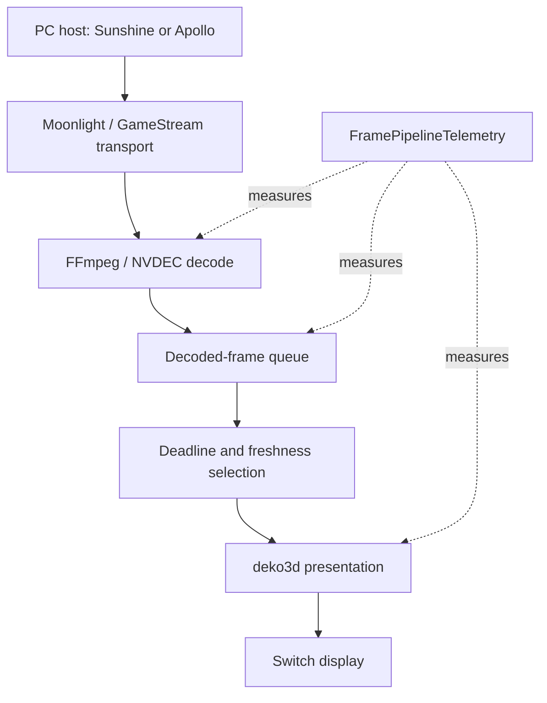



A stream can report a healthy bitrate and still feel late. **Artemis Switch** is my Moonlight-Switch fork for Nintendo Switch, focused on the path between receiving a frame and presenting it. The useful question is not just “how fast is the decoder?” but “where did this frame wait?”

<!--more-->

## A client with a clear boundary

Artemis builds on **XITRIX/Moonlight-Switch**: Borealis for the interface, the Moonlight/GameStream protocol for transport, FFmpeg/NVDEC for decoding, and deko3d for Switch presentation. Sunshine and Apollo remain PC hosts. Host administration stays in their own interfaces.

This distinction matters when debugging. A wrong virtual-display mode is a host issue; a growing decoded-frame queue belongs to the client. The repository documents host integrations, but that is not evidence that every host/device combination has passed hardware validation.

## The frame pipeline

This is a simplified reading of the streaming code, not a claim about measured end-to-end input latency.

## The subtle part: when to discard old frames

[`LowLatencyFrameSelection.hpp`](https://github.com/antoinebou12/Artemis-Switch/blob/main/app/src/streaming/LowLatencyFrameSelection.hpp) checks the **oldest frame’s deadline before advancing to the newest frame**. Once the queue is eligible, it discards older frames and favors freshness. A backlog can bypass the ordinary gate so a stalled renderer catches up.

Why preserve that oldest deadline? If the gate follows the newest arriving frame, its deadline can keep moving forward. The queue receives frames, yet presentation starves. This small policy is more informative than a generic “low latency” label.

## Measure stages separately

[`FramePipelineTelemetry.hpp`](https://github.com/antoinebou12/Artemis-Switch/blob/main/app/src/streaming/FramePipelineTelemetry.hpp) records decode timing, queue wait, client pipeline timing, render and GPU submission cost, actual video bitrate, and first-packet/decode/present milestones. It uses a monotonic clock and protects shared state with a mutex.

“Client pipeline” begins after network completion in this implementation. It does **not** include every host encoding, network transit, display scanout, and controller delay.

The README also describes Fit/Fill/Stretch presentation, FSR-style upscaling, RCAS sharpening, named stream profiles, and a performance overlay. These are controls to investigate tradeoffs, not a universal FPS promise.

## What I would compare on hardware

Keep the host, scene, resolution, and network fixed. Compare queue wait and present intervals with pacing options changed one at a time. Then test handheld and docked presentation separately. A lower average with worse spikes may still feel worse.

The project remains active. Its README explicitly separates portable tests and release builds from **device validation**. Read the [installation and status notes](https://github.com/antoinebou12/Artemis-Switch#installation) before treating a compile result as a gameplay result.

## Source trail

- [Repository and screenshots](https://github.com/antoinebou12/Artemis-Switch)
- [Frame selection policy](https://github.com/antoinebou12/Artemis-Switch/blob/main/app/src/streaming/LowLatencyFrameSelection.hpp)
- [Pipeline telemetry](https://github.com/antoinebou12/Artemis-Switch/blob/main/app/src/streaming/FramePipelineTelemetry.hpp)
- [Earlier handheld project overview]()
