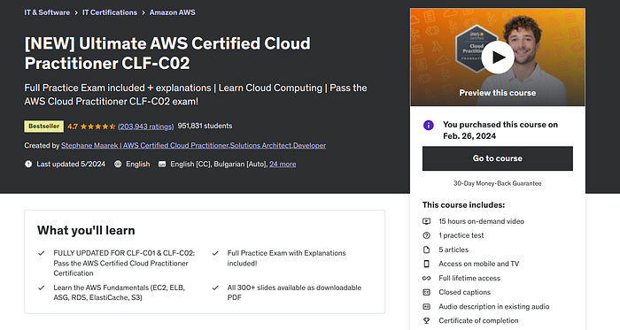
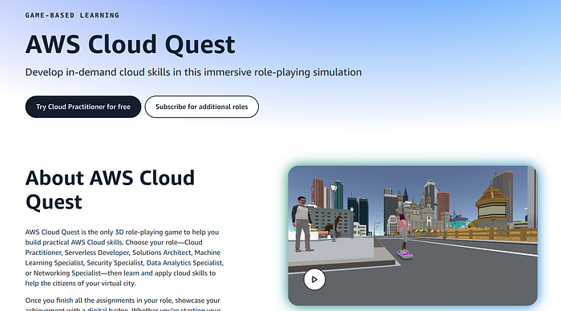
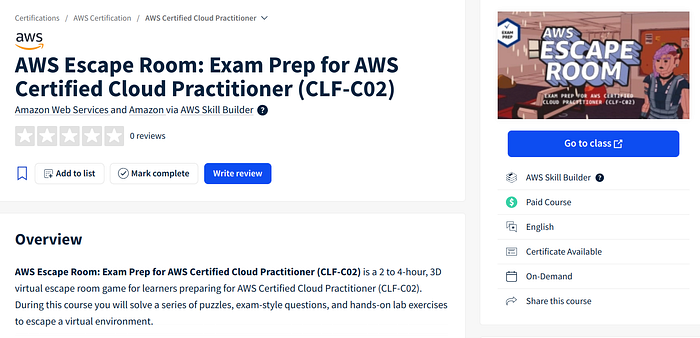
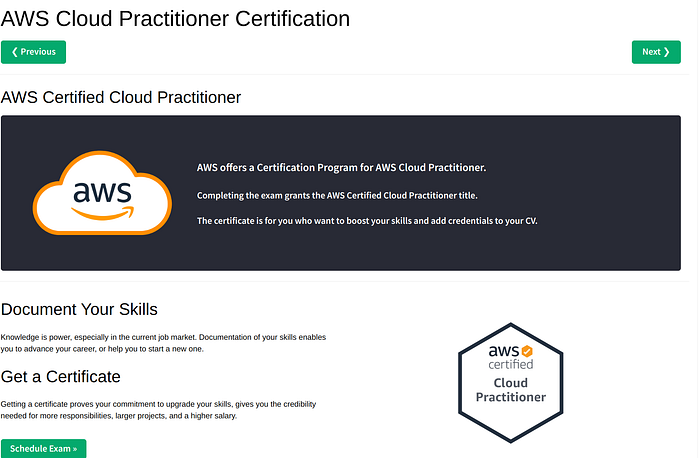
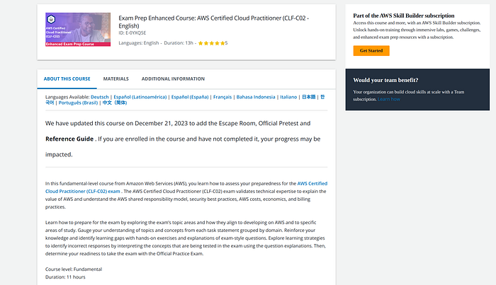
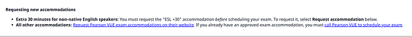
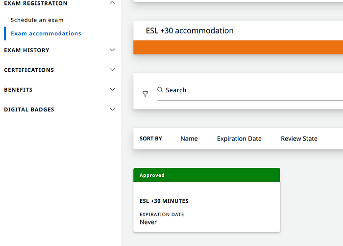
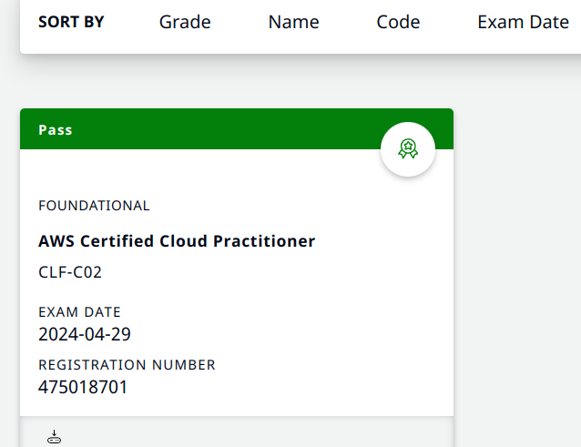
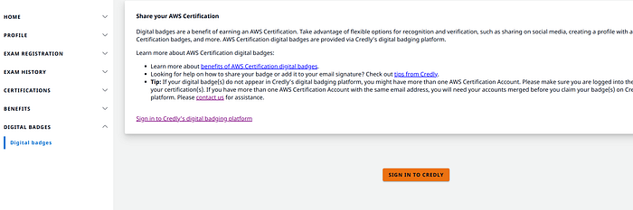
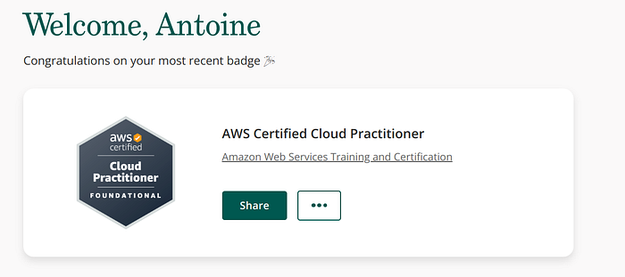

I passed the **AWS Certified Cloud Practitioner (CLF-C02)** after about **two weeks** (~60 hours) of focused study — not because the exam is trivial, but because mixing video, labs, and silly gamified prep kept me moving. This post is the resource stack that worked for me (Udemy, Skill Builder, Cloud Quest, Escape Room) plus **Pearson VUE** practicalities: extra time if English is not your first language, online proctoring, Credly badge.

<!--more-->

### **My Study Guide: A Two-Week Sprint to Certification**

**Time Commitment**: Approximately 60 hours over two weeks

Resources I used:

1.  **Ultimate AWS Certified Cloud Practitioner CLF-C02** (Udemy — Paid)

2. **AWS Cloud Quest: Cloud Practitioner** (AWS Skill Builder —Free)

3\. **AWS Escape Room: Exam Prep for AWS Certified Cloud Practitioner** (CLF-C02) (AWS Skill Builder — Paid Free Trial)

4\. **Free Practice Exam** ([https://www.w3schools.com/aws/aws\_cloudessentials\_awscert.php](https://www.w3schools.com/aws/aws_cloudessentials_awscert.php))

5\. **Exam Prep Enhanced Course: AWS Certified Cloud Practitioner** (CLF-C02 — English) (AWS Skill Builder — Paid Free Trial)

### AWS Skill Builder

AWS Skill Builder is AWS’s online learning hub: courses from beginner through advanced, plus labs tied to the services on the exam.

**What I used there:**

\- **Structured Learning Paths:** Cloud Practitioner has a dedicated path that tracks the exam objectives.  
\- **Hands-On Labs:** Console walkthroughs so you click through workflows instead of only watching videos.  
\- **Variety of Content**: Videos, quizzes, and reading — I switched formats when one got dull.

**AWS Cloud Quest**

AWS Cloud Quest: Cloud Practitioner is a game-shaped course: quests and puzzles that still teach the same AWS services.

\- **Interactive** — you play through tasks instead of clicking Next on slides  
\- **Scenarios** — quests map to common cloud decisions, not trivia alone  
\- **Pace** — easier to finish a “quest” on a tired evening than another lecture chapter

**AWS Escape Room**

The Escape Room packs exam-style problems into timed “escape” challenges — lighter than another straight practice quiz, still useful for format and pressure.

\- **Exam Simulation**: Format and time pressure closer to the real test.  
\- **Problem-solving**: You reason through scenarios, not only recall definitions.  
\- **Pace**: Kept me studying on days when another video chapter would have stalled.

**How I sequenced the two weeks**

*   **Week 1**: Ultimate AWS Certified Cloud Practitioner on Udemy — videos and hands-on labs.
*   **Week 2**: Cloud Quest, Escape Room, practice exams, and the Exam Prep Enhanced Course on Skill Builder.

## Pearson VUE and extra exam time

I booked through Pearson VUE — in-person or online proctoring. Scheduling and exam day went without drama.

Useful tip: if English is not your primary language, AWS lets you request a 50% longer exam. Steps:

1.  AWS Certification: Before scheduling your exam, go to exam accommodations

2\. **ID Verification**: Have a valid ID ready — required for both in-person and online exams.

3\. **Schedule Your Exam with the Extension**: Once approved, book with the extra time included. The buffer helps when you’re parsing longer scenario stems in a second language.

## Preparing for the Online Proctored Exam

If you take the exam online:

1.  Long Wait Times: Log in at least 30 minutes early — check-in can drag before the timer starts.
2.  Room Setup: Clean room, no food, no second monitor. The proctor will ask for a 360° webcam sweep for unauthorized materials.
3.  Proctoring Software: Install and test Pearson VUE’s software before exam day.
4.  Quiet Environment: Tell roommates or family the schedule so nobody knocks mid-question.

## Getting Your Digital Badge

After you pass, AWS issues a digital badge through Credly:

1.  Wait for Notification: After passing, wait 2–3 days for the Credly email that the badge is ready.
2.  Create a Credly Account: Same email address as your AWS Certification account.
3.  Accept Your Badge: Follow the email instructions and add the badge to Credly.
4.  Share Your Badge: Add it to LinkedIn, your resume, or anywhere else you list credentials.

### When to use this sprint plan

| You are… | This two-week path fits? |
|----------|---------------------------|
| New to cloud vocabulary | Yes |
| Already running prod on AWS daily | Skip CLF — go role-specific |
| Need hands-on K8s depth | Partial — add labs beyond CLF |
| Non-native English test taker | Yes — request extra time early |

### Pitfalls

- **Cramming without labs** — Cloud Quest carries retention; video alone fades.
- **Skipping practice exams** — format surprises hurt more than content gaps.
- **Booking mainnet experiments** — stay on free tier / Sepolia for learning bills.

### Related posts

- [Caddy + EC2 + CloudWatch]() — AWS after the cert
- [Run:ai on AWS webinar]()

### Takeaway

The certification is a vocabulary checkpoint more than a deep architect exam — but **Cloud Quest** and **Escape Room** made that vocabulary stick better than lectures alone. If you are on a similar sprint, stack one paid course with Skill Builder trials and book the exam while the context is fresh.

Questions about the two-week plan or Pearson accommodations are welcome on LinkedIn or GitHub issues on this site.

### References

*   [AWS Skill Builder](https://aws.amazon.com/training/skill-builder/)
*   [AWS Cloud Quest](https://aws.amazon.com/training/digital/aws-cloud-quest/)
*   Ultimate AWS Certified Cloud Practitioner CLF-C02 (Udemy)
*   [AWS Escape Room: Exam Prep for AWS Certified Cloud Practitioner](https://aws.amazon.com/training/digital/aws-escape-room/)
*   Free Practice Exam
*   [Exam Prep Enhanced Course: AWS Certified Cloud Practitioner](https://aws.amazon.com/training/digital/aws-certified-cloud-practitioner-exam-prep/)

---

*Originally published on [Medium](https://medium.com/@antoine.boucher012/a-journey-to-aws-certified-cloud-practitioner-9b17dffe4533).*
