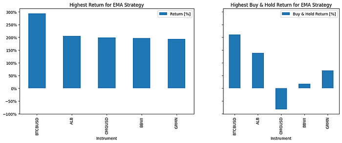
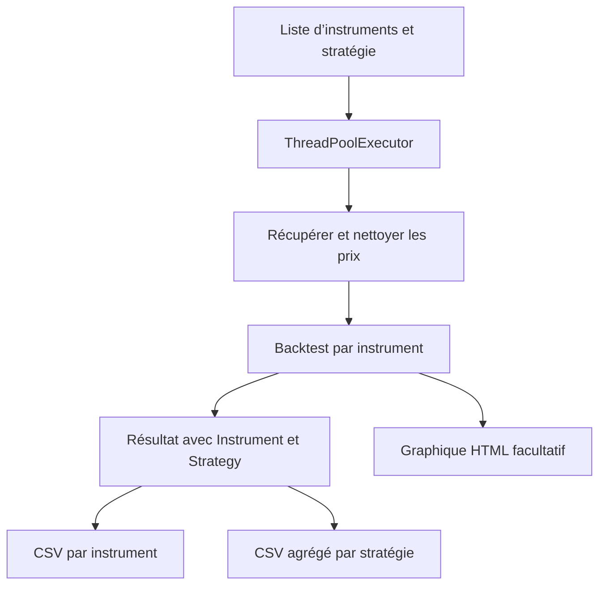



Un backtest par lots est un petit pipeline de données : choisir les instruments, obtenir les prix, nettoyer les observations, exécuter une stratégie et conserver des résultats comparables. **AlgoETS/BatchBacktesting** rend ces étapes visibles dans le code Python.

Cette illustration provient d’un article existant. Ce n’est pas un nouveau résultat de simulation.

<!--more-->

## Suivre un instrument

Dans [`src/BatchBacktesting.py`](https://github.com/AlgoETS/BatchBacktesting/blob/main/src/BatchBacktesting.py), `process_instrument` choisit un adaptateur de prix pour action ou crypto, nettoie les données et construit un `Backtest`. Il ajoute ensuite le nom de l’instrument et de la stratégie au résultat.

Le runner d’une stratégie utilise **quatre workers** par défaut. Les graphiques sont facultatifs. Ce sont des paramètres du code, pas des mesures de performance.

## Les hypothèses sont dans le constructeur

Le runner inspecté fixe **100 000 de capital initial**, une **commission de 0,002, soit 0,2 %**, et des **ordres exclusifs**. Une comparaison de rendement doit conserver ces hypothèses.

Elles ne couvrent pas tous les coûts ni les problèmes de données. Le glissement de prix, la disponibilité des ventes à découvert, les titres radiés et les opérations sur titres demandent une vérification distincte.

## Un détail de la stratégie EMA

Dans [`strategies.py`](https://github.com/AlgoETS/BatchBacktesting/blob/main/src/strategies.py), la classe EMA calcule les périodes 20, 80 et 150. Les conditions d’entrée comparent les courbes **20 et 80**. La courbe 150 est calculée, mais n’intervient pas dans ces conditions.

La règle d’achat ferme la position précédente, puis fixe un stop à 90 % du prix et une cible à 125 %. Cela décrit l’expérience implémentée, pas des paramètres optimaux.

## Conserver de vraies lignes de résultats

Le code écrit un CSV par instrument, un CSV agrégé par stratégie et des graphiques HTML facultatifs. Le README renvoie à un exemple EMA sur AAPL du **4 avril 2018 au 3 avril 2023**. Ces dates concernent cet exemple, pas tous les runs.

[Ouvrir le graphique AAPL publié](https://algoets.github.io/BatchBacktesting/output/charts/EMA/AAPL-2018-04-04-2023-04-03.html).

Dans [`analyse.py`](https://github.com/AlgoETS/BatchBacktesting/blob/main/src/analyse.py), `groupby("Instrument").max()` prend le maximum de chaque colonne indépendamment. La ligne obtenue peut mélanger plusieurs simulations. Il vaut mieux sélectionner une vraie ligne selon son rendement avant d’en commenter la durée et le drawdown.

## Comprendre les limites d’exécution

Un instrument en échec renvoie `None`. Si tous échouent, la concaténation finale n’a aucun résultat à assembler. Le helper multi-stratégies ajoute aussi un pool externe autour des pools internes : limites API et concurrence imbriquée méritent donc de l’attention.

Ces constats viennent de la lecture du code. Aucun nouveau backtest ni rendement n’a été produit pour cet article.

## Sources et articles liés

- [Dépôt et exemple historique](https://github.com/AlgoETS/BatchBacktesting)
- [Implémentation du runner](https://github.com/AlgoETS/BatchBacktesting/blob/main/src/BatchBacktesting.py)
- [Stratégies](https://github.com/AlgoETS/BatchBacktesting/blob/main/src/strategies.py)
- [Helpers d’analyse](https://github.com/AlgoETS/BatchBacktesting/blob/main/src/analyse.py)
- [Article précédent sur plusieurs tickers]()
