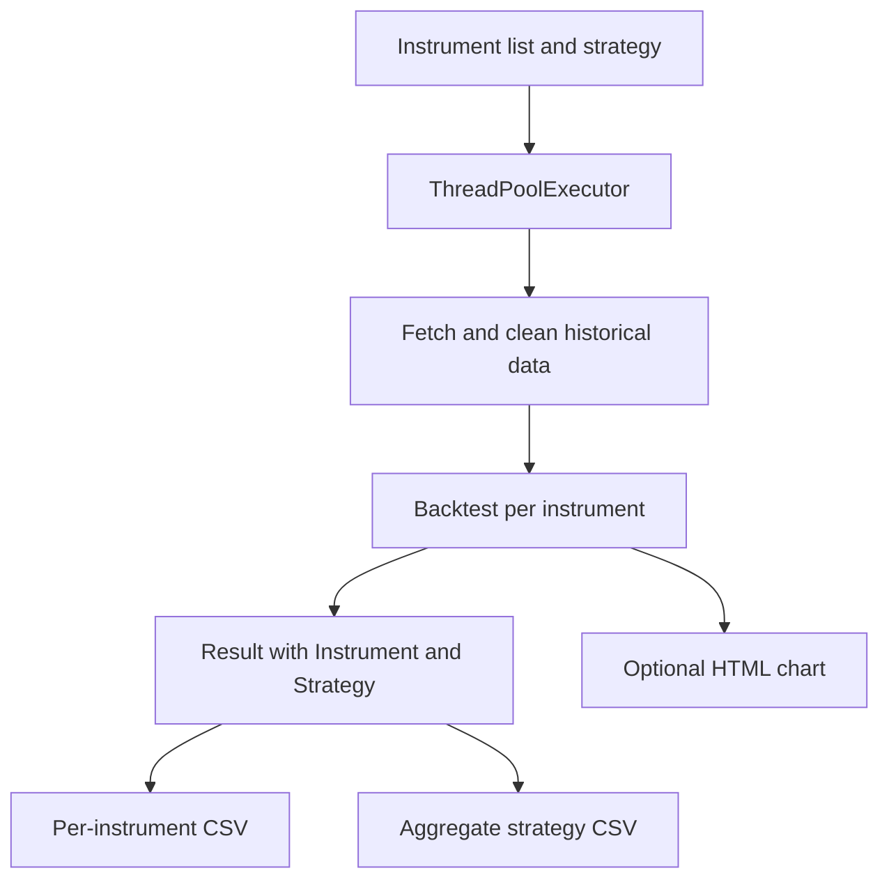



A batch backtest is a small data pipeline: choose instruments, obtain prices, clean the observations, run a strategy, and save comparable results. **AlgoETS/BatchBacktesting** makes those steps visible in Python rather than hiding them behind a dashboard.

This image is an existing article illustration, not a new benchmark run.

<!--more-->

## Follow a single instrument first

In [`src/BatchBacktesting.py`](https://github.com/AlgoETS/BatchBacktesting/blob/main/src/BatchBacktesting.py), `process_instrument` selects a stock or crypto price adapter, cleans the data, and constructs a `Backtest`. It attaches the instrument and strategy names to the result before returning it.

The single-strategy runner defaults to **four workers**. Plot generation is optional. Those are code defaults, not measured throughput.

## The assumptions are in the constructor

The inspected runner uses **100,000 starting cash**, **0.002 commission (0.2%)**, and **exclusive orders**. These settings belong beside any comparison of returns.

They still do not cover every market cost or data issue. Slippage, availability of short positions, delisted securities, and corporate actions need separate review.

## An EMA detail worth noticing

[`strategies.py`](https://github.com/AlgoETS/BatchBacktesting/blob/main/src/strategies.py) computes 20-, 80-, and 150-period EMAs for the EMA class. Its entry decisions compare the **20 and 80** curves; the 150-period curve is calculated but not used in those `next` conditions.

The long-side rule closes the prior position and buys with a stop at 90% of the current price and a target at 125%. This is the implemented experiment, not a claim that those parameters are optimal.

## Keep comparable rows together

The runner writes per-instrument CSVs, an aggregate CSV per strategy, and optional HTML charts. The README links a published AAPL EMA chart covering **2018-04-04 through 2023-04-03**. Those are that example’s dates, not a fixed range for every run.

[Open the published AAPL example](https://algoets.github.io/BatchBacktesting/output/charts/EMA/AAPL-2018-04-04-2023-04-03.html).

One analysis trap appears in [`analyse.py`](https://github.com/AlgoETS/BatchBacktesting/blob/main/src/analyse.py): `groupby("Instrument").max()` takes each column’s maximum independently. The resulting row can combine metrics from different runs. Select a real row by return before narrating its drawdown and duration.

## Know the failure boundaries

A failed instrument returns `None`. If all instruments fail, the later concatenation has no frames. The multi-strategy helper also creates an outer pool around inner pools, so API rate limits and nested concurrency deserve attention.

These are observations from reading the source. I did not rerun financial simulations for this article or generate new return claims.

## Sources and related posts

- [Repository and historical example](https://github.com/AlgoETS/BatchBacktesting)
- [Runner implementation](https://github.com/AlgoETS/BatchBacktesting/blob/main/src/BatchBacktesting.py)
- [Strategies](https://github.com/AlgoETS/BatchBacktesting/blob/main/src/strategies.py)
- [Analysis helpers](https://github.com/AlgoETS/BatchBacktesting/blob/main/src/analyse.py)
- [Earlier multi-ticker article]()
