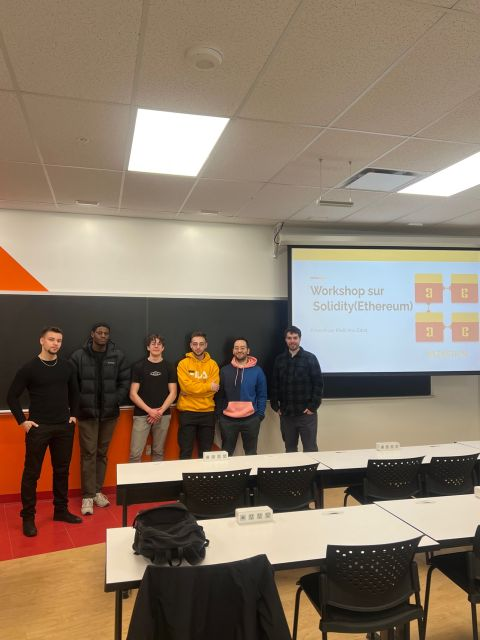
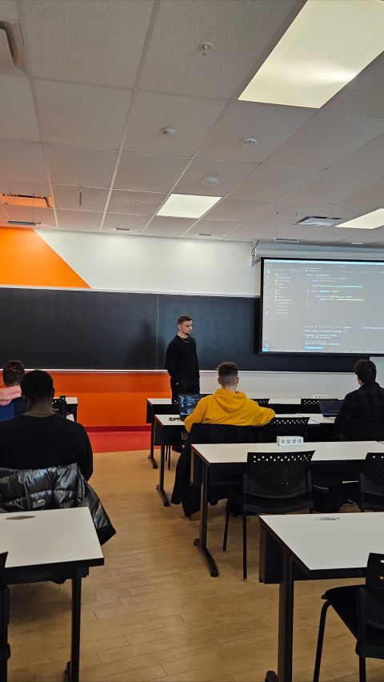

Retour sur notre tout premier workshop sur Ethereum.

Lundi dernier (11 mars 2024), notre tout premier workshop sur Ethereum a eu lieu à l’ÉTS : novices comme avancés ont pu créer et déployer leur propre token sur la blockchain et s’échanger leurs tokens entre eux. Nous tenons à remercier tout le monde d’avoir assisté à cet atelier. Merci également à **Khalil Anis Zabat** d’avoir animé et organisé l’atelier !


<!--more-->

Nous prévoyons d’organiser une suite à cet atelier avec d’autres types de tokens, incluant des techniques plus avancées. Dites-nous (ou écrivez-nous) si vous seriez intéressés par une reprise — et si vous avez des suggestions pour de prochains ateliers.

## Le déroulé

Khalil avait structuré l’atelier en deux temps :

1. **Remix dans le navigateur** — compiler et déployer sans installer toute la chaîne d’outils, pour pouvoir refaire les étapes chez soi.
2. **Environnement de dev local** — l’équivalent « pro » avec éditeur et tooling, sur le même contrat ERC-20.
3. **Sepolia** — ETH de test via faucet, **MetaMask** comme portefeuille, **Infura** comme passerelle RPC.
4. **OpenZeppelin** — ne pas réécrire `transfer` ; hériter d’un **ERC-20** éprouvé et se concentrer sur nom, symbole, décimales et premier `mint`.
5. **Transferts entre pairs** — déployer, échanger les adresses de contrat et **s’envoyer des tokens** jusqu’à ce que la salle ressemble à une mini-économie.

Tant que tu n’as pas signé une transaction et vu la ligne sur un explorateur, Solidity reste de la syntaxe. Après, c’est un registre public avec ton adresse dedans.

## Le contrat de départ

Squelette minimal montré à l’atelier :

```solidity
// SPDX-License-Identifier: MIT
pragma solidity ^0.8.20;

import "@openzeppelin/contracts/token/ERC20/ERC20.sol";

contract MyToken is ERC20 {
    constructor() ERC20("MyToken", "MTK") {
        _mint(msg.sender, 1000000 * 10 ** decimals());
    }
}
```

Tu choisis **nom** et **symbole**, les **décimales** (souvent 18), et tu **émet** une réserve initiale au déployeur (`msg.sender`). OpenZeppelin, c’est la bibliothèque partagée de la communauté pour les standards — même logique que l’**ERC-721** pour les NFT, mais ici on est resté sur un jeton fongible.


## Ce qui est sorti des questions (pédagogie live)

**Explorateurs de blocs (Etherscan, Sepolia).** Chaque transaction est une ligne : qui a envoyé quoi, à qui, le gas, le numéro de bloc.

**Gas et limites.** En pratique, les contrats ne sont pas des machines de Turing illimitées — une boucle infinie consomme le gas et bloque. **Sepolia** gardait l’atelier abordable.

**ABI = le squelette.** Après déploiement, l’ABI dit quelles fonctions existent pour les apps (ou les bots).

**Données on-chain vs hors chaîne.** Stocker gros sur la chaîne coûte cher ; on pointe souvent vers des **références** (IPFS, chaînes de stockage).

## Ambiance

Tables, prises et laptops ouverts — propice au **pair programming** quand Remix ou MetaMask demandait une confirmation de plus.




Byzantium annonçait d’**autres ateliers** sur d’autres types de tokens et du Solidity plus avancé. Celui-ci était la rampe d’accès.

## Liens

- [Publication LinkedIn / retour Byzantium](https://www.linkedin.com/posts/antoineboucher12_retour-sur-notre-tout-premier-workshop-activity-7173128307155156992-tQy4)
- [Mon contrat déployé (lien court)](https://lnkd.in/e-9T5-MX)
- [OpenZeppelin Contracts](https://docs.openzeppelin.com/contracts)
- [Remix IDE](https://remix.ethereum.org/)
- [Explorateur Sepolia](https://sepolia.etherscan.io/)

Merci à **Khalil** d’avoir enseigné dans le chaos utile (portefeuilles, faucets, transactions qui échouent), et à tou·te·s les participant·e·s pour cette première soirée chain chez Byzantium.
