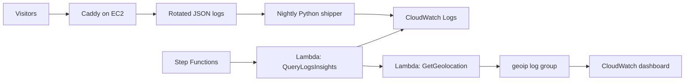
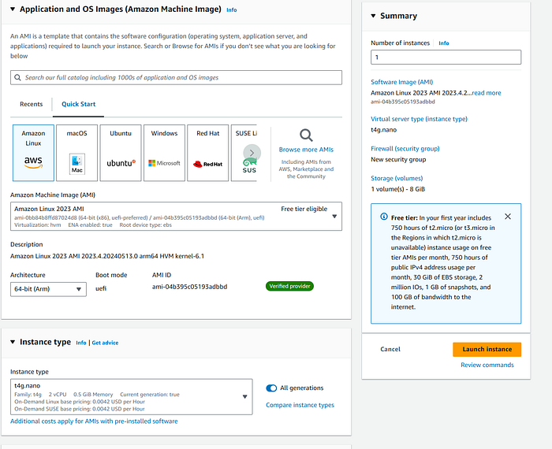
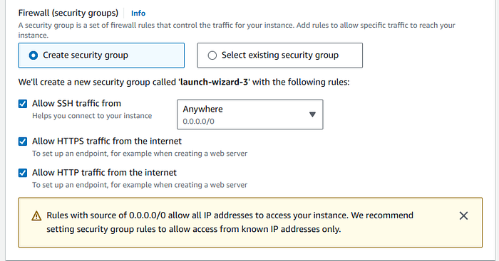
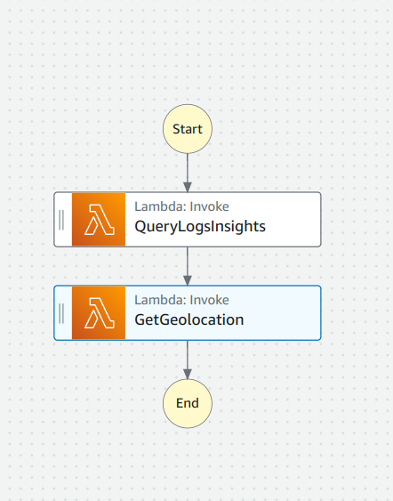
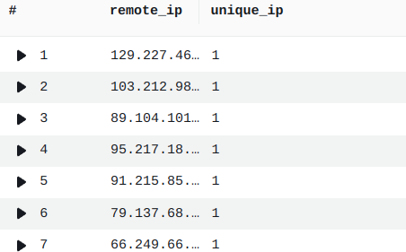
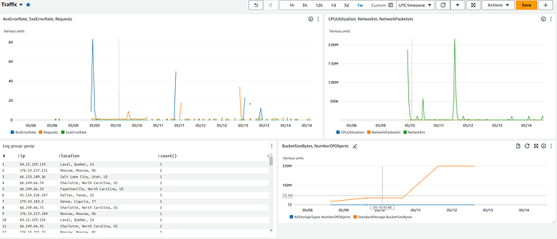

I already ran **Caddy** at home for Home Assistant. This article is the **AWS edge** version: a `t4g.nano` **EC2** instance, automatic HTTPS, JSON access logs shipped to **CloudWatch** by a nightly Python script, and a **Step Functions** workflow that runs two **Lambda** functions over those logs. The goal was cheap visibility into a personal reverse proxy, not a SaaS dashboard bill.

<!--more-->

## Before EC2: a VPS tunnel to home

My first public reverse proxy, around 2021, was a small VPS running Caddy, linked to a server at home by a **WireGuard** tunnel. Caddy terminated HTTPS on the VPS, served a few sites itself and forwarded the others to services on the home server. The setup followed a [public write-up on VPS reverse-proxy tunnels](https://blog.fuzzymistborn.com/vps-reverse-proxy-tunnel/).

The scripts were short:

- install WireGuard, generate each side's key pair under `umask 077`, and enable `wg-quick@wg0`;
- on the VPS, run NAT helper scripts in `PostUp` / `PostDown`;
- on the home server, enable IP forwarding and set `PersistentKeepalive = 25` so the tunnel stays open through the home router's NAT;
- install Caddy from its official Debian repository.

Two lessons carried over. First, this only worked for HTTP services: Caddy proxies HTTP, so a UDP game server such as Minecraft could not go through it. Second, the log block I wrote then (10 MB files, five kept, seven days) is the same one I used on EC2 and still use today. The Ansible roles I started for that machine stayed mostly empty scaffolding; the playbook only ever applied a `common` role for base packages and sudo.

## Architecture



Homelab taught me to like Caddy's **Caddyfile** ergonomics. AWS taught me to like paying cents for a nano instance when traffic is personal-scale.

## Step 1: EC2 and Caddy

- AMI: Amazon Linux 2023, 64-bit Arm, as in the screenshot below.
- Instance: **`t4g.nano`** (2 vCPU, 0.5 GiB). The console listed it at $0.0042 per hour on demand, which is the "about $0.10 per day" from my original notes. A `t2.micro` also works if you are inside the free tier.
- Security group: **22, 80, 443**.





The launch wizard defaults to SSH from `0.0.0.0/0`, and the console warns about it in the screenshot. Restrict port 22 to your own address, or drop it and use Session Manager. Ports 80 and 443 have to stay open: Caddy needs them for the ACME HTTP and TLS-ALPN challenges.

Install, as in my original notes:

```bash
sudo yum update -y
sudo yum install -y yum-utils
sudo yum-config-manager --add-repo https://dl.cloudsmith.io/public/caddy/stable/rpm.repo
sudo yum install caddy -y
```

### Caddyfile pattern

A per-site log snippet, and a reverse proxy to CloudFront or a local service:

```caddyfile
{
  email you@example.com
  admin localhost:2019
  metrics
}
(log_site) {
  log {
    output file /home/ec2-user/caddy/logs/{args[0]}.log {
      roll_size 10mb
      roll_keep 5
      roll_keep_for 168h
    }
    format json {
      time_format iso8601
    }
    level INFO
  }
}
example.com www.example.com {
  import log_site example.com
  reverse_proxy https://your-origin.example {
    header_up Host {upstream_hostport}
  }
}
```

Three changes from the version I first published:

- **Admin API on localhost.** The original had `admin :2019`, which listens on every interface; my table below then had to say "lock down the security group". Binding it to `localhost` removes the problem. Prometheus metrics are served on the admin endpoint at `/metrics`, so scrape them on the instance, or expose them through a separate site block that rejects any `remote_ip` outside an allowlist. My current configuration does the latter.
- **`metrics` as a global option.** The original enabled metrics with `servers { metrics }`. My current configuration uses the global `metrics` option instead; check which form your Caddy version expects.
- **`header_up Host` for HTTPS origins.** CloudFront and GitHub Pages pick the site from the `Host` header. Without the override, Caddy forwards the visitor's hostname and the origin does not recognise it.

`format json` with ISO 8601 timestamps makes every line a JSON object, which matters for the queries in step 3.

Reload with `sudo caddy reload`. It validates the new configuration and leaves the running one in place if it does not load.

## Step 2: CloudWatch without drowning in files

Caddy writes rotated JSON logs under `/home/ec2-user/caddy/logs/`. A small **boto3** script reads each file and sends its lines with `put_log_events` to a log group named `reverse_proxy`, one log stream per file, creating the group and stream the first time it sees them.

Schedule it with **cron** at night so daytime SSH sessions stay quiet:

```cron
0 0 * * * /usr/bin/python3 /home/ec2-user/cloudwatch.py
```

The script, as published:

```python
import os
import boto3
from datetime import datetime

cloudwatch = boto3.client('logs', region_name='us-east-1')
log_group_name = 'reverse_proxy'
log_directory = "/home/ec2-user/caddy/logs"

def send_log_to_cloudwatch(log_stream_name, log_message):
    try:
        streams = cloudwatch.describe_log_streams(logGroupName=log_group_name, logStreamNamePrefix=log_stream_name)
        if not streams['logStreams']:
            cloudwatch.create_log_stream(logGroupName=log_group_name, logStreamName=log_stream_name)
        cloudwatch.put_log_events(
            logGroupName=log_group_name,
            logStreamName=log_stream_name,
            logEvents=[{
                'timestamp': int(datetime.now().timestamp() * 1000),
                'message': log_message
            }]
        )
    except Exception as e:
        print(f"Failed to send log to CloudWatch: {str(e)}")

for filename in os.listdir(log_directory):
    if filename.endswith(".log"):
        log_stream_name = filename[:-4]
        file_path = os.path.join(log_directory, filename)
        with open(file_path, 'r') as file:
            for line in file:
                send_log_to_cloudwatch(log_stream_name, line.strip())
```

Things to watch with this design:

- **Batch the lines.** One `put_log_events` call accepts up to 10,000 events, so one call per line is mostly network overhead.
- **Remember what was sent.** If the script re-reads whole files every night, lines that are still in the current file get sent again. Keep an offset per file, or ship only files that Caddy has already rotated.
- **Mind the clock.** The cron entry runs at midnight in the instance's timezone, which is UTC unless you changed it.
- **Give the instance a role**, not access keys on disk. It needs `logs:CreateLogGroup`, `logs:CreateLogStream` and `logs:PutLogEvents` for that group.

## Step 3: Step Functions, Lambda and Insights queries

The workflow is two Lambda invocations in sequence: **QueryLogsInsights** runs a CloudWatch Logs Insights query over the shipped logs, then **GetGeolocation** looks up the addresses it returned.



**QueryLogsInsights** starts an Insights query over the last 24 hours, polls `get_query_results` until it finishes (30 seconds at most) and returns the list of IPs in the body:

```python
import boto3
import json
import time
from datetime import datetime, timedelta

def lambda_handler(event, context):
    client = boto3.client('logs')
    query = """
    fields @timestamp, @message
    | parse @message /"remote_ip": "(?<remote_ip>[^"]+)"/
    | stats count() by remote_ip
    | sort remote_ip asc
    """
    start_query_response = client.start_query(
        logGroupName='reverse_proxy',
        startTime=int((datetime.now() - timedelta(days=1)).timestamp()),
        endTime=int(datetime.now().timestamp()),
        queryString=query
    )
    query_id = start_query_response['queryId']
    response = None
    max_wait_time = 30
    start_time = time.time()
    while response is None or response['status'] == 'Running':
        if time.time() - start_time > max_wait_time:
            raise TimeoutError("Query did not complete within the maximum wait time.")
        response = client.get_query_results(queryId=query_id)
        time.sleep(0.5)

    ip_addresses = []
    for result in response['results']:
        for field in result:
            if field['field'] == 'remote_ip':
                ip_addresses.append(field['value'])

    return {'statusCode': 200, 'body': json.dumps({'ip_addresses': ip_addresses})}
```

**GetGeolocation** receives that body, asks [ipinfo.io](https://ipinfo.io/) about each address, and writes one JSON event per IP to a `geoip` log group:

```python
import json
import urllib3
import boto3
import time

def lambda_handler(event, context):
    ip_addresses = json.loads(event['body'])['ip_addresses']
    http = urllib3.PoolManager()
    results = []
    for ip in ip_addresses:
        response = http.request('GET', f"https://ipinfo.io/{ip}/json")
        data = json.loads(response.data.decode('utf-8'))
        results.append({
            'IP': ip,
            'Location': f"{data.get('city')}, {data.get('region')}, {data.get('country')}",
            'Coordinates': data.get('loc'),
            'Organization': data.get('org'),
            'Timezone': data.get('timezone')
        })

    log_client = boto3.client('logs')
    log_group_name = 'geoip'
    log_stream_name = 'geolocation_results'
    try:
        log_client.create_log_group(logGroupName=log_group_name)
    except log_client.exceptions.ResourceAlreadyExistsException:
        pass
    try:
        log_client.create_log_stream(logGroupName=log_group_name, logStreamName=log_stream_name)
    except log_client.exceptions.ResourceAlreadyExistsException:
        pass

    log_events = [{'timestamp': int(time.time() * 1000), 'message': json.dumps(r)} for r in results]
    batch_size = 10
    for i in range(0, len(log_events), batch_size):
        log_client.put_log_events(
            logGroupName=log_group_name,
            logStreamName=log_stream_name,
            logEvents=log_events[i:i + batch_size]
        )
    return {'statusCode': 200, 'body': json.dumps(results)}
```

Two notes on these handlers. The comment in the original said `PutLogEvents` takes ten events at a time; the real limit is 10,000 events or 1 MB per call, so the batching only costs extra requests. And the ipinfo.io calls run one after another without a token, so a long list of IPs can hit both the free rate limit and the Lambda timeout.

The query I first published was meant to list distinct remote IPs:

```sql
fields @message
| parse @message /"remote_ip": "(?<remote_ip>[^"]+)"/
| stats count_distinct(remote_ip) as unique_ip by remote_ip
| sort unique_ip desc
```

It has a bug that the screenshot shows: grouping by `remote_ip` and counting distinct `remote_ip` values inside each group always gives 1.



What I actually wanted was requests per IP, and the number of distinct IPs:

```sql
fields @message
| parse @message /"remote_ip":\s*"(?<remote_ip>[^"]+)"/
| stats count(*) as requests by remote_ip
| sort requests desc
```

For the distinct count alone, use `stats count_distinct(remote_ip) as unique_ips` without `by`. The `\s*` accepts both `"remote_ip": "…"` and Caddy's compact `"remote_ip":"…"`. When each event is a raw Caddy JSON line, Insights also discovers JSON fields by itself, so `stats count(*) by request.remote_ip` works without `parse`.

The geolocation results are queried the same way:

```sql
fields @timestamp, @message
| parse @message /"IP": "(?<ip>[^"]+)", "Location": "(?<location>[^"]+)"/
| stats count() by ip, location
| sort count desc
```

The dashboard puts them next to the request and 4xx/5xx error-rate metrics, CPU and network for the instance, and the size of the storage bucket:



## Cost and ops notes

| Choice | Tradeoff |
|--------|----------|
| `t4g.nano` EC2 | About $0.10 per day on demand; 0.5 GiB of RAM leaves little room for log processing on the box |
| File logs + cron shipper | Simple; not real-time, and needs offsets to avoid duplicates |
| Lambda + Step Functions | Pay per run; watch the free tier and the Insights data scanned |
| Caddy admin and metrics | Bind admin to `localhost`; expose metrics only through an allowlisted site |

## When not to use this stack

- High-traffic production multi-tenant edge: use a managed CDN or WAF.
- Strict real-time SIEM: a nightly batch shipper is too slow.
- Teams that do not want to maintain a server over SSH: consider Fargate with a log sidecar.

## Where this went next

My current reverse proxy runs Caddy in Docker on a VPS, provisioned with Terraform and configured with Ansible. I described it in [My reverse proxy: separating provisioning, configuration and health checks](). It keeps the same per-site JSON log snippet, but drops the CloudWatch shipper: an Ansible playbook downloads the log files on demand and a Python script turns them into a PDF report.

One lesson goes the other way. On EC2, visitors connected to Caddy directly, so `remote_ip` was the visitor's address. Once Cloudflare's proxy sits in front, `remote_ip` is a Cloudflare edge server until Caddy is told to trust Cloudflare's ranges and read `CF-Connecting-IP`. Every IP-based query in this article depends on that.

## Takeaway

You can get structured reverse-proxy visibility without Datadog money if you accept cron delays and a little Python glue. Check that your queries count what you think they count.

## Related posts

- [Home networking evolution](): where Caddy started for me
- [My reverse proxy: separating provisioning, configuration and health checks]()
- [AWS Cloud Practitioner journey]()

---

*Originally published on [Medium](https://medium.com/@antoine.boucher012/making-caddy-aws-ec2-cloudwatch-step-functions-and-lambda-work-together-creating-a-cheap-and-990fd0d9427d). Step Functions wiring: see Medium for full Lambda/SFN listings.*
