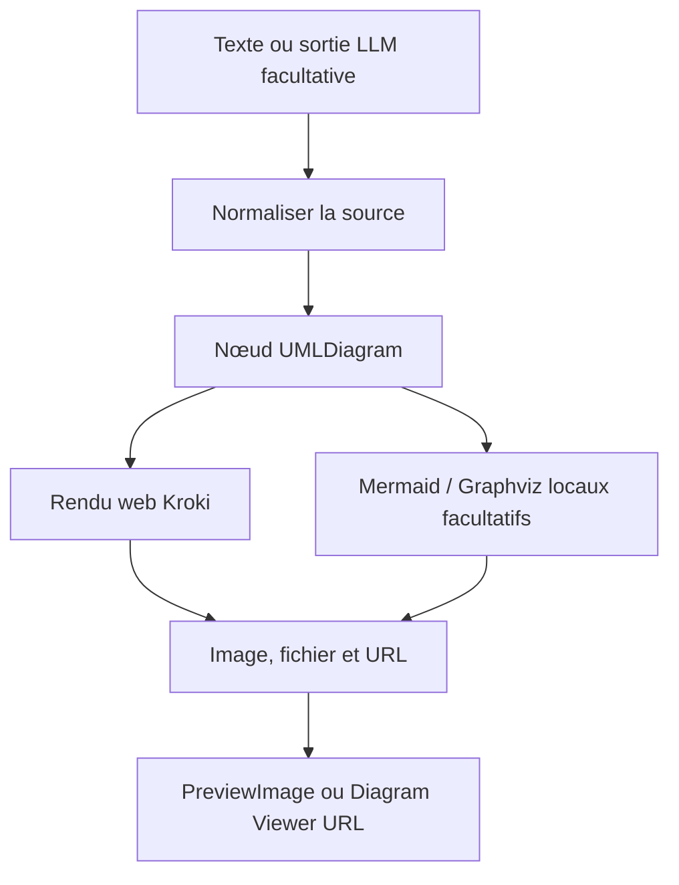



ComfyUI devient intéressant au-delà de la génération d’images lorsqu’un résultat intermédiaire peut circuler entre des nœuds. **ComfyUI-UML** applique ce principe aux diagrammes : du texte entre, puis une image, un fichier et un lien peuvent en sortir.


<!--more-->

## Garder le code dans le workflow

Une capture se modifie mal. Une source Mermaid ou PlantUML se relit, se compare et se régénère. Le nœud conserve cette source dans le workflow plutôt que de ne laisser qu’une image sans explication.

Le README annonce **28 types de diagrammes Kroki**, avec une validation des formats selon le type. Cela ne signifie pas que tous les moteurs acceptent tous les formats.



Ce schéma décrit les rôles des nœuds. Un LLM n’est pas nécessaire.

## Nettoyer la réponse d’un modèle

[`nodes/uml_diagram.py`](https://github.com/antoinebou12/ComfyUI-UML/blob/main/nodes/uml_diagram.py) normalise plusieurs formes de réponse et extrait les blocs de code. Si le type est connu, il privilégie un bloc correspondant. C’est utile lorsqu’un modèle ajoute des explications autour de Mermaid.

Extraire un bloc ne valide toutefois pas sa syntaxe. Le moteur de rendu doit encore accepter le diagramme.

## Passer des octets à une image ComfyUI

Pour une image matricielle, le code utilise Pillow, convertit en RGB, ramène les valeurs entre zéro et un, puis construit un tenseur **[1, H, W, 3]**.

Le SVG suit un autre chemin. Le code tente une conversion CairoSVG pour l’aperçu. Sans conversion réussie, une sortie non matricielle peut conserver son fichier tout en renvoyant un petit tenseur de remplacement. Le fichier sauvegardé et l’aperçu ne sont donc pas la même chose.

## Commencer simplement

```sh
comfy node install comfyui-uml
```

Après un redémarrage, commencer par `uml_single_diagram_only.json` : **UMLDiagram → PreviewImage**. Ajouter le visualiseur lorsque le rendu fonctionne. Le dépôt fournit aussi des exemples Mermaid, PlantUML et Ollama.

Le backend web transmet la source au service Kroki choisi. Pour travailler hors ligne ou sur une architecture sensible, les chemins Mermaid et Graphviz locaux sont documentés. Mermaid local exige ses dépendances JavaScript, et l’aperçu SVG peut nécessiter CairoSVG.

## Sources

- [README, capture et installation](https://github.com/antoinebou12/ComfyUI-UML)
- [Implémentation du nœud de rendu](https://github.com/antoinebou12/ComfyUI-UML/blob/main/nodes/uml_diagram.py)
- [Exemples de workflows](https://github.com/antoinebou12/ComfyUI-UML/tree/main/workflows)
- [Le projet de diagrammes MCP]()
