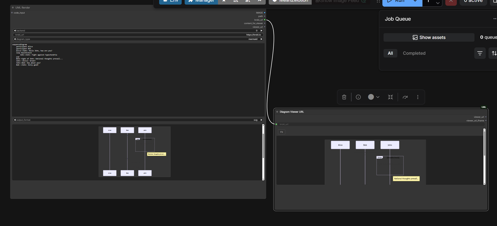
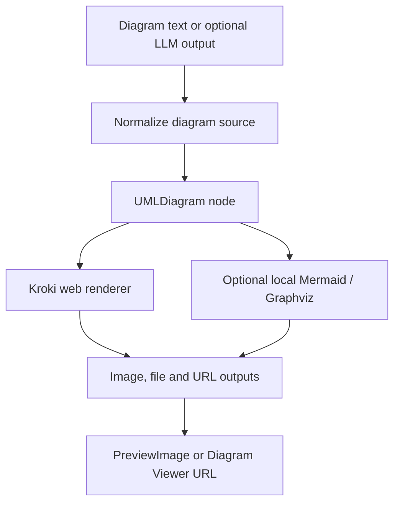



ComfyUI is useful beyond image generation when an intermediate result can become a node output. **ComfyUI-UML** applies that idea to diagrams: text enters a rendering node; an image, a saved file, and a shareable URL can leave it.



<!--more-->

## Keep the source in the workflow

A screenshot is hard to revise. Mermaid or PlantUML source is much easier to inspect, compare, and regenerate. The node lets that source travel with the rest of a ComfyUI workflow instead of becoming an unexplained image.

The README documents **28 Kroki diagram types**, with output formats validated per type. This does not mean every renderer supports every format.



This is a conceptual view of the documented nodes, not a requirement to use an LLM.

## What the code does with model output

[`nodes/uml_diagram.py`](https://github.com/antoinebou12/ComfyUI-UML/blob/main/nodes/uml_diagram.py) normalizes strings and several response shapes, extracts fenced diagram blocks, and prefers a block matching the selected type. That helps when a model returns prose around Mermaid code.

Extraction is not the same thing as syntax validation. A clean code block can still contain a broken diagram; the renderer must accept it.

## From rendered bytes to a ComfyUI image

Raster output is opened with Pillow, converted to RGB, normalized to floating-point values between zero and one, and wrapped as a tensor shaped **[1, H, W, 3]**.

SVG is different. The code attempts a CairoSVG conversion for an image preview. For non-raster output without a successful conversion, it can return a tiny placeholder tensor while preserving the file output. That distinction explains why a saved SVG and its preview may behave differently.

## Start with the smallest workflow

```sh
comfy node install comfyui-uml
```

Then restart ComfyUI and try the repository’s `uml_single_diagram_only.json`: **UMLDiagram → PreviewImage**. Add the viewer after rendering works. The repository also supplies Mermaid, PlantUML, and Ollama examples.

The web backend sends diagram source to the selected Kroki service. For sensitive architecture or offline use, the repository documents optional local Mermaid and Graphviz paths. Local Mermaid needs its JavaScript dependencies; SVG preview may need CairoSVG.

## Source trail

- [README, screenshot and installation](https://github.com/antoinebou12/ComfyUI-UML)
- [Rendering node implementation](https://github.com/antoinebou12/ComfyUI-UML/blob/main/nodes/uml_diagram.py)
- [Example workflows](https://github.com/antoinebou12/ComfyUI-UML/tree/main/workflows)
- [The MCP diagram project]()
