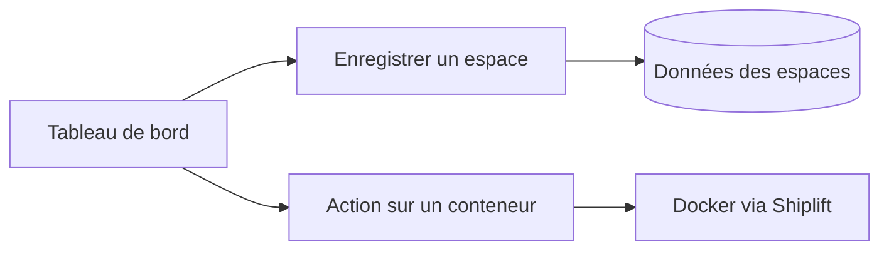

J’ai commencé DasherControl parce que mes services homelab finissaient dispersés dans mes onglets. L’idée était de regrouper des applets dans un espace de travail : favoris et applications intégrées au tableau de bord, avec quelques commandes Docker à proximité.

<!--more-->

## Deux parcours derrière le même tableau de bord

Sauvegarder une disposition passe par les routes des espaces et les données persistantes. Redémarrer un conteneur passe par l’adaptateur Shiplift vers Docker. PostgreSQL n’exécute pas l’action Docker et une applet n’est pas un conteneur. Cette séparation aide à comprendre les permissions et les erreurs.

[Suivre les routes et la frontière Docker dans la note d’architecture]().

## Un espace de travail a un propriétaire

Le frontend utilise Vue et le backend repose sur Rust, Rocket et Diesel. Dans [`src/workspaces/handler.rs`](https://github.com/antoinebou12/DasherControl/blob/main/src/workspaces/handler.rs), la liste des espaces utilise l’identifiant du compte présent dans un jeton. La route qui retourne les applets vérifie le propriétaire de l’espace avant de renvoyer son contenu.

La création d’un espace avec ses applets récupère également cet identifiant depuis le jeton. C’est le modèle prévu : une disposition sauvegardée appartient à un utilisateur, et chaque applet appartient à un espace.

Le fichier contient aussi d’anciennes routes de création et de suppression avec des vérifications différentes. Il faudrait revoir les autorisations de chaque opération avant d’en faire un service partagé. Cet article décrit une expérience, sans constituer un audit d’un système déployé.

## Docker a sa propre interface

[`src/containers/docker.rs`](https://github.com/antoinebou12/DasherControl/blob/main/src/containers/docker.rs) regroupe les appels Shiplift pour lister les conteneurs et les images, télécharger des images, créer des conteneurs, les arrêter ou les redémarrer. Les opérations Docker restent ainsi séparées du modèle des espaces de travail.

Le code révèle aussi un problème d’interface : les fonctions de liste retournent un vecteur vide après une erreur Docker. Un écran vide peut donc signifier qu’aucun conteneur n’existe ou que le service est inaccessible. Dans une nouvelle version, je distinguerais ces deux états à l’écran.

## Ce que le navigateur accepte d’intégrer

Le README mentionne des échecs de connexion dans les iframes. Certaines applications interdisent l’intégration, et l’authentification dans un cadre peut différer de celle d’un onglet normal. Le tableau de bord doit proposer un lien externe pour ces services.

Ce projet est ancien. La capture et le GIF optionnel conservent son interface d’époque ; ils ne démontrent pas sa compatibilité avec les dépendances actuelles.

Lire le GIF de démonstration d’origine



[Voir le code et le README d’origine](https://github.com/antoinebou12/DasherControl). Les deux illustrations viennent de son dossier `images`.
