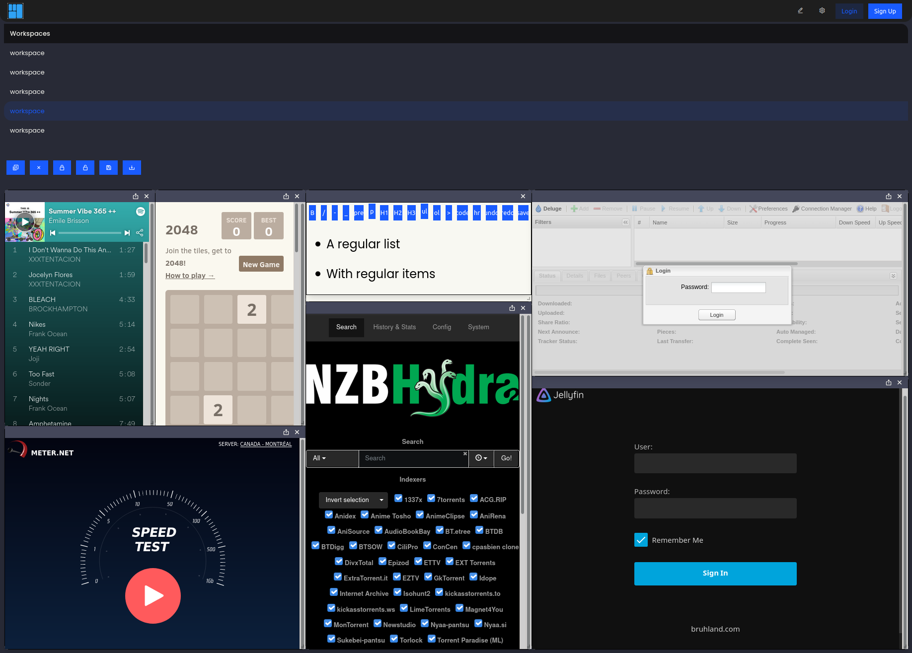

I started DasherControl because my homelab services kept spreading across browser tabs. The idea was a workspace of applets: bookmarks and embedded applications arranged in a dashboard, with a few Docker controls nearby.

<!--more-->

## Two paths behind the same dashboard



Saving a layout goes through workspace handlers and database records. Restarting a container goes through the Shiplift adapter to Docker. PostgreSQL does not execute the Docker action, and an applet is not itself a running container. Keeping those paths separate helps explain both permissions and failure states.

[Follow the handlers and Docker boundary in the architecture note]().

## A workspace has an owner

The frontend uses Vue, while the backend uses Rust, Rocket and Diesel. In [`src/workspaces/handler.rs`](https://github.com/antoinebou12/DasherControl/blob/main/src/workspaces/handler.rs), the list handler reads the tenant identifier from a token. The handler that returns applets checks the workspace’s tenant before returning its contents.

The create-with-applets route also derives the tenant identifier from the token. That is the intended ownership model: a saved layout belongs to a user, and applets belong to a workspace.

The file contains older create and delete paths with different checks. Their presence is a reason to inspect authorization across every operation before using this as a shared service. This article describes an experiment, not a security review of a deployed system.

## Docker is a separate boundary

[`src/containers/docker.rs`](https://github.com/antoinebou12/DasherControl/blob/main/src/containers/docker.rs) wraps Shiplift calls for listing containers and images, pulling images, creating containers, and stopping or restarting them. This separates the dashboard’s workspace model from Docker operations.

It also exposes a UI problem: the list helpers return an empty vector after a Docker error. An empty dashboard could therefore mean either “nothing is running” or “the service could not be reached.” I would make those states visibly different in a new version.

## What the browser can embed

The README records iframe login failures. Applications can restrict embedding, and authentication inside a frame may behave differently from an ordinary tab. A dashboard needs an external link for those services even when an iframe works for others.

This is an older project. The repository’s screenshot and optional GIF preserve the interface as it was; they do not demonstrate compatibility with current dependencies.

Play the original demo GIF



[Browse the source and original README](https://github.com/antoinebou12/DasherControl). Both illustrations come from its `images` directory.
