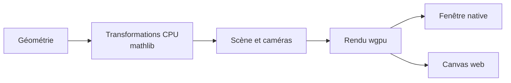

Dimension est mon workspace Rust pour mes expériences en mathématiques et en infographie. Le point de départ est `mathlib` : la bibliothèque expose le stockage matriciel, des solveurs numériques et les transformations utilisées côté CPU par le module de rendu.

<!--more-->



## Architecture

L’application fournit la géométrie et les transformations. La scène organise les entités et les caméras; le moteur prépare le travail GPU pour une fenêtre native ou un canevas web. Ce parcours de rendu ne signifie pas que tous les calculs numériques passent sur le GPU.

[Lire le parcours du code, composant par composant]().

## Commencer par le stockage

[`mathlib/src/lib.rs`](https://github.com/antoinebou12/Dimension/blob/main/mathlib/src/lib.rs) expose du stockage dense et des formats creux comme CRS et CCS. L’API comprend aussi des matrices, des vecteurs, des vues et des sous-matrices. Ces choix interviennent avant le premier dessin : ils déterminent comment le code représente et transmet ses données.

Le même point d’entrée expose les décompositions LU, Cholesky et SVD, ainsi que la recherche de racines et l’intégration numérique. Les fonctions GPU sont optionnelles. L’abstraction d’exécution représente un choix de conception ; elle ne constitue pas une mesure de gain de vitesse. Je ne présente pas de comparaison de performance ici.

## Suivre une transformation dans la scène

[`render/src/lib.rs`](https://github.com/antoinebou12/Dimension/blob/main/render/src/lib.rs) décrit un moteur wgpu qui utilise `mathlib` pour les transformations CPU et les calculs de caméra. Il expose notamment `World`, `EntityId`, `Transform`, les caméras et les cibles de rendu.

La scène représente les relations parent-enfant dans un arbre. Une transformation locale s’inscrit donc dans une hiérarchie : déplacer un parent modifie le repère dans lequel ses enfants sont rendus. La sérialisation est optionnelle, sous la fonctionnalité `serde`.

La couche plateforme prend en charge les fenêtres natives et les cibles WebAssembly avec canvas. Séparer cette couche du code de scène et des calculs permet de partager des composants, sans pour autant prouver un comportement identique sur chaque GPU ou navigateur.

## Lire le workspace au-delà du README

Le [`Cargo.toml`](https://github.com/antoinebou12/Dimension/blob/main/Cargo.toml) racine contient des crates de rendu, géométrie, collision, cinématique, physique, réseau, parsing et calcul neuronal, en plus de `mathlib`. Le README reste centré sur les mathématiques. Le manifeste et les points d’entrée des modules donnent une vue plus complète de la structure actuelle.

Ce code reste exploratoire. Pour justifier un résultat de performance, il faudrait un benchmark reproductible avec la taille des données et le matériel utilisé. Le dépôt montre pour l’instant comment je relie les calculs numériques à mes travaux d’infographie.

[Voir Dimension sur GitHub](https://github.com/antoinebou12/Dimension).
