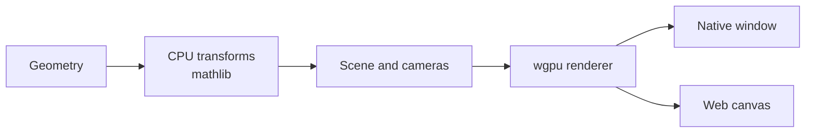

Dimension is my Rust workspace for mathematics and graphics experiments. The useful starting point is `mathlib`: it exposes matrix storage, numerical solvers and the transformations that the rendering crate uses on the CPU.

<!--more-->



## Architecture

The application supplies geometry and transforms. The scene layer organizes entities and cameras; the rendering layer prepares the GPU work for a native window or web canvas. This is the rendering path, not a claim that every numerical operation runs on the GPU.

[Open the component-by-component code walkthrough]().

## Start with the storage

[`mathlib/src/lib.rs`](https://github.com/antoinebou12/Dimension/blob/main/mathlib/src/lib.rs) exports dense storage alongside sparse formats such as CRS and CCS. The public API also includes matrix and vector types, matrix views and submatrices. Those choices matter before a renderer draws anything: they determine how a caller represents and passes its data.

The same entry point exposes LU, Cholesky and SVD decompositions, plus root finding and numerical integration. Optional GPU functionality sits behind a feature flag. The presence of an executor abstraction is a design choice, not a measured speedup; I have not included performance comparisons here.

## Follow a transform into the scene

[`render/src/lib.rs`](https://github.com/antoinebou12/Dimension/blob/main/render/src/lib.rs) describes a wgpu renderer that uses `mathlib` for CPU transforms and camera mathematics. Its exports include `World`, `EntityId`, `Transform`, cameras and render targets.

The scene represents parent-child relationships with a tree. A local transform therefore belongs to a hierarchy: moving a parent changes the context in which its children are rendered. Serialization is optional and enabled through the `serde` feature.

The platform layer supports native windows and WebAssembly canvas targets. Keeping platform code apart from scene and numerical code gives those targets shared building blocks, although it does not prove identical behavior on every GPU or browser.

## Read the workspace, not only the README

The root [`Cargo.toml`](https://github.com/antoinebou12/Dimension/blob/main/Cargo.toml) lists crates for rendering, geometry, collision, kinematics, physics, networking, parsing and neural work alongside `mathlib`. The README still focuses on the mathematics crate. I use the manifest and module entry points to understand the current structure.

This is exploratory code. Performance comparisons would need a reproducible benchmark with its input size and target hardware.

[Browse Dimension on GitHub](https://github.com/antoinebou12/Dimension).
