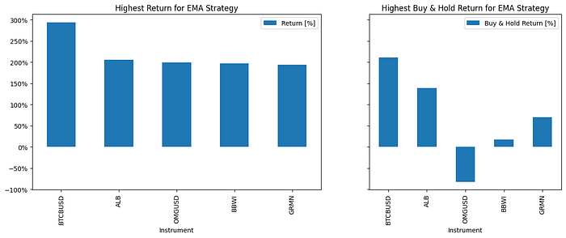

J’ai lancé en lot une stratégie de **croisement d’EMA** sur le S&P 500 et une liste de paires crypto avec [BatchBacktesting](https://github.com/AlgoETS/BatchBacktesting), en utilisant Financial Modeling Prep pour les actions et Binance pour les cryptos. Ce billet montre ce que fait l’exécuteur, comment lire les lignes extravagantes en haut et en bas du classement, et pourquoi rien de tout ça n’est un système de trading réel.

<!--more-->

## Ce que fait BatchBacktesting

1. Récupère les données OHLCV quotidiennes de **Financial Modeling Prep** (liste du S&P 500) ou de **Binance** (liste de cryptos).
2. Applique une classe de stratégie à chaque ticker avec [backtesting.py](https://kernc.github.io/backtesting.py/).
3. Écrit des **résultats CSV et des graphiques HTML optionnels** dans `output/`.

C’est un **outil de criblage**, pas un gestionnaire de portefeuille.

## Préparation

```bash
pip install numpy httpx rich backtesting pandas_ta
```

Le notebook définit lui-même les fonctions d’appel à l’API (`make_api_request`, `get_SP500`, `get_all_crypto`, récupération des historiques de prix). Il lui faut seulement les deux URL de base et vos clés :

```python
BASE_URL_FMP = "https://financialmodelingprep.com/api/v3"
BASE_URL_BINANCE = "https://fapi.binance.com/fapi/v1/"
FMP_API_KEY = "YOUR_FMP_API_KEY"
BINANCE_API_KEY = "YOUR_BINANCE_API_KEY"
```

Gardez les vraies clés dans des variables d’environnement, pas dans le notebook que vous versionnez.

## La stratégie EMA

Achat quand l’EMA 20 périodes passe au-dessus de l’EMA 80 périodes, vente au croisement inverse. Chaque entrée a un stop loss de 10 % et une prise de profit de 25 %.

```python
class EMA(Strategy):
    n1 = 20
    n2 = 80

    def init(self):
        close = self.data.Close
        self.ema20 = self.I(taPanda.ema, close.s, self.n1)
        self.ema80 = self.I(taPanda.ema, close.s, self.n2)

    def next(self):
        price = self.data.Close
        if crossover(self.ema20, self.ema80):
            self.position.close()
            self.buy(sl=0.90 * price, tp=1.25 * price)
        elif crossover(self.ema80, self.ema20):
            self.position.close()
            self.sell(sl=1.10 * price, tp=0.75 * price)
```

## Lancer le lot

```python
tickers = get_SP500()
run_backtests(tickers, strategy=EMA, num_threads=12, generate_plots=True)

tickers = get_all_crypto()
run_backtests(tickers, strategy=EMA, num_threads=12, generate_plots=True)
```

`run_backtests` répartit les tickers sur un pool de threads et produit un graphique par instrument, comme [ce graphique AAPL](https://algoets.github.io/BatchBacktesting/output/charts/EMA/AAPL-2018-04-04-2023-04-03.html). Le dépôt ne contient pas de résultats précalculés : lancez-le en local pour obtenir votre propre dossier `output/`.

## Lire le classement

Les cinq meilleurs rendements EMA : BTCBUSD +293,78 %, ALB +205,97 %, OMGUSD +199,62 %, BBWI +196,82 %, GRMN +193,47 %.
Les cinq pires : BTTBUSD −99,93 %, UAL −82,63 %, NCLH −81,51 %, LNC −78,02 %, CHRW −76,38 %.

| Ticker | Rendement | Réflexion |
|--------|----------:|-----------|
| BTCBUSD | +293,78 % | Volatilité crypto et paramètres ajustés à la période |
| BTTBUSD | −99,93 % | Effondrement d’un jeton ; la liquidité n’est pas modélisée |
| UAL / NCLH | −82 % / −81 % | Les fenêtres de l’ère COVID punissent les règles de tendance naïves |

**Les listes du haut et du bas sont des diagnostics**, pas des listes d’achat et de vente. Ouvrez le graphique du ticker avant de raconter une histoire sur une ligne.



Le graphique place le rendement EMA à côté du buy-and-hold. OMGUSD a gagné environ 200 % avec la règle alors que le buy-and-hold perdait environ 80 % : le gain vient d’une position vendeuse pendant l’effondrement, pas d’un avantage fiable.

## Où se trouve le code complet

L’article Medium colle toutes les fonctions utilitaires : appels HTTP, threads, écriture CSV et graphiques. Leur place est dans le [dépôt BatchBacktesting](https://github.com/AlgoETS/BatchBacktesting), où elles sont maintenues. Le [billet suivant]() ajoute une stratégie MACD au même exécuteur.

## Quand ne pas s’en servir

| Mauvais usage | Pourquoi ça fait mal |
|---------------|----------------------|
| Déployer le premier ticker en réel | Surajusté à la fenêtre |
| Ignorer frais et glissement | Le backtest gonfle les résultats |
| Sauter les dates hors échantillon | Un changement de régime casse la règle |

## À retenir

Les exécutions en lot montrent la **distribution des résultats** d’une règle simple : précieux pour l’humilité, dangereux en pilote automatique.

## Articles liés

- [Backtesting de plusieurs indicateurs]() : le même exécuteur avec MACD
- [MarketWatch en Python]() : API de trading simulé
- [Bandes de risque Monte Carlo]()

---

*Publié à l’origine sur [Medium](https://medium.com/@antoine.boucher012/exp%C3%A9rimentation-des-indicateurs-technique-avec-python-et-backtesting-828bf93e92cc).*
