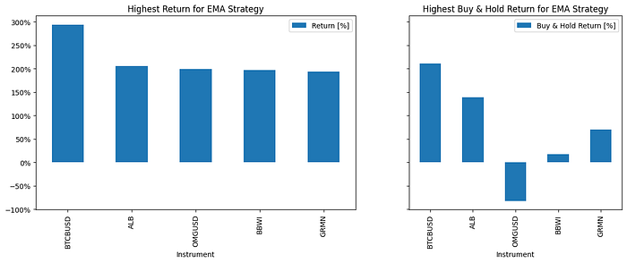

I batch-ran an **EMA crossover** strategy across the S&P 500 and a list of crypto pairs with [BatchBacktesting](https://github.com/AlgoETS/BatchBacktesting), using Financial Modeling Prep for equities and Binance for crypto. This post shows what the runner does, how to read the outrageous rows at the top and bottom of the leaderboard, and why none of it is a live trading system. The original article is in French on Medium.

<!--more-->

## What BatchBacktesting does

1. Pulls daily OHLCV from **Financial Modeling Prep** (S&P 500 list) or **Binance** (crypto list).
2. Applies a strategy class to each ticker with [backtesting.py](https://kernc.github.io/backtesting.py/).
3. Writes **CSV results and optional HTML charts** under `output/`.

It is a **screening hammer**, not a portfolio manager.

## Setup

```bash
pip install numpy httpx rich backtesting pandas_ta
```

The notebook defines the API helpers itself (`make_api_request`, `get_SP500`, `get_all_crypto`, price history fetchers). It only needs the two base URLs and your keys:

```python
BASE_URL_FMP = "https://financialmodelingprep.com/api/v3"
BASE_URL_BINANCE = "https://fapi.binance.com/fapi/v1/"
FMP_API_KEY = "YOUR_FMP_API_KEY"
BINANCE_API_KEY = "YOUR_BINANCE_API_KEY"
```

Keep real keys in environment variables, not in the notebook you commit.

## The EMA strategy

Buy when the 20-period EMA crosses above the 80-period EMA, sell on the opposite cross. Each entry carries a 10 % stop loss and a 25 % take profit.

```python
class EMA(Strategy):
    n1 = 20
    n2 = 80

    def init(self):
        close = self.data.Close
        self.ema20 = self.I(taPanda.ema, close.s, self.n1)
        self.ema80 = self.I(taPanda.ema, close.s, self.n2)

    def next(self):
        price = self.data.Close
        if crossover(self.ema20, self.ema80):
            self.position.close()
            self.buy(sl=0.90 * price, tp=1.25 * price)
        elif crossover(self.ema80, self.ema20):
            self.position.close()
            self.sell(sl=1.10 * price, tp=0.75 * price)
```

## Running the batch

```python
tickers = get_SP500()
run_backtests(tickers, strategy=EMA, num_threads=12, generate_plots=True)

tickers = get_all_crypto()
run_backtests(tickers, strategy=EMA, num_threads=12, generate_plots=True)
```

`run_backtests` spreads the tickers over a thread pool and writes one chart per instrument, such as [this AAPL chart](https://algoets.github.io/BatchBacktesting/output/charts/EMA/AAPL-2018-04-04-2023-04-03.html). The repository does not ship precomputed results: run it locally to get your own `output/` folder.

## Reading the leaderboard

Top five EMA returns: BTCBUSD +293.78 %, ALB +205.97 %, OMGUSD +199.62 %, BBWI +196.82 %, GRMN +193.47 %.
Bottom five: BTTBUSD −99.93 %, UAL −82.63 %, NCLH −81.51 %, LNC −78.02 %, CHRW −76.38 %.

| Ticker | Return | Gut check |
|--------|-------:|-----------|
| BTCBUSD | +293.78 % | Crypto volatility plus a parameter fit to the period |
| BTTBUSD | −99.93 % | A token collapse; liquidity is not modeled |
| UAL / NCLH | −82 % / −81 % | COVID-era windows punish naive trend rules |

**Top and bottom lists are diagnostics**, not buy and sell lists. Open the per-ticker chart before telling a story about a row.



The chart puts the EMA return next to buy-and-hold. OMGUSD made about 200 % with the rule while buy-and-hold lost about 80 %: the gain came from being short through a collapse, not from a reliable edge.

## Where the full code lives

The Medium article pastes every helper: HTTP calls, threading, CSV writers and plotting. Those belong in the [BatchBacktesting repository](https://github.com/AlgoETS/BatchBacktesting), where they are maintained. The [follow-up post]() adds a MACD strategy to the same runner.

## When not to use this

| Misuse | Why it hurts |
|--------|--------------|
| Deploying the top ticker live | Overfit to the window |
| Ignoring fees and slippage | The backtest inflates |
| Skipping out-of-sample dates | A regime change breaks the rule |

## Takeaway

Batch runs teach the **distribution of outcomes** under a simple rule: invaluable for humility, dangerous as autopilot.

## Related posts

- [Multiple indicators backtesting](): the same runner with MACD
- [MarketWatch Python](): paper trading API
- [Monte Carlo risk bands]()

---

*Originally published in French on [Medium](https://medium.com/@antoine.boucher012/exp%C3%A9rimentation-des-indicateurs-technique-avec-python-et-backtesting-828bf93e92cc).*
