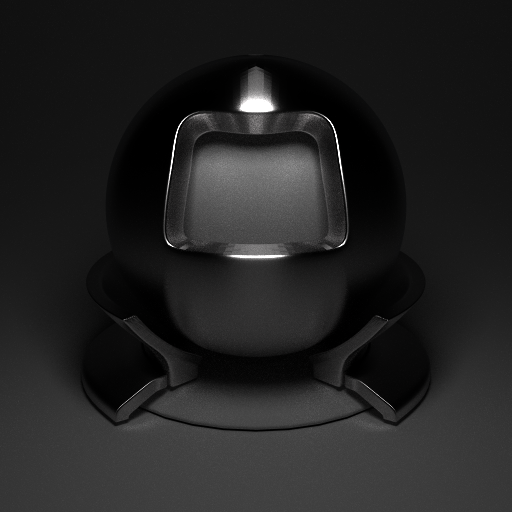
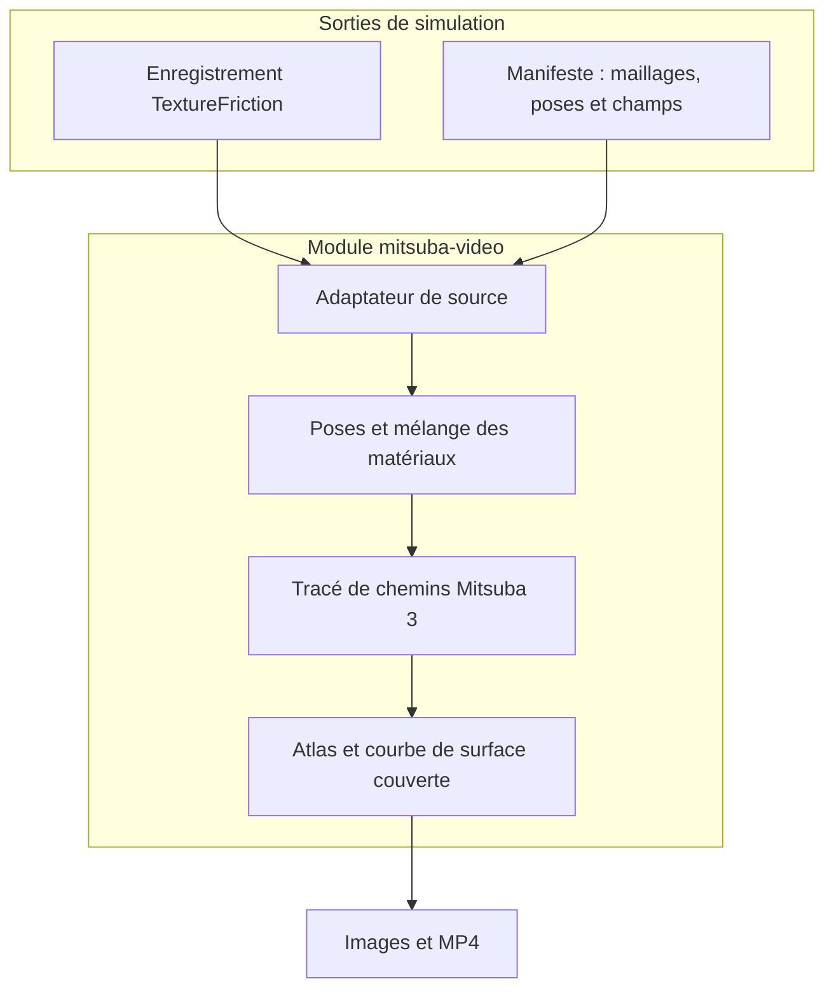
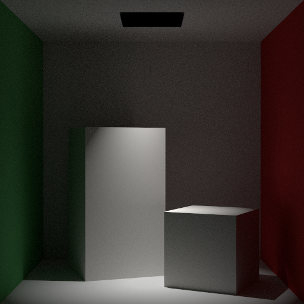

MistubaVideo transforme les sorties de simulation en images et vidéos avec Mitsuba 3. Son moteur par lots traite des séquences OBJ. Le module `mitsuba-video` rejoue les poses des corps et les champs de surface, comme l’usure.

<!--more-->

## La place du rendu

La simulation calcule le mouvement et les changements de surface. Le rendu montre les déplacements, les régions modifiées dans l’atlas UV et l’évolution des matériaux. Un enregistrement permet de changer la caméra ou l’éclairage sans relancer la simulation.

`python main.py multi --folder exports` traite une séquence OBJ. Les vues, la résolution et les échantillons par pixel règlent le rendu; FFmpeg assemble les images en vidéo ou en GIF. Le rendu de champs ajoute les transformations et textures de chaque image.



*Illustration de matériau déjà présente dans le rapport. Elle montre l’ombrage, sans représenter un résultat de simulation d’usure.*

## Le module de rendu

Le paquet `mitsuba-video` lit un manifeste versionné ou un enregistrement TextureFriction grâce à un adaptateur de source. Le manifeste décrit les corps, maillages, matériaux, poses et images de champs. `ManifestWriter` permet à un autre simulateur de produire ce format.

Pour chaque image sélectionnée, le module applique les poses enregistrées, mélange les matériaux de base et affectés selon le champ de surface, puis effectue le rendu. Il peut ajouter une carte de chaleur, un panneau d’atlas UV et une courbe de surface couverte avant l’encodage MP4.



`inspect` vérifie les entrées et `preview` permet de vérifier le cadrage. `render` produit la séquence; `encode` modifie l’assemblage vidéo à partir des images existantes. Les préréglages comprennent `preview`, `draft` et `paper`.

```bash
mitsuba-video inspect path/to/manifest.json
mitsuba-video preview path/to/manifest.json
mitsuba-video render path/to/manifest.json -q preview
```

## Lire les résultats

Les sorties comprennent les images de la scène, les images composites, un CSV de surface couverte et `render_config.json`, avec les paramètres et temps de calcul. Les images EXR linéaires sont optionnelles. La courbe mesure la surface couverte du champ enregistré. Elle ne mesure pas la surface visible de l’objet à l’écran.

Conservez les paramètres d’affichage pour comparer des vidéos : changer l’échelle de la carte de chaleur peut donner une apparence différente au même champ.



*Illustration d’éclairage déjà présente dans le rapport. L’éclairage et le champ de surface enregistré sont deux entrées distinctes.*

## Sources et tests

Le paquet documente des tests pytest pour les transformations, le mélange des matériaux, les lecteurs OBJ et MTL, ainsi que le schéma et le générateur de manifestes. Aucun pourcentage mesuré de couverture n’est fourni ici.

[Documentation du module de rendu](https://github.com/ETSim/MistubaVideo/tree/main/packages/mitsuba_video).

La [documentation du projet]() regroupe le lien source et la terminologie.

- [MistubaVideo sur GitHub](https://github.com/ETSim/MistubaVideo)
