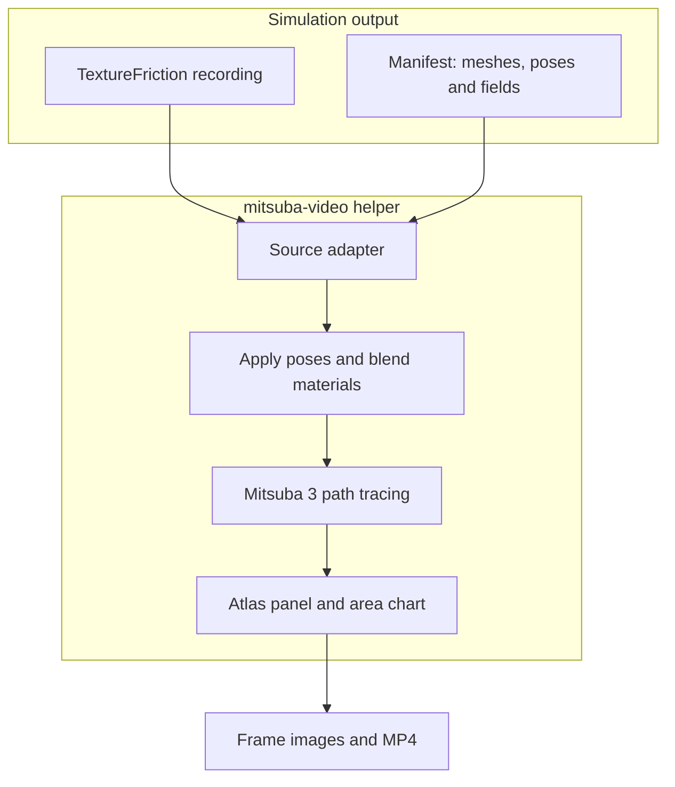

MistubaVideo turns simulation exports into images and video with Mitsuba 3. Its batch renderer handles OBJ sequences; the `mitsuba-video` helper replays recorded body poses and surface fields such as wear.

<!--more-->

## Where rendering fits

A simulation computes motion and changes to surfaces. The renderer reads those outputs to show where bodies moved, which regions of the UV atlas changed, and how the material appearance evolves. Rendering a recording lets you change the camera or lighting without repeating the simulation.

`python main.py multi --folder exports` renders an OBJ sequence. Camera views, resolution and samples per pixel control the output; FFmpeg assembles the images into video or GIF. The field renderer adds per-frame transforms and textures.



## The render helper

| Stage | Data |
| --- | --- |
| Input | Meshes, materials, recorded poses and surface fields |
| Processing | Source adapter, material blend and Mitsuba rendering |
| Output | Rendered frames, area CSV, settings and MP4 |

The `mitsuba-video` package accepts a versioned manifest or a TextureFriction recording through a source adapter. A manifest describes bodies, meshes, materials, poses and field images. `ManifestWriter` lets another simulator export this format.

For each selected frame, the helper applies recorded poses, blends base and affected materials using the surface field, and renders the scene. It can add a heatmap, a UV-atlas panel and a covered-area chart before encoding an MP4.



Start with `inspect` to check the input and `preview` to check framing. `render` produces the sequence; `encode` changes video assembly using existing frames. Quality presets include `preview`, `draft` and `paper`.

```bash
mitsuba-video inspect path/to/manifest.json
mitsuba-video preview path/to/manifest.json
mitsuba-video render path/to/manifest.json -q preview
```

## Reading the output

Outputs include beauty images, composite frames, a field-area CSV and `render_config.json` with settings and timings. Linear EXR frames are optional. The chart measures the recorded field's covered area. It does not measure the visible area of the rendered object.

Keep display settings with the render when comparing videos: changing the heatmap range can make the same field look different.



## Sources and tests

The package documents pytest tests for transforms, material blending, OBJ and MTL readers, and the manifest schema and writer. A measured coverage percentage is not supplied here.

[Render-helper documentation](https://github.com/ETSim/MistubaVideo/tree/main/packages/mitsuba_video).

Implementation: [source interface](https://github.com/ETSim/MistubaVideo/blob/main/packages/mitsuba_video/src/mitsuba_video/source.py), [material blending](https://github.com/ETSim/MistubaVideo/blob/main/packages/mitsuba_video/src/mitsuba_video/blend.py).

The [project documentation]() provides the source link and terminology.

- [MistubaVideo on GitHub](https://github.com/ETSim/MistubaVideo)
