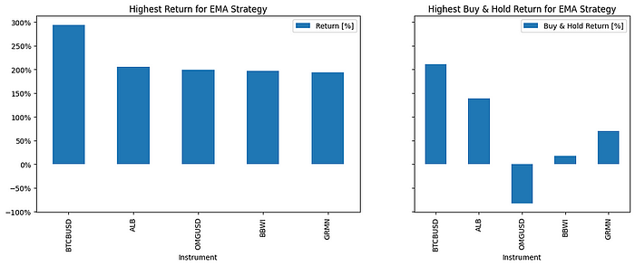

Même moteur **[BatchBacktesting](https://github.com/AlgoETS/BatchBacktesting)** que l’[expérience précédente sur les indicateurs](), mais à l’**échelle d’un portefeuille** : beaucoup de tickers, deux stratégies, actions et cryptos, puis les meilleurs et les pires résultats agrégés.

<!--more-->

## Pourquoi lancer beaucoup de tickers à la fois

Un backtest sur un seul ticker flatte toujours. Une grille répond à d’autres questions :

- La règle ne fonctionne-t-elle que sur un seul symbole héroïque ?
- Les désastres se concentrent-ils dans un secteur ou une période ?
- Les cryptos dominent-elles le classement parce que la volatilité n’a pas de limite dans la simulation ?

## Architecture (celle de BatchBacktesting)

| Couche | Rôle |
|--------|------|
| Adaptateurs de données | Récupération FMP et Binance |
| Stratégies | Jeux de paramètres `EMA` et `MACD` |
| Exécuteur | Pool de threads, sortie CSV, graphiques en option |
| `output/` | Artefacts par exécution, non versionnés sur GitHub par défaut |

Les résultats précalculés ne sont **pas** dans le dépôt (trop dépendants de chaque utilisateur). On les génère en local, puis on les consulte dans `output/charts/...`.

## Les deux stratégies

Les deux stratégies utilisent [backtesting.py](https://kernc.github.io/backtesting.py/) avec les indicateurs de `pandas_ta`.

**Croisement d’EMA.** Achat quand l’EMA 20 périodes passe au-dessus de l’EMA 80 périodes, vente au croisement inverse. Chaque entrée a un stop loss de 10 % et une prise de profit de 25 %.

```python
class EMA(Strategy):
    n1 = 20
    n2 = 80

    def init(self):
        close = self.data.Close
        self.ema20 = self.I(taPanda.ema, close.s, self.n1)
        self.ema80 = self.I(taPanda.ema, close.s, self.n2)

    def next(self):
        price = self.data.Close
        if crossover(self.ema20, self.ema80):
            self.position.close()
            self.buy(sl=0.90 * price, tp=1.25 * price)
        elif crossover(self.ema80, self.ema20):
            self.position.close()
            self.sell(sl=1.10 * price, tp=0.75 * price)
```

**Croisement MACD.** La ligne MACD est l’EMA 12 périodes moins l’EMA 26 périodes ; la ligne de signal est une EMA 9 périodes de cette différence. Achat quand la MACD passe au-dessus de son signal, vente au croisement inverse. Pas de stop loss ni de prise de profit ici.

```python
class MACD(Strategy):
    short_period = 12
    long_period = 26
    signal_period = 9

    def init(self):
        close = self.data.Close
        self.macd = self.I(taPanda.macd, close.s, self.short_period, self.long_period, self.signal_period)

    def next(self):
        macd_line = self.macd.macd
        signal_line = self.macd.signal
        if crossover(macd_line, signal_line):
            self.position.close()
            self.buy()
        elif crossover(signal_line, macd_line):
            self.position.close()
            self.sell()
```

## Lancer à grande échelle

```python
tickers = get_SP500()
run_backtests(tickers, strategy=EMA, num_threads=12, generate_plots=True)
run_backtests(tickers, strategy=MACD, num_threads=12, generate_plots=True)

tickers = get_all_crypto()
run_backtests(tickers, strategy=EMA, num_threads=12, generate_plots=True)
run_backtests(tickers, strategy=MACD, num_threads=12, generate_plots=True)
```

Chaque appel se répartit sur un pool de threads. Ajustez `num_threads` à votre machine et aux limites d’API de Financial Modeling Prep et de Binance.

## Classement EMA

Les cinq meilleurs rendements de la stratégie EMA :

| Instrument | Rendement |
|------------|----------:|
| BTCBUSD | 293,78 % |
| ALB | 205,97 % |
| OMGUSD | 199,62 % |
| BBWI | 196,82 % |
| GRMN | 193,47 % |

Les cinq pires :

| Instrument | Rendement |
|------------|----------:|
| BTTBUSD | −99,93 % |
| UAL | −82,63 % |
| NCLH | −81,51 % |
| LNC | −78,02 % |
| CHRW | −76,38 % |



C’est le graphique de droite qui compte. OMGUSD a rapporté environ 200 % avec la règle EMA alors que le buy-and-hold perdait environ 80 % : la règle a gagné en restant vendeuse pendant l’effondrement. BTCBUSD et ALB ont monté dans les deux cas, ce qui en dit plus sur la période que sur la règle.

Les **rendements élevés** mélangent souvent de longues phases haussières sur des paires crypto volatiles, des signaux chanceux sur des actions sans tendance et des paramètres qui collent par hasard à une période. Les **pertes profondes** signalent des symboles peu liquides que la simulation négocie quand même, des règles de tendance dans des secteurs en chute (aérien et croisières ci-dessus) et des paires cassées ou retirées traitées comme des tickers normaux.

Avant de dire « MACD bat EMA », comparez le **rendement médian** sur tous les tickers, pas seulement les cinq premiers.

## Limites honnêtes

- Ce n’est **pas un conseil financier**.
- Frais, emprunt de titres, suspensions et opérations sur titres ne valent que ce que valent le flux de données et les réglages par défaut de la bibliothèque.
- Un résultat passé ne garantit aucun avantage futur.

## À retenir

Servez-vous des backtests multi-tickers comme de **tests de fumée** pour vos règles : trouver où elles cassent, pas où placer votre capital.

## Articles liés

- [Expérimentation des indicateurs]()
- [Prévoir des cours avec Monte Carlo]()

---

*Publié à l’origine sur [Medium](https://medium.com/@antoine.boucher012/multiple-technical-indicators-backtesting-on-multiple-tickers-using-python-a5c933d3f1bf) (en anglais). Code complet : [BatchBacktesting](https://github.com/AlgoETS/BatchBacktesting).*
