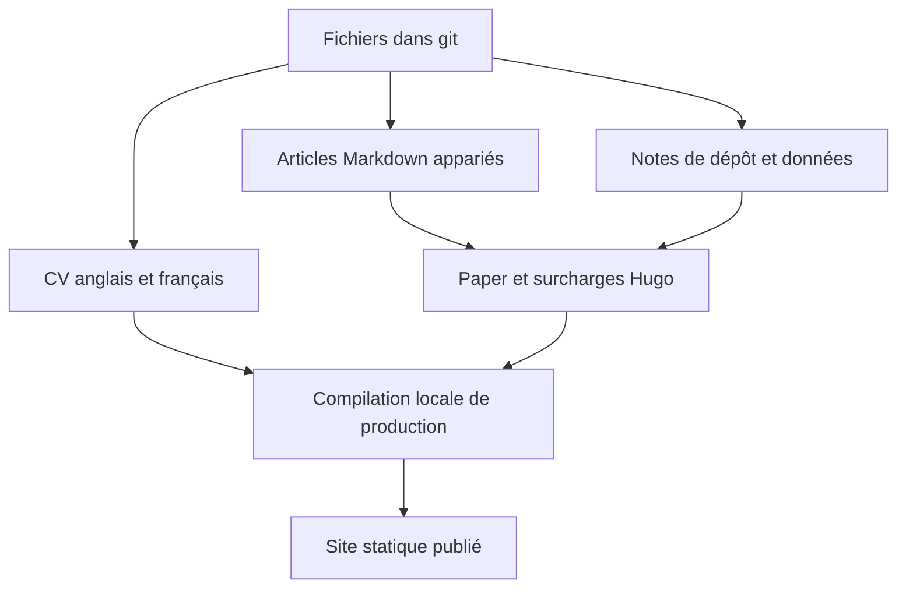

La première version réunissait le CV et quelques articles sous Hugo. Cette refonte donne au CV, au blog et aux notes de dépôt une identité visuelle commune, avec une mise en page adaptée à chaque lecture. Elle fait suite à [Créer un portfolio avec Hugo (semaine 1)]().

<!--more-->

## Une identité commune, de la place pour le contenu

Le fond bleu ardoise et la surface claire relient maintenant le CV au blog. Le vert sarcelle indique les liens, les filtres sélectionnés et les actions utiles. Fraunces porte les grands titres. Le texte et les commandes utilisent une typographie plus discrète. La palette, les espacements et les règles de mouvement sont décrits dans [DESIGN.md](https://github.com/antoinebou12/CV/blob/main/DESIGN.md).

Cette identité prend des proportions différentes selon la page. Le CV présente d’abord le nom, le portrait et le téléchargement PDF. Un article demande une colonne de lecture confortable et des sections claires. Une référence technique doit accueillir commandes, tableaux d’API et schémas, avec une navigation latérale sur grand écran.

Sur petit écran, la navigation et les actions passent à la ligne. Le code défile dans son propre bloc et le texte reste sur une colonne. Les figures sont affichées en entier : rogner les axes d’une surface ou les étiquettes d’une architecture retire de l’information.

## Maîtriser les surcharges de Paper

Le blog est passé de HBTheme à [Paper](https://github.com/nanxiaobei/hugo-paper). Les templates de `hugo/layouts/` définissent l’en-tête des articles, les listes, la recherche et les pages de projet. Les styles communs se trouvent dans `hugo/assets/`.

Une correction du template s’applique ainsi à tous les articles. L’en-tête rassemble le type de contenu, la date, le temps de lecture et les sujets. Les articles longs ont un sommaire repliable. Les versions anglaise et française sont reliées par `translationKey` et par le sélecteur de langue de l’en-tête. Répéter un lien de traduction dans l’introduction ajoute un choix de navigation au milieu du propos.

La description de l’article reste dans les métadonnées de recherche et de partage. Le début visible vient du premier paragraphe, ce qui évite de lire deux fois la même introduction.

## Articles et références techniques

Le champ `post_kind` distingue les articles, les conférences et les tutoriels dans les listes et la recherche. Les recettes gardent leur section. Les fiches de dépôt se trouvent dans `projects/notes/`, où le catalogue peut pointer vers une référence technique stable.

Un article suit une idée dans le code. La fiche associée rassemble les commandes, les sources et, selon le projet, l’API ou le déploiement. Un projet Docker a besoin de ports, de stockage et de relations de démarrage. Une bibliothèque numérique demande une explication de ses structures de données et de ses algorithmes. Les sections vides alourdissent la lecture.

Le catalogue permet de rechercher et de combiner des filtres. Documentation et GitHub restent deux actions distinctes sur chaque carte. Les badges d’archive et de fork décrivent l’état du dépôt sans remplacer son titre ou son résumé.

## Des schémas utilisables à la taille de lecture

Les diagrammes Mermaid proposent le zoom, l’ajustement, la taille réelle, le plein écran et l’export SVG. Au départ, le schéma s’ajuste à la largeur disponible. Le lecteur peut ensuite examiner une étiquette sans faire défiler toute la page horizontalement.

Le texte et les liens source continuent d’expliquer les relations. Une flèche de déploiement doit avoir un sens précis : `depends_on` dans Compose décrit l’ordre de démarrage, tandis que la disponibilité du service est une autre question.

La [source du premier schéma](./images/site-refonte-flow.mmd) conserve la vue du thème et des outils éditoriaux utilisés pendant la refonte.

## Des skills pour les règles récurrentes

Les skills du dépôt donnent un cadre aux modifications répétées. `cv-hero` identifie les pages CV canoniques et leur copie anglaise générée. `hugo-site` décrit les templates, les articles bilingues et la navigation. `project-docs` précise la structure des fiches et les sources nécessaires aux affirmations techniques.

Les recommandations Apple servent à examiner la hiérarchie, la taille des cibles, le contraste et le mouvement. Sur ce site, ces principes s’appliquent aux commandes du navigateur et aux mises en page adaptatives. La passe humanizer porte sur le texte : explications directes, détails concrets et moins d’introductions répétées.

Ces règles indiquent où regarder avant de modifier un composant partagé. Il faut encore examiner la page réelle. Une règle ne suffit pas à vérifier qu’une image appartient au projet ou que les étiquettes d’un schéma sont lisibles.

## Prévisualiser et publier

Les sources restent dans git : HTML pour le CV, paires Markdown pour les articles et fichiers de données pour les fiches techniques. L’[article JSON Resume]() présente le CV lisible par machine qui accompagne ces pages.

Je construis la sortie de production localement, vérifie les pages générées puis publie l’arborescence statique. Les mentions de mise à jour utilisent la date de publication du site dans America/Toronto. Les dates originales des articles gardent leur sens historique.

Une compilation réussie ne remplace pas la lecture de la page. Je vérifie les modes clair et sombre, les petits et grands écrans, les langues, les images et les commandes. La réduction des animations doit laisser tout le contenu accessible. L’aperçu du diaporama utilise maintenant des diapositives rendues localement, disponibles pendant le développement comme après publication.

## Articles liés

- [Créer un portfolio avec Hugo (semaine 1)]()
- [Parcours en génie logiciel]()
