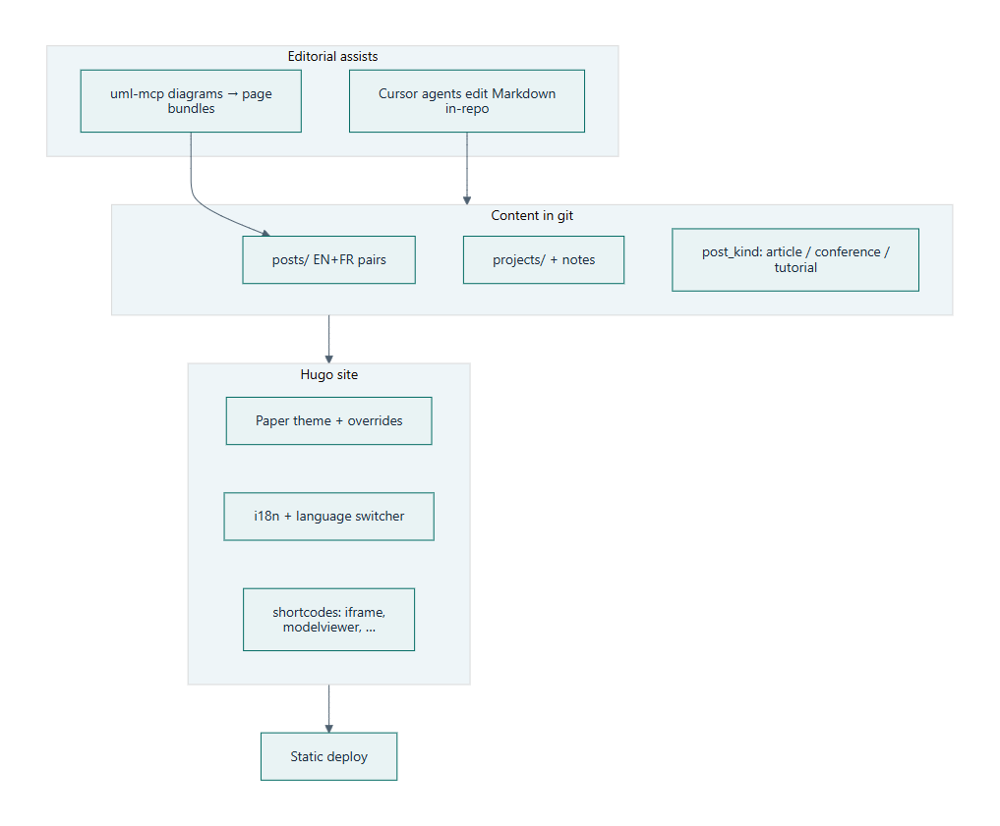

La semaine 1 a prouvé que le dépôt pouvait porter plus qu’un PDF de CV. Voici le journal de la **refonte** : même racine Hugo, autre produit — **Paper** à la place de HBTheme, paires **EN/FR**, articles typés, catalogue de projets, et **MCP** quand un schéma ou un brouillon doit atterrir plus vite dans git. Suite de **[Créer un portfolio avec Hugo (semaine 1)]()**. **[English version]()**.

<!--more-->

## De HBTheme à Paper

HBTheme a mis le site en ligne. Modules opinionated et pipeline npm : bons pour démarrer, pénibles dès qu’on veut des layouts vraiment custom.

Le blog tourne maintenant sur **[Paper](https://github.com/nanxiaobei/hugo-paper)** avec des overrides du projet : en-tête bilingue et sélecteur de langue, mode sombre, menus dans `hugo.toml`, chaînes dans `i18n`. Les CV HTML restent à la racine du site (`index-en.html` / `index-fr.html`) ; l’arbre Hugo est la coquille éditoriale, pas un second moteur de CV.

Leçon qui reste : thème mince, partials qu’on possède — plutôt que d’éplucher un thème « tout inclus » pendant des années.

## Le bilingue par défaut

Chaque article public est une paire :

- `hugo/content/posts/<slug>/index.md`
- `hugo/content/posts/<slug>/index.fr.md`

Même `translationKey`, même `date`, même `post_kind`. L’anglais pointe vers le français près du début (et l’inverse). Cette discipline évite une grosse « on devrait traduire le blog » plus tard.

## `post_kind` et le catalogue projets

Listes et recherche regroupent le contenu par type — **article**, **conference**, **tutorial** — au lieu d’une seule pile chronologique. Les conférences ont un traitement distinct (kicker, image du page bundle) ; le travail projet vit sous `projects/` avec des notes de dépôt, pour une fiche locale stable sans tout fourrer dans `/posts`.

Le site n’est plus « un thème avec des billets » : petit modèle de contenu — posts pour le récit, projets pour l’inventaire, kinds pour le rendu des cartes et des pages.

## À quoi ressemble la pile

La source de vérité reste le Markdown dans git. Autour, la forme a changé — PNG statique ci-dessous (capture en thème clair ; le Mermaid live contraste mal en mode sombre). Source : [`site-refonte-flow.mmd`](./images/site-refonte-flow.mmd).

## MCP pour documenter et publier plus vite

En semaine 1, les embeds étaient surtout iframes et liens. Les diagrammes de systèmes et de pipelines partent maintenant du chat : **[uml-mcp]()** transforme du Mermaid (ou d’autres types via Kroki) en fichiers à côté de l’article — `.mmd` dans le page bundle, souvent avec un SVG — puis Hugo (ou la clôture Mermaid) l’affiche.

C’est le gain utile pour publier : moins de copier-coller depuis un playground de plugin, plus d’« l’agent écrit la source du schéma dans le dépôt ». Quand le rendu live se bat avec le mode sombre, je garde le `.mmd` et je publie un **PNG en thème clair** dans le page bundle (le schéma de pile de cet article). Les agents Cursor rédigent aussi le Markdown bilingue dans le même arbre : le portfolio reste des diffs relisables, pas une file de brouillons CMS.

Je traite toujours la sortie agent comme un premier jet. La barre de publication n’a pas bougé : anglais et français lisibles, liens qui marchent, schémas alignés sur le texte.

## Ce qui n’a pas changé

| Toujours vrai | Pourquoi |
|---------------|----------|
| **Dépôt = source de vérité** | Markdown → HTML |
| **Hébergement statique** | Peu coûteux, rapide, pas d’admin à patcher |
| **Substack optionnel** | Longform / email au besoin ; Hugo reste la maison pro |
| **Iframes avec parcimonie** | Démos et embeds invités — pas le cœur du modèle |

JSON Resume et le CV HTML restent à côté de cette coquille ; voir **[CV professionnel + JSON Resume]()**.

## Articles liés

- [Créer un portfolio avec Hugo (semaine 1)]() — HBTheme, Substack, shortcode iframe
- [uml-mcp — diagrammes depuis le chat]() — l’outil diagrammes de cette boucle
- [Parcours en génie logiciel]() — le contexte carrière que le portfolio porte
