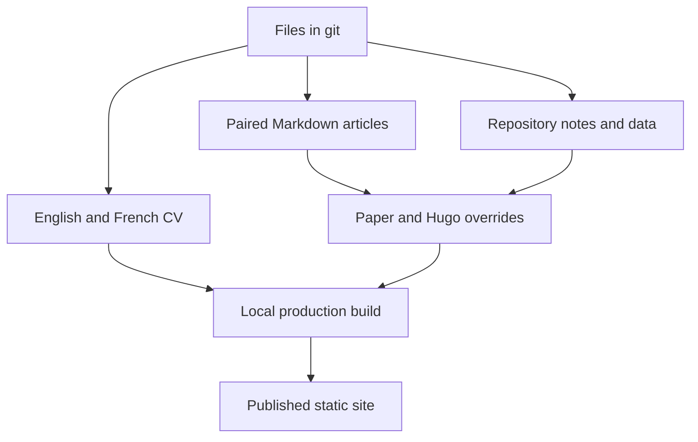

The first version put the CV and a few posts online with Hugo. This rebuild gives the CV, articles and repository notes a shared visual identity, while keeping a layout suited to each kind of reading. It follows [Create a portfolio with Hugo (week 1)]().

<!--more-->

## A shared canvas, with room for the content

The slate-blue background and pale paper surface now connect the CV to the blog. Teal marks links, selected filters and useful actions. Fraunces carries the main titles; body text and controls use more restrained type. The palette, spacing and motion rules are recorded in [DESIGN.md](https://github.com/antoinebou12/CV/blob/main/DESIGN.md).

The same identity has different proportions on each page. The CV puts the name, portrait and PDF action first. An article needs a comfortable reading column and clear sections. A project reference needs room for commands, API tables and diagrams, with page navigation beside it on a wide screen.

On a narrow screen, navigation and actions wrap, long code scrolls inside its own block, and the text remains in one column. Figures keep their full contents visible. A surface plot or architecture diagram loses meaning when its axes or labels are cropped.

## Owning the Paper overrides

The blog moved from HBTheme to [Paper](https://github.com/nanxiaobei/hugo-paper). Project templates in `hugo/layouts/` define the article header, lists, search and project pages. Shared styles live in `hugo/assets/`.

This makes a template fix apply across articles. The header now groups the content kind, date, reading time and topic badges. Longer articles have a collapsible contents list. English and French remain paired by `translationKey`, with the language switcher in the site header. Repeating a translation link in each introduction adds another navigation choice to a paragraph that should introduce the subject.

The article description stays in search and social metadata. The visible opening is the article’s first paragraph, so readers encounter the introduction once.

## Articles and project references have different jobs

The `post_kind` field distinguishes articles, conferences and tutorials in lists and search. Recipes keep their own section. Repository pages live under `projects/notes/`, where the catalog can link to a stable technical reference.

An article can follow one idea through the code. Its project note holds setup commands, source references and optional API or deployment details. For example, a Docker project needs service ports, storage and startup relationships. A numerical library needs its data structures and the path into its algorithms. Empty sections make both harder to read.

The catalog supports searching and combining filters. Documentation and GitHub remain separate actions on each card. Archive and fork badges describe repository status; they do not replace the project’s title or summary.

## Diagrams should be useful at the reading size

Mermaid diagrams now have zoom, Fit, full-size, fullscreen and SVG export controls. A diagram starts fitted to the available space. Readers can then inspect a particular label without scrolling the whole page sideways.

Text and source links still explain the relationships. In deployment diagrams, a dependency arrow needs a precise meaning: Compose’s `depends_on` records startup order, while readiness is a separate concern.

The earlier [stack diagram source](./images/site-refonte-flow.mmd) records the theme and editorial tools used during the rebuild.

## Skills make editing rules explicit

I use repository skills to keep recurring changes consistent. `cv-hero` identifies the canonical CV pages and their generated English copy. `hugo-site` describes the templates, bilingual page bundles and navigation. `project-docs` specifies the repository-note structure and the evidence needed for technical claims.

The Apple design guidance helps review hierarchy, target sizes, contrast and motion. For this website, those principles apply to browser controls and responsive layouts. The humanizer pass focuses on the writing: direct explanations, concrete details and fewer repeated introductions.

These skills give an editor a place to look before changing a shared component. The result still needs review against the actual page. A rule cannot tell whether a chosen image belongs to the project or whether a diagram’s labels are legible.

## Previewing and publishing

The source remains in git: HTML for the CV, paired Markdown bundles for articles, and data files for repository references. The [JSON Resume article]() explains the machine-readable CV alongside those pages.

I build the production output locally, check the generated pages, and publish the static tree. The last-updated labels use the release date in America/Toronto. Original article dates keep their historical meaning.

A preview needs more than a successful build. I check light and dark mode, small and wide viewports, language links, image loading and the controls that a reader can use. Reduced-motion settings also need to leave every piece of content accessible. The slide-deck preview now serves rendered slides locally, which lets it work during development as well as after publication.

## Related reading

- [Create a portfolio with Hugo (week 1)]()
- [uml-mcp: diagrams from chat]()
- [Software engineering journey]()
