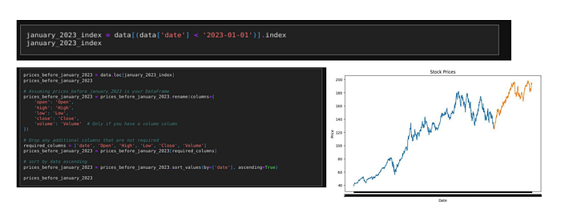
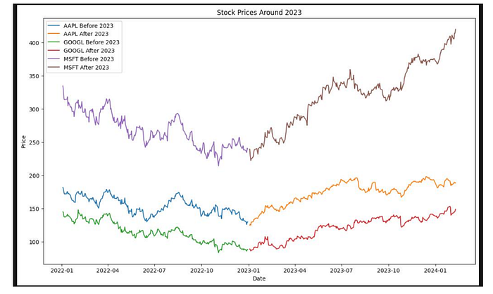
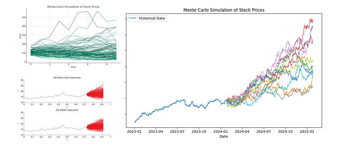
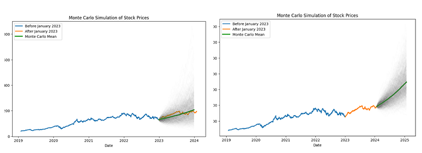
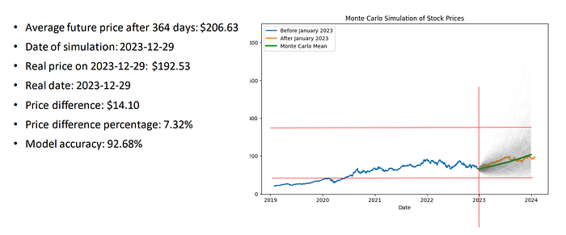
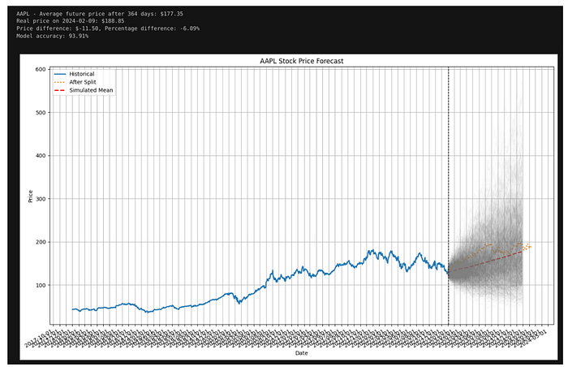
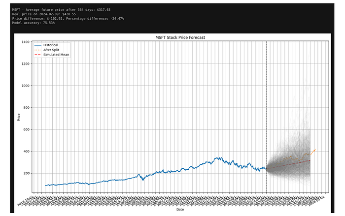

En trading, on raisonne en **fourchettes**, pas avec un prix magique. J’ai appliqué un **Monte Carlo forward** aux clôtures quotidiennes d’Apple : estimer la dérive et la volatilité des rendements log avant 2023, simuler beaucoup de trajectoires, puis vérifier si les prix réels de 2023 tombaient dans une **bande du 5e au 95e percentile**.

<!--more-->

## Monte Carlo forward ou MCMC

| Outil | Question à laquelle il répond |
|-------|-------------------------------|
| **Monte Carlo forward (ce billet)** | « Jusqu’où le prix peut-il aller sous un modèle simple de type GBM ? » |
| **MCMC** (p. ex. l’échantillonnage KDE de Landauskas et Valakevičius) | « Quelle distribution colle aux prix observés avant de simuler ? » |

Les deux se combinent : ajuster avec MCMC, explorer des scénarios avec des trajectoires forward. Cet article implémente l’étape forward en Python ; [AlgoETS/MarkokChainMonteCarlo](https://github.com/AlgoETS/MarkokChainMonteCarlo) contient les expériences côté MCMC.

## Préparation

Bibliothèques : `pandas`, `numpy`, `httpx`, `matplotlib`, `scipy`, `rich`, et en option `backtesting` / `pandas_ta` pour les graphiques connexes. Les prix historiques viennent des fonctions d’appel à l’API Financial Modeling Prep du notebook d’origine.

## Découpage entraînement / validation

On récupère tout l’historique d’`AAPL` et on coupe au **2023-01-01** :

- **Entraînement** : estimer la moyenne et la variance des rendements log.
- **Validation (hold-out)** : comparer les bandes simulées aux clôtures réelles.



Le même découpage pour AAPL, GOOGL et MSFT montre à quel point les trois titres ont évolué différemment après janvier 2023 :



## Le cœur de la simulation

Rendements log de la fenêtre d’entraînement → dérive et volatilité quotidiennes → chocs gaussiens → propagation du prix avec `exp(dérive + vol * Z)`.

```python
def monte_carlo_simulation(data, days, iterations):
    if isinstance(data, pd.Series):
        data = data.to_numpy()
    if not isinstance(data, np.ndarray):
        raise TypeError("Data must be a numpy array or pandas Series")

    log_returns = np.log(data[1:] / data[:-1])
    mean = np.mean(log_returns)
    variance = np.var(log_returns)
    drift = mean - (0.5 * variance)
    daily_volatility = np.std(log_returns)

    future_prices = np.zeros((days, iterations))
    current_price = data[-1]
    for t in range(days):
        shocks = drift + daily_volatility * norm.ppf(np.random.rand(iterations))
        future_prices[t] = current_price * np.exp(shocks)
        current_price = future_prices[t]
    return future_prices
```

`norm.ppf(np.random.rand(iterations))` transforme des tirages uniformes en chocs normaux centrés réduits : chaque ligne de `future_prices` correspond à un jour de bourse pour toutes les trajectoires simulées. Le terme `- 0.5 * variance` est la correction d’Itô ; sans lui, la moyenne de `exp(choc)` monterait plus vite que ce que justifient les rendements historiques.



Fonctions de téléchargement des données et boucles de tracé : [article original sur Medium](https://medium.com/@antoine.boucher012/predicting-stock-prices-with-monte-carlo-simulations-0884ef32c35b).

## Lire le résultat

- **Éventail de trajectoires grises** : la diversité des scénarios.
- **Trajectoires médiane et moyenne** : la tendance centrale (pas identiques quand la distribution est asymétrique).
- **Bande 5e–95e** : un intervalle de type risque pour « où le prix pourrait atterrir ».
- **Point de validation** : la réalité est-elle restée dans la bande à l’horizon correspondant ?



Pour AAPL, le prix moyen simulé après 364 jours était de **206,63 $**, contre une clôture réelle de **192,53 $** le 2023-12-29 : un écart de 14,10 $, soit 7,32 %.



Une exécution plus tardive pour AAPL et MSFT, vérifiée sur les clôtures de 2024, donne des éventails plus larges. La moyenne MSFT s’est trompée d’environ 14 % : une bande construite sur la volatilité passée ne dit rien d’une réévaluation du titre.





La distribution finale donne des **prix par quantile** et des percentiles de rendement par rapport à la dernière clôture d’entraînement. C’est utile pour mesurer « à quel point le modèle se trompe », pas comme signal d’achat.

## Quand le Monte Carlo GBM ne suffit pas

| Limite | Réalité |
|--------|---------|
| Volatilité constante | Les marchés regroupent la volatilité |
| Pas de sauts | Les publications de résultats créent des écarts |
| Un seul titre | La diversification est ignorée |
| Pas un test de stratégie | À combiner avec les [billets de backtesting]() |

## À retenir

Monte Carlo mesure la **largeur du risque modèle** sur une fenêtre de validation ; le backtesting mesure le **PnL d’une règle**. Gardez les deux questions séparées.

## Articles liés

- [Bibliothèque Python MarketWatch]()
- [Backtesting de plusieurs indicateurs]()

## Références

- Landauskas, M. et Valakevičius, E. (2011). [*Modelling of Stock Prices by MCMC*](https://ojs.mruni.eu/ojs/intellectual-economics/article/view/817)
- [Investopedia — Monte Carlo basics](https://www.investopedia.com/articles/investing/112514/monte-carlo-simulation-basics.asp)

---

*Publié à l’origine sur [Medium](https://medium.com/@antoine.boucher012/predicting-stock-prices-with-monte-carlo-simulations-0884ef32c35b) (en anglais). Le code complet du notebook est dans le dépôt et sur Medium.*
