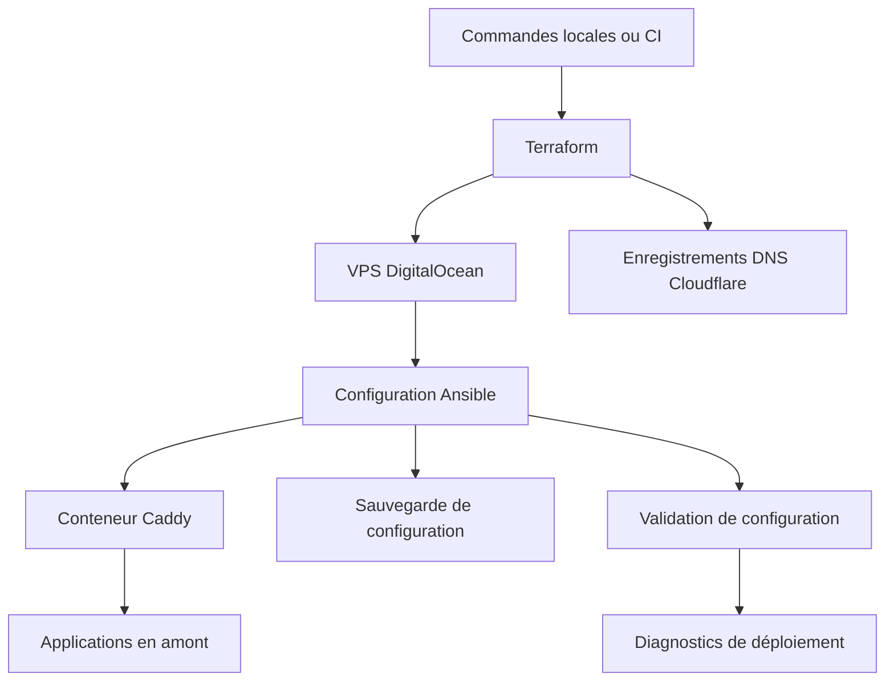

Mon projet de reverse proxy utilise Caddy sur un VPS DigitalOcean, avec le DNS Cloudflare. Terraform crée l’infrastructure, Ansible la configure et des contrôles distincts examinent le service obtenu.

Cet article décrit le dépôt examiné le 22 octobre 2026. Le code est privé : le schéma est volontairement simplifié et ne contient aucun domaine, adresse ou identifiant réel. La lecture du code n’a déclenché aucun déploiement.

<!--more-->

## Deux types de changements

Terraform gère l’infrastructure. La configuration DNS définit les enregistrements du domaine principal et les entrées génériques, avec leurs variantes IPv6. Ansible configure le serveur et les applications. Un `justfile` fournit les commandes de provisionnement, de déploiement et de validation.

Les flèches représentent des responsabilités, pas la garantie que chaque commande suit le même parcours. La frontière importante est celle de la responsabilité : deux systèmes d’automatisation ne devraient pas modifier le DNS indépendamment.

## Lire l’ordre du déploiement

Le rôle Caddy commence par la sauvegarde, prépare éventuellement un bouncer CrowdSec, configure le conteneur, puis inclut les tâches de validation. Celles-ci vérifient la structure des points d’accès et leurs références aux fournisseurs TLS. Un point d’accès doit notamment avoir un nom d’hôte et une destination, une redirection ou une configuration générique.

Ces vérifications ne répondent pas à la même question qu’une requête HTTP. Une configuration peut être valide alors que son application en amont est indisponible. À l’inverse, le service déjà en place peut encore répondre alors que la nouvelle configuration est invalide.

Le dépôt contient aussi des rôles pour Umami, WireGuard et la configuration système. Leur présence ne signifie pas que chaque déploiement les active tous.

## Une réponse ne prouve pas que l’application fonctionne

Le fichier de contrôles comprend des diagnostics du conteneur, de l’API d’administration, des accès HTTP et HTTPS, des métriques et des certificats. Plusieurs contrôles sont volontairement non bloquants. Certains acceptent des réponses **404, 502 ou 503**, en plus des codes de succès.

Cela peut confirmer que le proxy est joignable, mais pas que l’application fonctionne pour ses utilisateurs. Une condition de validation utile doit attendre une réponse précise de l’application concernée, pas simplement une réponse du proxy.

Autre distinction importante : le point d’entrée du rôle examiné n’inclut pas directement le fichier de contrôles. Son résumé laisse plusieurs champs de santé non renseignés. La présence d’un fichier dans le dépôt ne prouve donc pas son exécution lors d’un déploiement donné.

## Une sauvegarde ne garantit pas le retour arrière

Les tâches de retour arrière cherchent une sauvegarde disponible, restaurent la configuration lorsque c’est possible et tentent de redémarrer le conteneur. Le point d’entrée place son bloc de récupération après les premières inclusions de tâches. Je ne présenterais donc pas ce mécanisme comme une récupération automatique de tous les échecs.

Pour la suite, les critères sont concrets : une sauvegarde connue comme fonctionnelle, une restauration testée, des contrôles au niveau de l’application et un échec qui empêche réellement la promotion. Cette lecture ne prétend pas que ces améliorations sont déjà réalisées.

*Sources : README du dépôt privé, déclarations Terraform des ressources DNS, point d’entrée du rôle Caddy et tâches de validation, de diagnostic et de retour arrière. Les configurations opérationnelles et les secrets sont exclus.*
