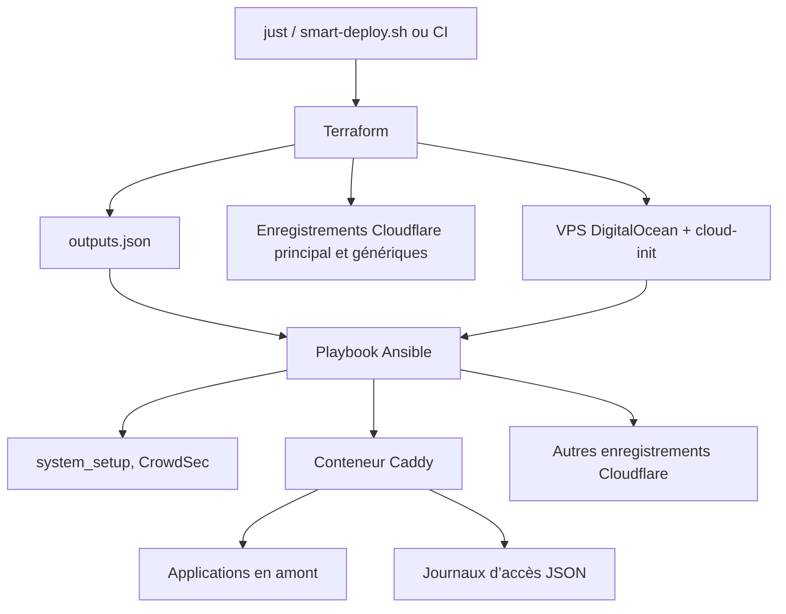

Mon projet de reverse proxy fait tourner Caddy dans Docker sur un VPS DigitalOcean, derrière le DNS Cloudflare. Terraform crée l’infrastructure, Ansible la configure et une série de contrôles examine le service obtenu.

Cet article décrit la configuration telle que je l’ai relue en octobre et novembre 2026. Le code est privé : le schéma et les extraits sont simplifiés et ne contiennent aucun domaine, adresse ou identifiant réel. J’ai lu le code sans lancer de déploiement : les constats ci-dessous portent sur ce que fait le code, pas sur des incidents mesurés.

<!--more-->

## Deux types de changements

Le côté Terraform est court et découpé par responsabilité : `versions.tf` fixe les fournisseurs DigitalOcean (`~> 2.0`) et Cloudflare (`~> 4.0`), `digitalocean.tf` déclare un droplet et son pare-feu cloud, `cloudflare.tf` déclare les enregistrements DNS, et `variables.tf` / `outputs.tf` définissent l’interface. Les valeurs par défaut décrivent une machine modeste : Ubuntu 22.04, 1 vCPU et 1 Go de RAM, IPv6 et monitoring activés.

Le fichier DNS crée quatre enregistrements : domaine principal et entrée générique, chacun en A et en AAAA, passant par le proxy Cloudflare par défaut. Chaque enregistrement utilise `count`, ce qui permet de créer le VPS sans DNS quand aucun jeton ni aucune zone Cloudflare n’est configuré.

Ansible gère tout ce qui se passe sur le serveur. Un `justfile` fournit les points d’entrée (`deploy`, `caddy`, `provision`, `validate`, `download-logs`…), et la plupart appellent un seul script, `smart-deploy.sh`, qui décide s’il faut d’abord provisionner.



Les flèches représentent des responsabilités, pas la garantie que chaque commande suit le même parcours.

### Le passage de relais entre Terraform et Ansible

Terraform écrit ses sorties dans `outputs.json`, que le playbook lit dans une pré-tâche. Une sortie n’existe que pour trancher la question de la responsabilité du DNS :

```hcl
output "terraform_managed_dns" {
  description = "Flag indicating DNS is managed by Terraform (for Ansible to skip apex/wildcard)"
  value       = length(cloudflare_record.apex) > 0
}
```

Quand l’indicateur est vrai, le rôle `cloudflare_dns` vérifie seulement que les enregistrements principal et générique existent, sans y toucher. Quand il est faux, Ansible les gère lui-même. L’idée est la bonne : un seul responsable par enregistrement, et ce responsable est explicite.

Deux détails l’affaiblissent. D’abord, le mode de réinitialisation de `smart-deploy.sh` est un troisième acteur. Avec `--reset`, il supprime les droplets et le pare-feu par leur nom via l’API DigitalOcean, supprime les enregistrements principal et génériques via l’API Cloudflare, puis exécute `terraform state rm` sur les ressources correspondantes avant de tout réappliquer. Or `just setup`, que le README présente comme la première commande à lancer, est un alias de `--reset --force` : il détruit et recrée le serveur sans rien demander. Ensuite, les enregistrements AAAA portent `ignore_changes = [content]`, contrairement aux A. Si le droplet est remplacé hors du mode de réinitialisation, Terraform met à jour les adresses IPv4 mais garde l’ancienne adresse IPv6.

## L’ordre réel d’un déploiement

Le playbook exécute ses pré-tâches (charger l’environnement, lire les sorties Terraform, régénérer l’inventaire, provisionner si demandé), puis ces rôles dans l’ordre :

1. `system_setup` : paquets, vérification de Docker, UFW, fail2ban, zsh, chrony.
2. `wireguard`, seulement si `WIREGUARD_ENABLED` est défini. Il écrit la configuration et active le routage IP ; il ne génère pas de clés et ne démarre pas le tunnel.
3. `crowdsec` : le moteur CrowdSec dans un conteneur, plus le paquet du bouncer pare-feu iptables. Caddy reçoit son propre bouncer plus tard, dans le rôle Caddy.
4. `caddy`.
5. `umami`, seulement si `UMAMI_ENABLED` est défini.
6. `cloudflare_dns`, selon l’indicateur de responsabilité ci-dessus.

Dans le rôle Caddy, l’ordre compte plus que la liste des fonctionnalités :

1. Sauvegarder le Caddyfile actuel avec un suffixe horodaté et garder les cinq plus récents (configurable, jamais moins d’un).
2. Créer la clé du bouncer CrowdSec, s’il est activé.
3. Générer le nouveau Caddyfile **directement à son emplacement de production**, écrire le fichier compose, construire l’image personnalisée (sur le VPS, ou en local puis envoyée en archive tar), lancer `docker compose down`, puis `up -d`, attendre le port d’administration, puis `docker compose restart`.
4. Valider : vérifier avec `caddy list-modules` que l’image contient les modules attendus, puis exécuter `caddy validate` sur le fichier déployé dans cette même image.
5. Collecter les métriques du déploiement dans un `block` dont le `rescue` lance le retour arrière.

L’étape 4 est un bon contrôle placé au mauvais endroit. Valider avec la vraie image détecte des erreurs qu’un `caddy:latest` standard ne peut pas voir, puisque le Caddyfile utilise des directives de modules (bouncer CrowdSec, DNS Cloudflare, géolocalisation MaxMind) compilés avec `xcaddy`. Mais au moment où elle s’exécute, le nouveau fichier est déjà en production et le conteneur a déjà redémarré dessus. Et comme la validation se trouve hors du `block`, un `caddy validate` en échec arrête le playbook sans déclencher le retour arrière.

Les vérifications de structure que je décrivais dans la première version de cet article (chaque point d’accès doit avoir un nom d’hôte et une destination, une redirection ou des entrées génériques, et les fournisseurs TLS référencés doivent exister) ne s’exécutent que dans le mode optionnel « points d’accès programmatiques » du gabarit, désactivé par défaut. Dans le mode par défaut, `caddy validate` est le seul vrai contrôle.

Redémarrer le conteneur est aussi plus lourd que nécessaire. `down` puis `up` coupe toutes les connexions à chaque déploiement. Caddy peut appliquer une nouvelle configuration à chaud via son API d’administration ou `caddy reload`, et il la rejette sans toucher à la configuration en cours si elle ne se charge pas.

L’ordre que je veux à la place : générer dans un chemin temporaire, valider avec la vraie image, puis mettre le fichier en place et recharger. Une validation en échec doit laisser le service en cours intact.

## Des motifs de Caddyfile à garder

Le gabarit est construit à partir de snippets que chaque site importe :

- `log_site` : un fichier de journal JSON par site, rotation à 10 Mo, cinq fichiers conservés pendant sept jours.
- `security_headers` et `common_site` : HSTS, `nosniff`, `X-Frame-Options`, une `Permissions-Policy` restrictive, en-tête `Server` retiré, compression zstd/gzip.
- `block_scanners` : répondre 404 pour `.env`, `.git`, les chemins WordPress ou de type `phpinfo` et tout ce qui se termine par `.php`, avant que la requête n’atteigne une application.
- `reverse_proxy_secure` : délai de connexion de 5 s, délai de 10 s pour les en-têtes de réponse, au plus 10 connexions par hôte en amont, et identifiants de trace transmis en en-têtes.
- Un blocage géographique optionnel avec la base MaxMind GeoLite2, protégé par la vérification des modules mentionnée plus haut.

L’API d’administration écoute sur l’interface de bouclage du conteneur. Les métriques et les fichiers de journaux ne sont accessibles que par des blocs de site dédiés qui refusent tout client absent d’une liste `remote_ip` autorisée.

Plusieurs noms d’hôte servent des projets GitHub Pages statiques. Il faut alors réécrire le chemin et corriger deux en-têtes, car GitHub Pages aiguille selon l’en-tête `Host` et ses redirections pointent vers l’adresse `github.io` :

```caddyfile
(ghpages_site) {
	@root path /
	rewrite @root {args[1]}/{args[2]}

	@notprefix not path {args[1]}*
	rewrite @notprefix {args[1]}{path}

	reverse_proxy https://<user>.github.io {
		header_up Host <user>.github.io
		header_down Location (https?://<user>\.github\.io) https://{args[0]}
	}
}
```

On l’utilise ainsi : `import ghpages_site example.com /project index.html`. Les blocs de site de mon gabarit répètent encore cette logique au lieu d’importer le snippet ; une correction à un endroit n’atteint donc pas encore les autres.

Un commentaire du gabarit est faux. Il affirme que la vraie adresse du client est « automatiquement extraite » de l’en-tête `CF-Connecting-IP` de Cloudflare. Caddy ne fait confiance à aucun en-tête de transfert tant que le serveur ne déclare pas de `trusted_proxies` (et, pour cet en-tête, `client_ip_headers CF-Connecting-IP`). Rien dans les options globales ne le fait, et les enregistrements Cloudflare passent par le proxy par défaut. Donc `{remote_ip}`, la valeur `X-Forwarded-For` envoyée en amont et l’adresse inscrite dans les journaux désignent un serveur de bordure Cloudflare, pas le visiteur. Tout ce qui raisonne ensuite sur les adresses des clients, y compris le rapport de journaux plus bas, hérite de ce problème.

## Docker, le pare-feu et des listes de ports qui divergent

Cloud-init installe Docker, un fichier d’échange dimensionné selon la RAM, UFW et fail2ban. Il installe aussi une petite unité systemd pour un problème facile à manquer : les ports publiés par Docker contournent UFW. Docker réécrit la destination des paquets entrants vers le conteneur et les fait suivre, si bien qu’ils ne passent jamais par les règles d’entrée d’UFW. La solution consiste à filtrer dans la chaîne `DOCKER-USER`, que Docker réserve à cet usage. En version simplifiée :

```bash
# Published container ports bypass UFW, so filter them in DOCKER-USER
iptables -I DOCKER-USER 1 -m conntrack --ctstate RELATED,ESTABLISHED -j ACCEPT
for p in 80 443; do
  iptables -I DOCKER-USER 2 -i "$EXT_IF" -p tcp \
    -m conntrack --ctorigdstport "$p" -j ACCEPT
done
iptables -A DOCKER-USER -i "$EXT_IF" -j DROP
```

Le vrai script vérifie chaque règle avec `iptables -C` avant de l’insérer, ce qui permet de le relancer sans risque, et une unité « oneshot » ordonnée après `docker.service` le réapplique au démarrage.

La faiblesse, c’est que la liste des ports ouverts vit maintenant à cinq endroits : le pare-feu DigitalOcean, UFW dans cloud-init, UFW dans le rôle `system_setup`, la liste `DOCKER-USER` et la section `ports:` du fichier compose. Ces listes divergent déjà. Par exemple, le fichier compose publie UDP 443 pour HTTP/3, mais le pare-feu cloud et les règles `DOCKER-USER` n’admettent que TCP : HTTP/3 ne peut donc jamais atteindre Caddy. Une seule variable reprise aux cinq endroits éliminerait ce type d’erreur.

## Une réponse ne prouve pas que l’application fonctionne

Il existe un `health_checks.yml` avec des diagnostics du conteneur, de l’API d’administration, des accès HTTP et HTTPS, des métriques et des certificats, ainsi qu’un `logging_setup.yml` qui vérifie les permissions des journaux et l’espace disque. Aucun des deux n’est inclus par le rôle ni par le playbook. La présence d’un fichier de tâches dans un dépôt ne prouve pas qu’un déploiement l’a exécuté.

Même exécutés, ils ne bloqueraient rien. La plupart des tâches utilisent `failed_when: false`, et les requêtes HTTP et HTTPS acceptent 404, 502 et 503 en plus des codes 2xx et de redirection. Ces réponses montrent que le proxy est joignable, pas qu’une application fonctionne pour ses utilisateurs.

Ce qui s’exécute réellement, c’est le résumé des `post_tasks` du playbook. Il vérifie l’état du conteneur, les points `/config/` et `/metrics` de l’API d’administration, la présence d’un service à l’écoute sur les ports 80 et 443 (avec un avertissement : sinon, Cloudflare répondra par une erreur 525) et les dernières lignes du journal du conteneur qui parlent de TLS. Tout cela est informatif. Deux détails expliquent pourquoi ce résumé aide souvent peu :

- Le `block` final du rôle écrase le fait `deployment_metrics` rempli par les tâches du conteneur et remet `reload_successful`, `health_check_passed` et `metrics_accessible` à `null`. Le résumé se rabat donc sur ses propres requêtes.
- Ces requêtes appellent l’API d’administration sur l’interface de bouclage de l’hôte. Or l’API écoute sur celle du conteneur, et Docker fait suivre un port publié vers l’interface réseau du conteneur, pas vers son interface de bouclage. Tel quel, je m’attends à ce que ces requêtes échouent même quand Caddy fonctionne. Je ne l’ai pas vérifié sur le serveur.

Une condition de validation utile attend une réponse précise de chaque application importante (un code et une chaîne connue, par exemple), et son échec doit arrêter le déploiement.

## Une CI qui ne peut pas échouer

Le workflow de CI exécute la vérification syntaxique Ansible, `ansible-lint`, `terraform fmt`, `terraform validate` et `just --list` à chaque push et pull request vers `main` et `develop`. Chaque étape porte `continue-on-error: true` : le workflow est vert quoi qu’il arrive. Son étape Caddyfile, comme le script local `validate.sh`, cherche un Caddyfile statique qui n’existe plus depuis que la configuration est devenue un gabarit Jinja, et `validate.sh` validerait avec l’image `caddy:latest` standard, sans les modules.

Pendant ce temps, le workflow de déploiement se lance à chaque push sur `main` qui touche le playbook ou un rôle. En pratique, le seul contrôle entre un commit et la production est l’étape `caddy validate` sur le serveur, qui s’exécute une fois la nouvelle configuration déjà en place.

## Une sauvegarde ne garantit pas le retour arrière

Les tâches de retour arrière prennent la sauvegarde enregistrée au début de l’exécution, ou à défaut le `Caddyfile.backup.*` le plus récent, la recopient, redémarrent le conteneur, puis font échouer le playbook explicitement. J’apprécie ce dernier point : un retour arrière qui annoncerait un succès masquerait l’échec d’origine.

La limite, c’est la couverture. Le `rescue` ne protège que le bloc final de métriques. Un échec dans les tâches du conteneur ou dans la validation, là où une mauvaise configuration se manifesterait vraiment, termine le playbook sans rien restaurer. La sauvegarde existe, mais la restauration reste manuelle.

## Journaux : télécharger, puis analyser

La configuration n’envoie pas les journaux vers un service hébergé. `just download-logs` lance un petit playbook qui copie le dossier des journaux de Caddy et la sortie du conteneur dans un dossier temporaire du VPS, en fait une archive zip, la télécharge, puis fait le ménage. `just analyze-logs` exécute ensuite un script Python qui lit les journaux d’accès JSON et produit un PDF avec ReportLab : codes de statut, catégories d’agents utilisateurs, percentiles de latence, trafic par heure, requêtes suspectes et une liste de recommandations.

C’est une vue manuelle et après coup, ce qui convient à un proxy personnel. Une version antérieure de ce montage envoyait plutôt les journaux chaque nuit vers CloudWatch ; je l’ai décrite dans [Caddy, EC2, CloudWatch, Step Functions et Lambda](). À cause du problème de proxys de confiance décrit plus haut, les sections du rapport consacrées aux adresses IP décrivent pour l’instant Cloudflare plus que les visiteurs.

## Ce que je changerais en premier

Par ordre de valeur pour l’effort :

1. Valider une copie générée avec la vraie image avant qu’elle remplace le fichier en production, puis recharger au lieu de `down`/`up`.
2. Placer la validation et les tâches du conteneur dans le `block` pour que le retour arrière les couvre.
3. Déclarer les plages de Cloudflare dans `trusted_proxies` et lire `CF-Connecting-IP`.
4. Faire échouer la CI sur de vraies erreurs et la pointer vers le gabarit.
5. Ajouter un contrôle applicatif par site important, sans `failed_when: false`.
6. Renommer `just setup` ou l’arrêter avant de détruire un serveur existant, et générer les listes de ports à partir d’une seule variable.

Rien de tout cela n’est encore fait. Cette lecture montre seulement où en est le code actuel.

*Sources : README du dépôt privé, `justfile`, script de déploiement, fichiers Terraform, playbook, rôle Caddy (tâches de sauvegarde, de conteneur, de validation, de diagnostic, de journalisation et de retour arrière, gabarits Caddyfile et compose, Dockerfile), rôles système, CrowdSec et WireGuard, scripts de téléchargement et d’analyse des journaux, et workflows GitHub Actions. Les configurations opérationnelles et les secrets sont exclus.*
