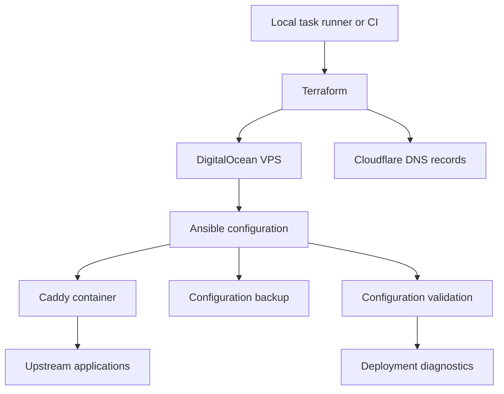

My reverse-proxy project uses Caddy on a DigitalOcean VPS, with Cloudflare DNS. Terraform creates the infrastructure, Ansible configures it, and separate checks examine the resulting service.

This article describes the repository as reviewed on October 22, 2026. The source is private, so the diagram is deliberately simplified and contains no real domains, addresses or credentials. I reviewed the code without running a deployment.

<!--more-->

## Two kinds of change

Terraform manages the infrastructure layer. The DNS configuration defines apex and wildcard records, including IPv6 variants. Ansible handles the server and application configuration. A `justfile` provides entry points for provisioning, deployment and validation.

The arrows describe responsibilities, not a guarantee that every command follows the same path. The important boundary is ownership: DNS changes should not be independently managed by two automation systems.

## Read the deployment order

The Caddy role starts with backup tasks, optionally prepares a CrowdSec bouncer, sets up the container, and then includes configuration-validation tasks. Those tasks check endpoint structure and TLS-provider references. For example, an endpoint needs a hostname and an upstream, redirect or wildcard configuration.

That catches a different class of problem from an HTTP probe. A configuration can be structurally valid while its upstream application is unavailable. Conversely, an existing service can still answer requests while a proposed configuration is invalid.

The repository also contains roles for Umami analytics, WireGuard and system setup. Their presence does not mean every deployment enables all of them.

## A response is not the same as a healthy application

The health-check task file includes container, admin API, HTTP, HTTPS, metrics and certificate diagnostics. Several checks intentionally avoid failing the playbook. Some accept responses such as **404, 502 or 503** as well as successful status codes.

Those responses can establish that a proxy is reachable. They cannot establish that a user-facing application works. A useful deployment gate needs an expected response from the relevant application, not simply any response from the proxy.

There is another distinction worth keeping visible: the reviewed role entry point does not directly include the health-check task file. Its deployment summary leaves several health fields unset. A task file existing in a repository is not evidence that a particular deployment executed it.

## Backup is a prerequisite, not a rollback guarantee

The rollback tasks look for an available configuration backup, restore it when possible and attempt to restart the container. The role entry point places its rescue block after earlier task includes. I would not describe that as automatic recovery from every deployment failure.

For future changes, the checks I want are concrete: a known-good backup, a tested restoration path, explicit application-level health criteria, and a failure that actually stops promotion. This review does not claim those improvements have already been implemented.

*Source basis: the private repository README, Terraform DNS resource declarations, and Caddy role entry-point, validation, health-check and rollback tasks. Operational configuration and secrets are omitted.*
