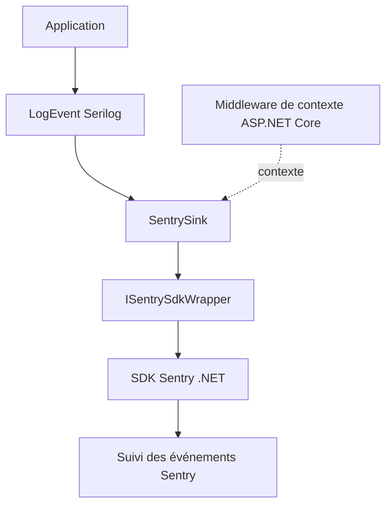



Un log indique qu’un événement a eu lieu. Pour enquêter sur une erreur, il faut aussi l’exception, la version, l’environnement et parfois le contexte de la requête. **Serilog.Sinks.SentrySDK** relie ces deux vues.


Le projet est basé sur **serilog-contrib/serilog-sinks-sentry**. Ses étoiles GitHub concernent ce dépôt, pas l’adoption totale de Serilog ou de Sentry.

<!--more-->

## Le rôle de l’adaptateur



[`SentrySink.cs`](https://github.com/antoinebou12/Serilog.Sinks.SentrySDK/blob/main/src/Serilog.Sinks.SentrySDK/SentrySink.cs) implémente `ILogEventSink` et `IDisposable`. L’interface `ISentrySdkWrapper` abstrait la capture de messages, d’exceptions et la création de transactions. Cette frontière facilite aussi les tests.

## Une seule initialisation

Le sink configure Sentry lui-même. Son constructeur refuse un DSN vide, prépare les options et conserve le handle d’initialisation. Le README déconseille une deuxième initialisation indépendante avec `SentrySdk.Init` dans le même processus.

C’est particulièrement facile à oublier dans une application web qui initialise déjà son monitoring. Il faut choisir le propriétaire de cette initialisation avant d’ajouter le sink.

```sh
dotnet add package Serilog.Sinks.SentrySDK
```

Les exemples console et ASP.NET Core du dépôt donnent les configurations à suivre pour la version installée.

## Choisir le contexte transmis

Le projet ASP.NET Core comprend un adaptateur de requête, une politique de déstructuration, des extensions d’exception et un middleware de contexte. Ces informations aident au diagnostic, mais il faut choisir ce qui doit quitter l’application.

Le sink expose des options avancées et un callback `beforeSend`. Le code documente son ordre d’exécution par rapport au mapping EventId. C’est utile pour filtrer ou enrichir les événements sans effacer le travail du sink.

## Packages et statistiques

Le README décrit deux packages principaux ciblant **net6.0 et net10.0**, plus des variantes `.6` et `.10`. Il s’agit des cibles des packages, pas d’un avis sur le cycle de support des runtimes.

[](https://www.nuget.org/packages/Serilog.Sinks.SentrySDK)

Ce badge montre le **compteur courant de ce package**. Il n’additionne pas les variantes, et un téléchargement ne correspond pas forcément à une installation active. Les statistiques GitHub datées restent distinctes.

## Ce que les vérifications démontrent

Le dépôt documente les tests xUnit, la couverture et les contrôles de formatage. Les liens CI permettent de consulter leurs résultats. Cet article ne prétend pas avoir relancé ces tests et n’invente aucun pourcentage de couverture.

## Sources

- [README et packages](https://github.com/antoinebou12/Serilog.Sinks.SentrySDK)
- [Implémentation du sink](https://github.com/antoinebou12/Serilog.Sinks.SentrySDK/blob/main/src/Serilog.Sinks.SentrySDK/SentrySink.cs)
- [Exemples console et web](https://github.com/antoinebou12/Serilog.Sinks.SentrySDK/tree/main/demos)
- [Statistiques NuGet](https://www.nuget.org/packages/Serilog.Sinks.SentrySDK)
