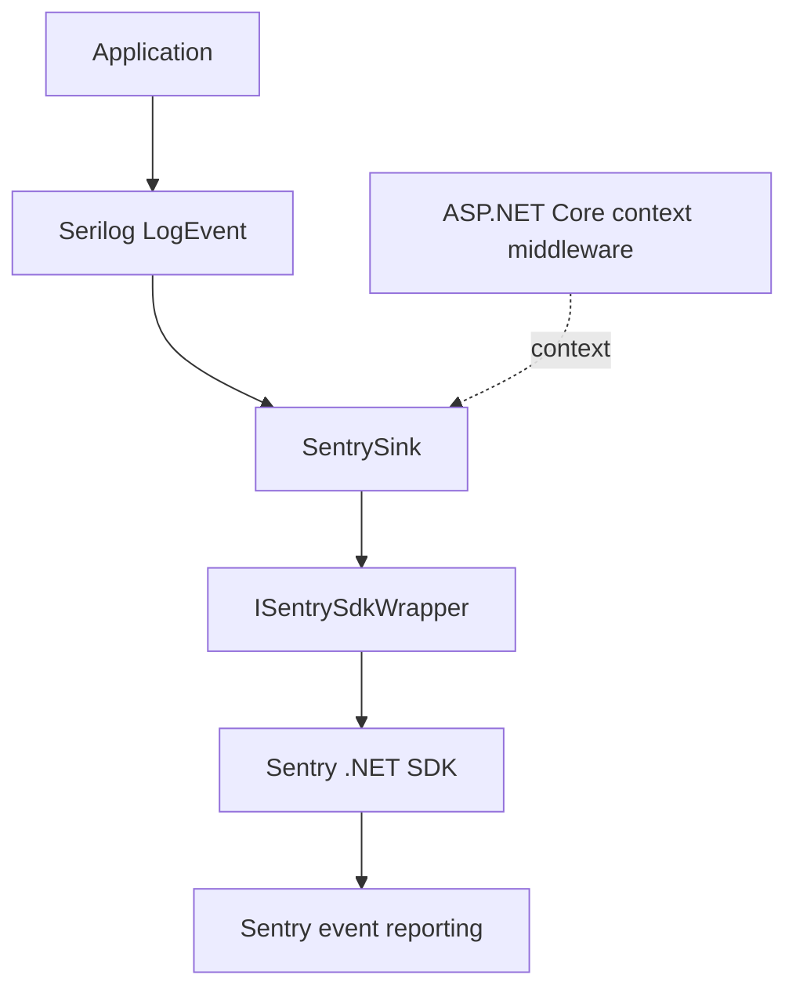



A log line tells you that something happened. An error event becomes useful when it also carries the exception, release, environment, and request context needed to investigate it. **Serilog.Sinks.SentrySDK** connects those two views.


This project is based on **serilog-contrib/serilog-sinks-sentry**. Its own GitHub stars measure interest in this repository, not total Serilog or Sentry adoption.

<!--more-->

## The adapter boundary



[`SentrySink.cs`](https://github.com/antoinebou12/Serilog.Sinks.SentrySDK/blob/main/src/Serilog.Sinks.SentrySDK/SentrySink.cs) implements `ILogEventSink` and `IDisposable`. An `ISentrySdkWrapper` abstracts message capture, exception capture, and transaction creation. That boundary also makes SDK interactions replaceable in tests.

## Initialize once

The sink configures Sentry internally. Its constructor rejects an empty DSN, prepares options, and owns an initialization handle. The README warns against adding a second independent `SentrySdk.Init` in the same process.

This is easy to miss in a web application that already initializes monitoring elsewhere. Decide who owns initialization before adding the sink.

```sh
dotnet add package Serilog.Sinks.SentrySDK
```

The repository includes console and ASP.NET Core demos. Use their configuration examples for the installed version rather than copying an arbitrary overload from an older package.

## Context needs deliberate handling

The companion ASP.NET Core project contains a request adapter, destructuring policy, exception extensions, and context middleware. Request context helps diagnose failures, but it should be selected deliberately. Review PII settings and filtering before sending application data.

The sink exposes advanced options and a `beforeSend` callback. Its code documents callback ordering around EventId mapping; that is useful when filtering or enriching events without overwriting the sink’s own mapping.

## Packages and adoption

The current README describes two main package IDs that target **net6.0 and net10.0**, plus separate `.6` and `.10` variants. This describes package targets, not a recommendation about runtime support lifecycles.

[](https://www.nuget.org/packages/Serilog.Sinks.SentrySDK)

The badge is a **live download count for that package ID**. It excludes the separately published variants, and downloads are not the same as active installations. The dated repository snapshot above is kept separate.

## What the checks establish

The README documents xUnit tests, coverage collection, and formatting checks. CI and release badges are linked evidence; this article does not claim those checks were rerun here or invent a coverage percentage.

## Sources

- [README and package matrix](https://github.com/antoinebou12/Serilog.Sinks.SentrySDK)
- [Sink implementation](https://github.com/antoinebou12/Serilog.Sinks.SentrySDK/blob/main/src/Serilog.Sinks.SentrySDK/SentrySink.cs)
- [Console and web demos](https://github.com/antoinebou12/Serilog.Sinks.SentrySDK/tree/main/demos)
- [NuGet package statistics](https://www.nuget.org/packages/Serilog.Sinks.SentrySDK)
