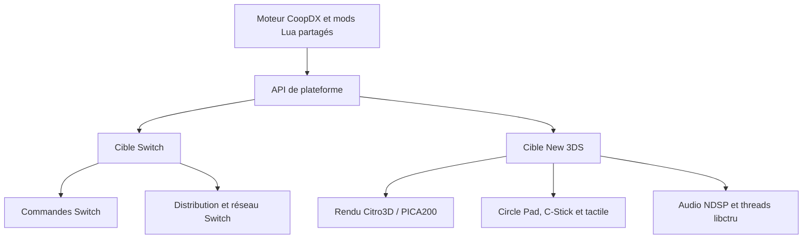



Le travail d’un port console dépasse largement un drapeau de compilation. **sm64coopdx-switch-N3DS** adapte le moteur Coop Deluxe à deux consoles portables très différentes. Les changements portent surtout sur le rendu, les commandes, l’audio, les threads et la distribution.

Le projet repose sur **sm64coopdx de la Coop Deluxe Team**, qui poursuit sm64ex-coop de djoslin0. Le moteur multijoueur et l’écosystème Lua viennent de ces projets. Ici, le sujet est l’adaptation aux consoles.

<!--more-->

## Un moteur, plusieurs services matériels



Les [notes du port New 3DS](https://github.com/antoinebou12/sm64coopdx-switch-N3DS/blob/main/docs/new3ds-port.md) imposent une séparation nette : cette cible ne doit ajouter **aucune dépendance libctru, Citro3D ou devkitARM** aux builds PC et Switch.

## Traduire le rendu pour PICA200

Le backend New 3DS implémente l’API graphique de CoopDX avec Citro3D et PICA200. Il traduit les combinaisons de couleurs courantes vers les étapes TEV et gère notamment les textures, la profondeur, le scissor, le mélange et le brouillard.

Il signale aussi les combinaisons dégradées. Compiler ne suffit pas à prouver la fidélité du rendu : ces diagnostics montrent précisément les effets que le GPU ne peut pas encore représenter correctement.

L’interface tient compte de l’écran supérieur de 400×240 et de l’écran inférieur de 320×240. Les commandes natives relient le Circle Pad au déplacement et le C-Stick à la caméra. L’audio NDSP utilise des buffers bornés en PCM16 stéréo.

## Valider la plateforme avant le jeu

Deux chemins existent : une petite application de démarrage dans `Makefile.new3ds` et l’intégration complète dans `Makefile.new3ds-game`.

```sh
make -f Makefile.new3ds port-smoke -j2
make -f Makefile.new3ds-game new3ds-integration-smoke -j2
```

Ce sont des commandes documentées, pas des essais exécutés pour cet article. Les fichiers Docker Compose et les répertoires de build séparés évitent de mélanger les toolchains Switch et New 3DS.

## Un fichier de release ne prouve pas la jouabilité

Le README propose une release New 3DS, mais les notes détaillées demandent encore de **ne pas présenter le port comme jouable** et indiquent que le jeu sur appareil reste non vérifié. Un artefact disponible ne démontre donc pas la stabilité ni la compatibilité multijoueur.

La documentation Switch couvre CoopNet, le réseau local sans fil, le clavier en jeu, les diagnostics de crash et la distribution. Le [guide d’installation](https://github.com/antoinebou12/sm64coopdx-switch-N3DS/blob/main/docs/SWITCH_INSTALL.md) donne les instructions à jour.

Le build exige votre propre ROM nord-américaine de SM64 obtenue légalement. Cet article ne fournit ni ROM ni ressources extraites du jeu.

## Sources

- [Dépôt et README](https://github.com/antoinebou12/sm64coopdx-switch-N3DS)
- [Architecture New 3DS et état de validation](https://github.com/antoinebou12/sm64coopdx-switch-N3DS/blob/main/docs/new3ds-port.md)
- [Compilation Switch](https://github.com/antoinebou12/sm64coopdx-switch-N3DS/blob/main/docs/switch.md)
- [Adaptateur de commandes Switch](https://github.com/antoinebou12/sm64coopdx-switch-N3DS/blob/main/src/pc/controller/controller_switch.c)
