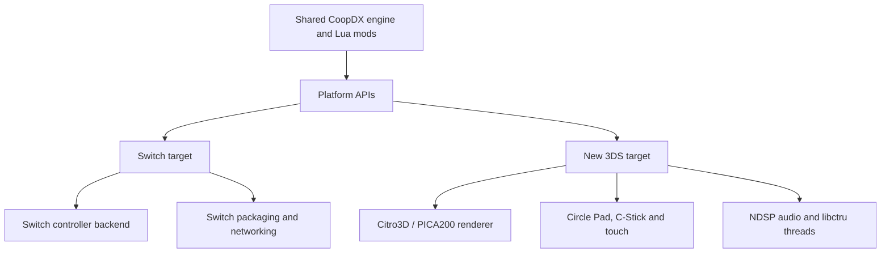



The interesting part of a console port is rarely a single compiler flag. **sm64coopdx-switch-N3DS** brings the Coop Deluxe engine to two very different handheld targets. The work lives at the platform boundary: graphics, input, audio, threading, and packaging.

This fork builds on the **Coop Deluxe Team’s sm64coopdx**, which continues djoslin0’s sm64ex-coop. The multiplayer engine and Lua ecosystem are upstream work; the console adapters are the focus here.

<!--more-->

## One engine, different platform services



The repository’s [New 3DS port notes](https://github.com/antoinebou12/sm64coopdx-switch-N3DS/blob/main/docs/new3ds-port.md) explicitly require that desktop and Switch builds gain **no libctru, Citro3D, or devkitARM dependencies** from the new target. That is the architectural constraint worth preserving.

## New 3DS is a graphics translation problem

The New 3DS backend implements CoopDX’s rendering API through Citro3D and PICA200. It translates common color-combiner paths into TEV stages, handles texture swizzling, depth, scissor, blending, and fog, and reports degraded combiner cases.

That last point matters. A backend that compiles is not automatically a faithful renderer. Explicit diagnostics tell you where the target GPU cannot represent an effect in the initial implementation.

The hardware foundation also separates the 400×240 top screen from the 320×240 bottom screen. Native controls map Circle Pad movement and C-Stick camera input. NDSP uses bounded buffers for stereo PCM16 audio.

## Build the shell before the game

There are two New 3DS paths: a small platform shell in `Makefile.new3ds`, and full-game integration in `Makefile.new3ds-game`.

```sh
make -f Makefile.new3ds port-smoke -j2
make -f Makefile.new3ds-game new3ds-integration-smoke -j2
```

These are documented compile checks, not commands I ran as part of writing this article. Separate Docker compose files and build subtrees keep the Switch and New 3DS toolchains apart.

## Release files do not settle hardware status

The README links a New 3DS release, while the detailed port notes still say **not to call the port playable** and describe hardware gameplay as unverified. Those signals should be read together: an artifact exists, but that alone does not establish stability or full multiplayer compatibility.

Switch documentation covers CoopNet, local wireless, an in-game keypad, crash diagnostics, and packaging. Consult the [Switch installation guide](https://github.com/antoinebou12/sm64coopdx-switch-N3DS/blob/main/docs/SWITCH_INSTALL.md) for current instructions.

Builds require your own legally obtained North American SM64 ROM. This article supplies no ROM or extracted game assets.

## Source trail

- [Repository and README](https://github.com/antoinebou12/sm64coopdx-switch-N3DS)
- [New 3DS architecture and verification status](https://github.com/antoinebou12/sm64coopdx-switch-N3DS/blob/main/docs/new3ds-port.md)
- [Switch build notes](https://github.com/antoinebou12/sm64coopdx-switch-N3DS/blob/main/docs/switch.md)
- [Switch controller adapter](https://github.com/antoinebou12/sm64coopdx-switch-N3DS/blob/main/src/pc/controller/controller_switch.c)
