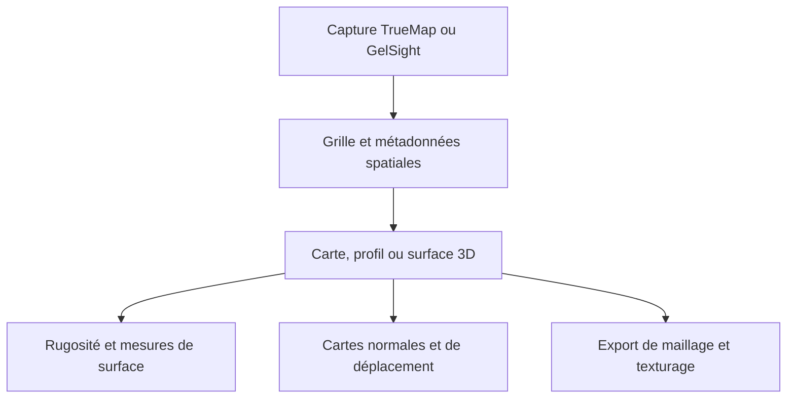

TrueMapData lit les captures de surface TrueMap et GelSight, expose leurs hauteurs sous forme de tableaux NumPy et fournit des outils d’analyse et d’export graphique. La même représentation sert à étudier une surface ou à produire des cartes de déplacement et des maillages.

<!--more-->

## Ce que contient une capture

Un fichier `.tmd` contient un en-tête, des métadonnées spatiales et une grille de hauteurs. La bibliothèque lit le format historique v1 et le format v2 de type TrueMap v6. Les deux stockent des échantillons `float32` par lignes : `height_map[ligne, colonne]`, de forme `(height, width)`. Les longueurs et les décalages décrivent l’étendue physique de la capture.

Ces métadonnées restent importantes après la lecture. Une texture peut couvrir n’importe quelle plage UV, mais une surface mesurée doit conserver son pas d’échantillonnage pour garder son échelle physique. Le [guide du format binaire](https://github.com/ETSim/TrueMapData/blob/main/docs/user-guide/working-with-tmd-files.md) décrit les octets et les vérifications des en-têtes v2 alternatifs.

```python
from tmd import TMD

capture = TMD.load("path/to/capture.tmd")
heights = capture.height_map
metadata = capture.metadata
```

Le chemin est un exemple à remplacer par une capture. Le code lit ensemble la grille et ses métadonnées.

## Examiner la surface avant l’export

Les commandes proposent une carte de chaleur 2D, une surface 3D, des profils par ligne ou colonne, des contours et des comparaisons entre fichiers. Matplotlib produit des figures statiques. Plotly peut enregistrer une vue HTML interactive. Le support optionnel de Polyscope ouvre une fenêtre d’inspection 3D.



```shell
pip install "truemapdata[viz]"
tmd-process visualize basic path/to/capture.tmd
tmd-process visualize 3d path/to/capture.tmd --plotter plotly --output surface.html
```

Je vérifie le champ de hauteur et son échelle avant de choisir une carte dérivée. Une carte normale décrit l’orientation locale pour l’éclairage. Une carte de déplacement porte la hauteur. Avec les dépendances de maillage optionnelles, l’export produit notamment des fichiers STL, OBJ, PLY, glTF et USD.



Le parcours apply-on-mesh regroupe les textures dérivées avec un modèle OBJ/MTL. Les bornes du modèle, `mm_per_pixel` et les dimensions de capture déterminent le pavage. La taille du scan reste ainsi liée à la surface qui reçoit la texture.

## Rugosité et usure

La rugosité décrit une surface à un instant donné. L’extension `truemapdata[roughness]` utilise Surfalize pour les paramètres surfaciques ISO 25178. Surfalize est sous licence GPL-3.0 et s’installe séparément du cœur sous licence MIT.

L’analyse d’usure compare plusieurs captures. Avant de soustraire les hauteurs, les images doivent partager la même grille et la même région dans le plan. Le [guide des séquences](https://github.com/ETSim/TrueMapData/blob/main/docs/user-guide/sequential-wear-analysis.md) décrit l’alignement par translation et le recalage OpenCV/SIFT, dont le recalage à partir des normales.

La convention est `hauteur de référence − hauteur courante`. Une perte positive signifie que la surface courante est plus basse. Le calcul d’un volume physique demande aussi le pas des pixels dans les deux directions. Une erreur de recalage ou des unités incohérentes modifient ce résultat.

Les commandes `tmd-wear` couvrent les séries de volume, l’évolution des rayures, les heuristiques d’axe de glissement et les trajectoires de rugosité. Elles complètent les filtres, la détection de défauts, l’export de séquences et la compression de `tmd-process`.

## Sources et exemples

Les figures de surface et de profil viennent des [exemples du README](https://github.com/ETSim/TrueMapData#visual-examples). Ce ne sont pas des mesures de mon mémoire. La figure de surface utilise des hauteurs normalisées.

La [note TrueMapData]() rassemble les liens vers le dépôt et son architecture.

- [Dépôt TrueMapData](https://github.com/ETSim/TrueMapData)
- [Documentation](https://etstribology.github.io/TrueMapData/)
- [Guide de visualisation](https://github.com/ETSim/TrueMapData/blob/main/docs/user-guide/visualization.md)
