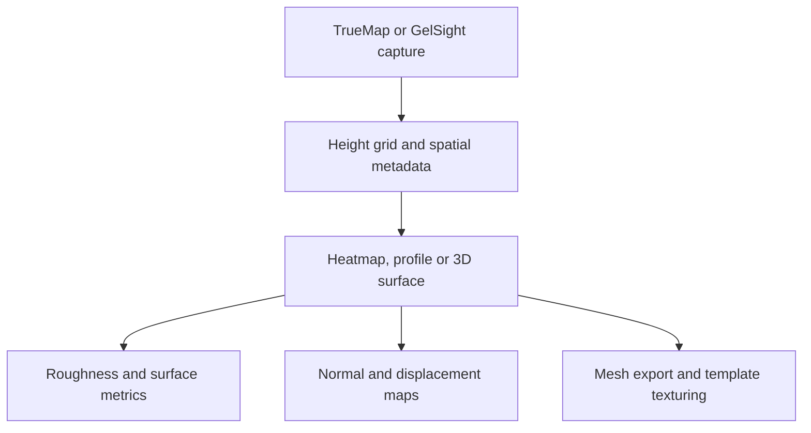

TrueMapData reads surface captures from TrueMap and GelSight, exposes their heights as NumPy arrays, and provides tools for analysis and graphics export. The same surface representation supports metrology work and assets such as displacement maps or meshes.

<!--more-->

## What a capture contains

A `.tmd` file contains a header, spatial metadata and a grid of heights. The library supports the legacy v1 format and the TrueMap v6-style v2 format. Both store `float32` samples in row-major order: `height_map[row, column]`, with shape `(height, width)`. Scan lengths and offsets describe the capture’s physical extent.

That metadata matters when a grid leaves the file reader. A texture can stretch over any UV range; a measured surface needs its sample spacing to retain physical scale. The [binary format guide](https://github.com/ETSim/TrueMapData/blob/main/docs/user-guide/working-with-tmd-files.md) documents the byte layout and the reader’s checks for alternate v2 headers.

```python
from tmd import TMD

capture = TMD.load("path/to/capture.tmd")
heights = capture.height_map
metadata = capture.metadata
```

The path above is a placeholder for a capture. The code reads the raster and metadata together.

## Inspect the surface before exporting it

The visualization commands offer a 2D heatmap, a 3D surface, row and column profiles, contours, and comparisons between files. Matplotlib produces static plots; Plotly can save an interactive HTML view. Optional Polyscope support provides a 3D inspection window.



```shell
pip install "truemapdata[viz]"
tmd-process visualize basic path/to/capture.tmd
tmd-process visualize 3d path/to/capture.tmd --plotter plotly --output surface.html
```

I check the height field and its scale before choosing a derived map. A normal map describes local orientation for shading. A displacement map carries height information. Mesh export creates geometry in formats including STL, OBJ, PLY, glTF and USD, with the optional mesh dependencies installed.



The apply-on-mesh path bundles derived textures with a template OBJ/MTL. It uses template bounds, `mm_per_pixel` and capture dimensions to set tiling. This connects the size of the scan to the surface receiving the texture.

## Roughness and wear answer different questions

Roughness analysis describes a surface at a particular capture. The optional `truemapdata[roughness]` extra uses Surfalize for ISO 25178 areal parameters. Surfalize is GPL-3.0 and is installed separately from the MIT-licensed core package.

Wear analysis compares captures over time. Before subtracting heights, the frames need the same grid and the same in-plane region. The [sequence guide](https://github.com/ETSim/TrueMapData/blob/main/docs/user-guide/sequential-wear-analysis.md) describes translation alignment and OpenCV/SIFT registration, including registration driven by normals.

The loss convention is `reference height − current height`. Positive loss means the current surface is lower than the reference. Computing a physical volume also needs the pixel spacing in both directions. Registration errors or inconsistent height units would change that result.

The `tmd-wear` commands cover volume series, scratch evolution, slip-axis heuristics and roughness trajectories. Those outputs complement the filters, defect detection, sequence export and compression tools in `tmd-process`.

## Source and examples

The surface and profile figures here are original examples from the [repository README](https://github.com/ETSim/TrueMapData#visual-examples), not measurements from my thesis. The surface figure uses normalized heights.

The [TrueMapData project note]() links the repository and its code overview.

- [TrueMapData repository](https://github.com/ETSim/TrueMapData)
- [Documentation](https://etstribology.github.io/TrueMapData/)
- [Visualization guide](https://github.com/ETSim/TrueMapData/blob/main/docs/user-guide/visualization.md)
