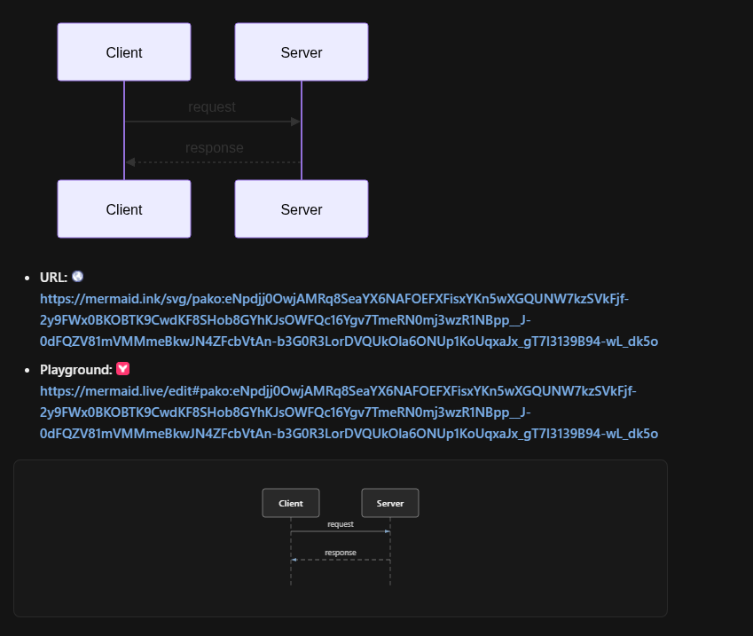
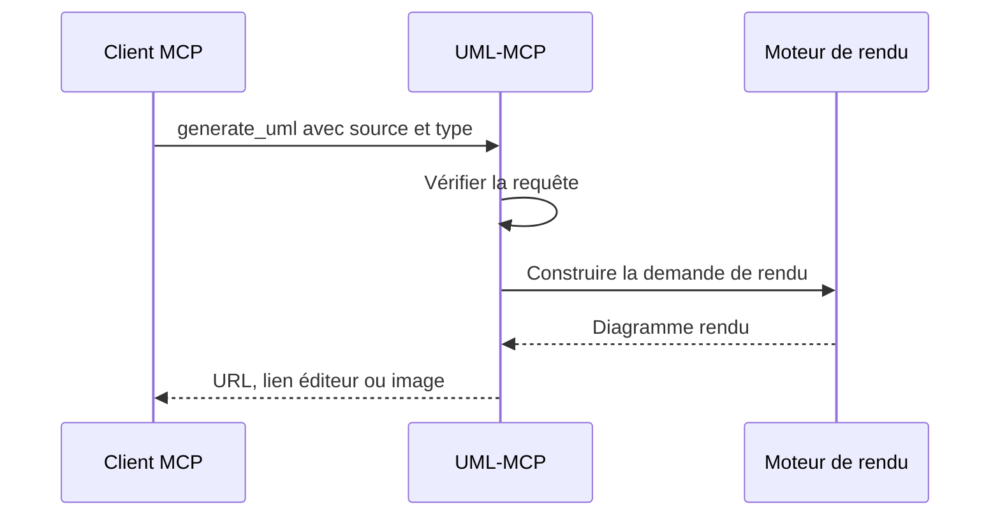

**[uml-mcp](https://github.com/antoinebou12/uml-mcp)** fournit de vrais outils de diagrammes aux clients MCP : l’assistant transmet une source Mermaid, PlantUML ou un autre format pris en charge, puis le serveur renvoie un rendu et des liens. Le dépôt documente cinq outils et environ 37 types via Kroki. Ces chiffres décrivent l’interface, pas un benchmark. **[English version]()**.



<!--more-->

## Du code Mermaid aux liens

Le module [`tools/kroki/mermaid.py`](https://github.com/antoinebou12/uml-mcp/blob/main/tools/kroki/mermaid.py) construit un état JSON, le compresse avec zlib et l’encode en base64 compatible avec les URL. Cette source alimente un lien d’image et un lien d’édition mermaid.live.

Le code distingue le SVG, servi sous `/svg/`, des images PNG/JPEG/WebP sous `/img/?type=...`. Une erreur de chemin peut donc casser un diagramme même si la source Mermaid est correcte.

Le dépôt propose aussi `generate_uml_image`, `validate_uml`, `list_diagram_types` et `generate_uml_batch`. Le choix dépend du besoin : aperçu dans le chat, contrôle de la source ou plusieurs rendus.

## Le serveur a aussi une interface d’administration

Le README actuel documente `uml-mcp admin`, des métriques et un playground Kroki. Ces outils aident à distinguer une mauvaise source, un moteur indisponible et un problème de configuration. Ils ne remplacent pas la vérification du diagramme produit.

Pour un autre usage de la même idée, voir [ComfyUI-UML]().

## Pourquoi MCP plutôt que des gabarits copiés-collés ?

J'ai commencé avec les plugins ChatGPT ([plugin D2C OpenAI]()) et les [gabarits AIPRM](). Les deux marchent, mais les éditeurs voulaient des **outils natifs** : activer un serveur une fois, appeler `generate_uml` depuis l'agent, sauver `.mmd` + SVG à côté de l'article. MCP est cette couche — même idée que le plugin, autre hôte.

## Formats supportés

| Backend | Usage |
|---------|--------|
| **Mermaid** | Flux GitHub-native, séquences rapides |
| **PlantUML** | UML classique, déploiements |
| **Kroki** | Rendu unifié quand on mélange les formats |

Point de terminaison : [uml-mcp.vercel.app/mcp](https://uml-mcp.vercel.app/mcp). Site doc : [antoinebou12.github.io/uml-mcp](https://antoinebou12.github.io/uml-mcp/).

## Cursor (résumé)

1. Cloner ou installer depuis **[github.com/antoinebou12/uml-mcp](https://github.com/antoinebou12/uml-mcp)** (bloc config MCP dans le README).
2. Ajouter le serveur dans les réglages MCP de Cursor.
3. Demander le type de diagramme explicitement — ex. « séquence Mermaid : utilisateur, React, FastAPI, Postgres, login avec cache miss ».

J'utilise uml-mcp sur ce blog pour pipelines et parcours ; voir [figurines IA]() ou [parcours ingénierie]().

## Limites

- Le modèle invente encore parfois la syntaxe — toujours valider le rendu localement.
- Pas de secrets dans les prompts ; noms de services, pas de credentials prod.
- L'histoire plugin OpenAI a migré vers GPT personnalisé + MCP ; le post D2C reste le contexte historique.

## Page projet

Badges et liens : **[page projet uml-mcp]()**.

## Articles liés

- [Plugin D2C OpenAI]()
- [Prompts diagrammes ChatGPT et AIPRM]()
- [Homebrew portable]()
