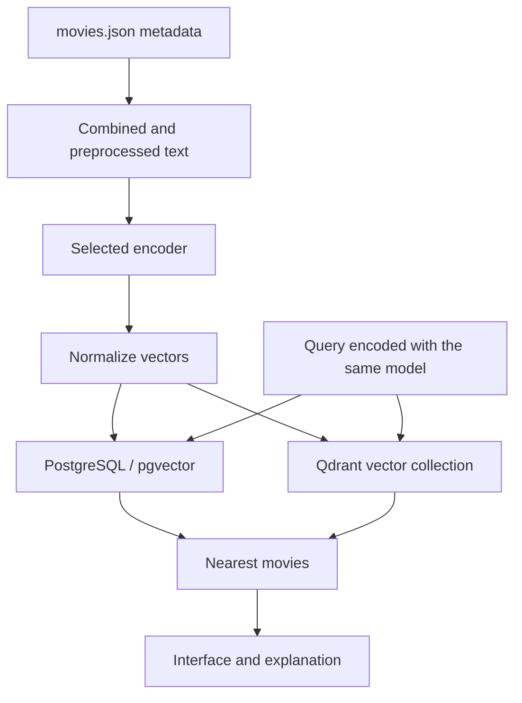
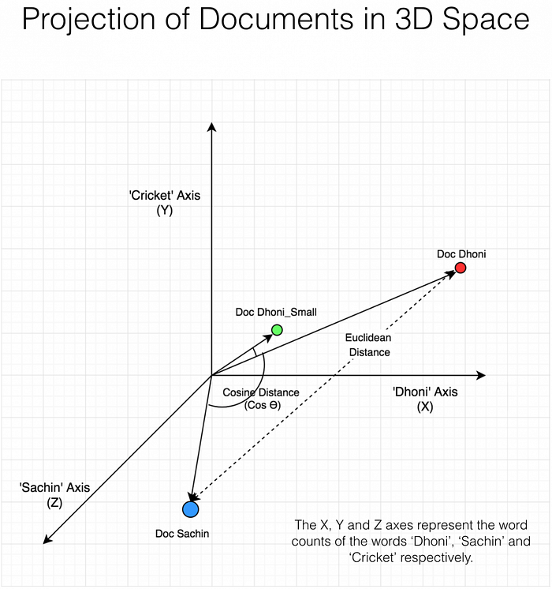
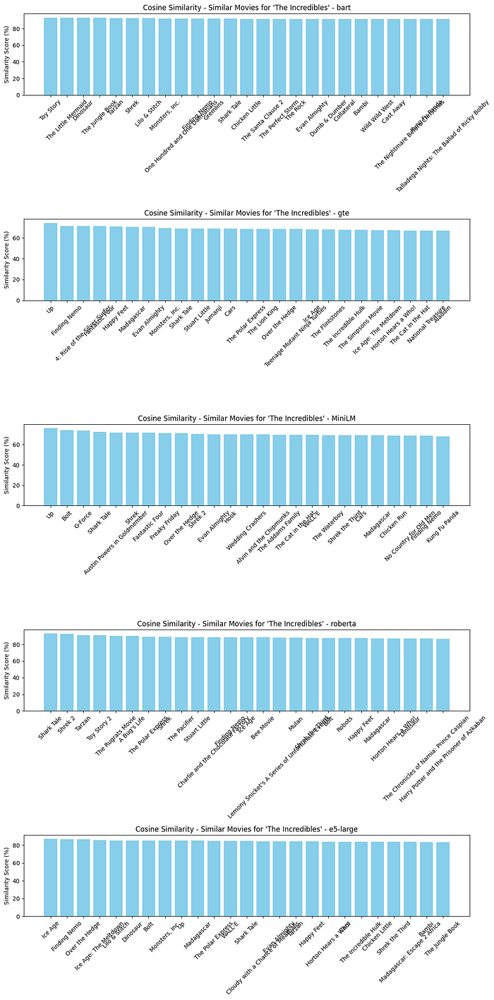
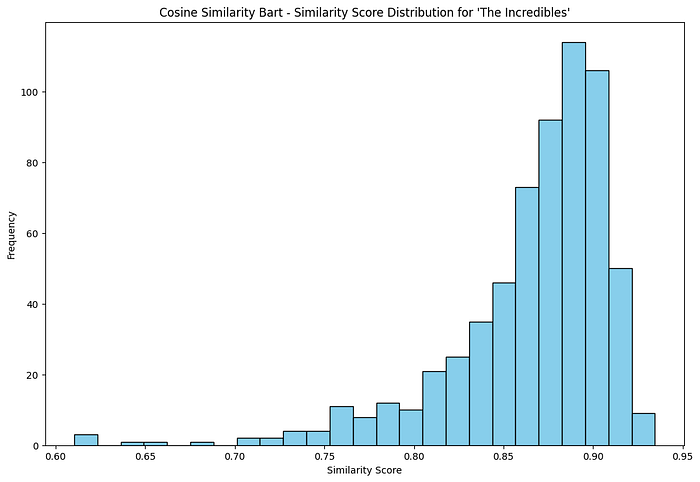
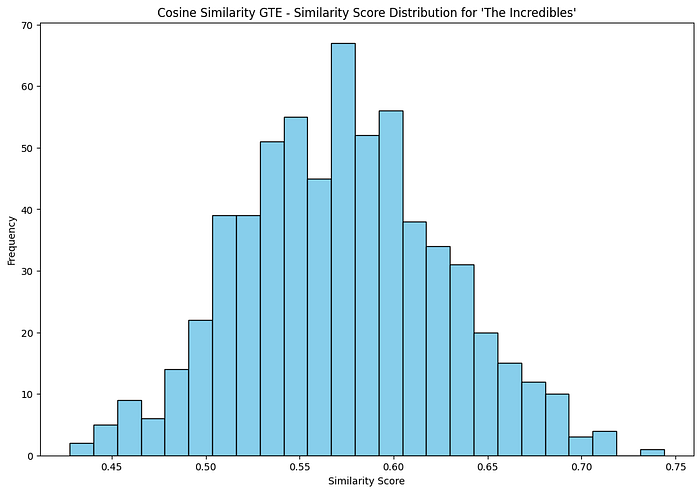
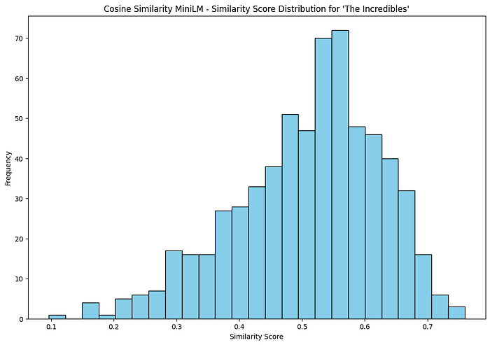
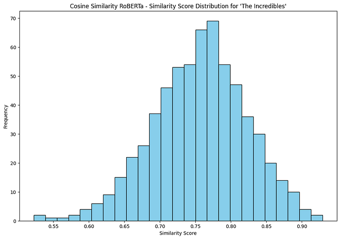
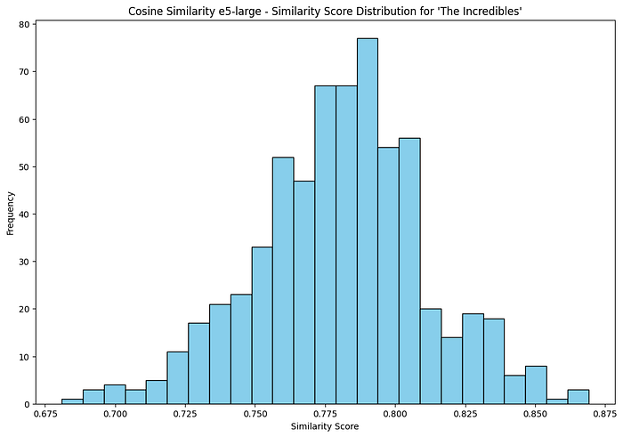
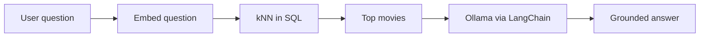

I taught a thread on “find movies like this” that kept growing: **embeddings in PostgreSQL**, the same idea in **Qdrant** with two different vector meanings, then **retrieval + a local LLM** grounded on the same rows. This page is the story; notebooks and animations live in [AlgoETS/SimilityVectorEmbedding](https://github.com/AlgoETS/SimilityVectorEmbedding) (see also the [project page]()). Part 2 also draws on the FastAPI teaching project I built to serve the Qdrant flows.

<!--more-->



## The original demos

These three animations come from the project README. They show recorded interfaces and processing steps, not current latency measurements.













## What the notebooks actually build

[`postgres/1.create_table.ipynb`](https://github.com/AlgoETS/SimilityVectorEmbedding/blob/main/postgres/1.create_table.ipynb) combines title, year, genres, actors, director, summary, and country into model input. It compares **five model configurations**: BART, GTE, MiniLM-L12, RoBERTa, and e5-large. This is a code inventory, not an accuracy ranking.

[`qdrant/0.simple.ipynb`](https://github.com/AlgoETS/SimilityVectorEmbedding/blob/main/qdrant/0.simple.ipynb) creates a **384-dimensional** collection with cosine distance and upserts batches of **100** points. The dimension must match the selected encoder. The notebook recreates its collection, so inspect that step before using an existing database.



This editable Mermaid replaces a static architecture screenshot. It summarizes the shared dense-vector path without pretending different encoders share one interchangeable vector space.


## The question behind all three parts

Recommendation systems usually hide three different questions:

1. **Plot language** — “films that feel like this description.”
2. **Taste overlap** — “users who rated like you.”
3. **Explainability** — “why these titles?” with text the user asked.

Parts 1–3 map to those questions. Mixing them without labeling the vector type is how demos lie.

## Part 1 — PostgreSQL, pgvector, and honest SQL

### Build the catalog

Start from structured movie JSON ([`movies.json`](https://github.com/AlgoETS/SimilityVectorEmbedding/blob/main/movies.json) in the course repo). Concatenate title, year, genres, cast, summary; encode with Sentence Transformers (MiniLM, GTE, etc.); store typed `vector` columns beside relational fields.

Why **pgvector**? Vectors stay next to SQL you already trust. Distance operators (`<=>` cosine, `<->` L2) turn kNN into `ORDER BY … LIMIT`.

```sql
SELECT title,
       1 - (embedding_minilm <=> (
         SELECT embedding_minilm FROM movies WHERE title = $1
       )) AS similarity
FROM movies
WHERE title IS DISTINCT FROM $1
ORDER BY similarity DESC
LIMIT 10;
```

Swap column names per model — the course keeps several `embedding_*` columns to compare neighborhoods side by side.

### What students learn here

- Normalizing embeddings for cosine.
- How choice of encoder shifts “similar” (BART vs MiniLM vs e5-large).
- That SQL transparency beats a black-box API when you are debugging wrong neighbors.

### What Part 1 measured

Cosine distance compares the angle between two vectors, Euclidean (L2) distance the gap between their tips. A short document and a long one about the same topic point the same way but sit at different lengths, which is why cosine is the default for text embeddings.



For *The Incredibles*, the Medium article ranked the nearest movies under five encoders (BART, GTE, MiniLM, RoBERTa, e5-large) and four measures: cosine similarity, L2 distance, inner product and Jaccard distance. The cosine panel:



The top-match bars all look alike. The score distributions over the whole catalog do not, and they say more about each encoder than the rankings:











BART gives almost every movie a high score, so a threshold like “similarity above 0.8” keeps nearly the whole catalog. MiniLM spreads the same catalog over a much wider range, which makes its rankings easier to cut. A score only means something relative to its own encoder’s distribution.

The plotting code and the other distance measures are in the [Medium Part 1](https://medium.com/@antoine.boucher012/using-vector-databases-to-find-similar-movies-algorithm-part-1-f14a244bb23d) and the `postgres/` notebooks in the repository.

## Part 2 — Qdrant, MovieLens, dense vs sparse

Same “similarity in vector space,” different **semantics**. Start with the notebook `qdrant/0.simple.ipynb`, then move to the FastAPI teaching project, which loads MovieLens 100K (1,682 movies, 943 users) and MovieLens 1M (3,883 movies, 6,040 users) into Qdrant with three collections per dataset:

| Collection | Vector type | What is encoded | Question it answers |
|------------|-------------|-----------------|---------------------|
| `<dataset>_movies` | Dense, 384 dimensions, cosine | 1M: title + genres. 100K: title + release date | “Titles that read like this query” |
| `<dataset>_ratings` | **Sparse**, named `ratings`: movieId → normalized rating | One point per user | “Users with overlapping taste” |
| `<dataset>_users` | Dense, 384 dimensions | Gender, age and occupation as text. 1M keeps four named vectors (one per attribute plus a combined one) | “Users with a similar profile” |

Two details change how you should read the results:

- **The MovieLens movie vectors do not contain plots.** They encode the title plus genres (1M) or the title plus release date (100K). The dense search here is closer to title and genre matching than to “plot language.” Only the small French `movies.json` loader embeds synopsis, cast, director and writers.
- **Ratings are centered before they become sparse values.** The 1M loader turns ratings into z-scores (subtract the mean, divide by the standard deviation). The 100K loader rescales 1–5 to the range −1 to 1. A disliked movie becomes a negative value instead of a small positive one.

### How the encoder is wired

The project loads `sentence-transformers/all-MiniLM-L6-v2` through Hugging Face `transformers` and mean-pools the last hidden state, which gives 384 dimensions. That is not the MiniLM-L12 configuration from the PostgreSQL notebooks, so vectors from the two parts are not interchangeable. Before encoding, text is lowercased, punctuation is stripped and NLTK English stopwords are removed. A query must go through the same preprocessing, or its vector drifts away from the stored ones.

### Collaborative filtering with a sparse search

The ratings path does not train a model. It turns your ratings into a sparse query, asks Qdrant for the 20 nearest users, then adds up those users’ ratings for movies you have not rated:

```python
query = rest.NamedSparseVector(name="ratings", vector=to_vector(user_ratings))
results = client.search(collection_name=f"{dataset}_ratings",
                        query_vector=query, with_vectors=True, limit=20)

movie_scores = defaultdict(float)
for user in results:
    ratings = user.vector["ratings"]
    for movie_id, rating in zip(ratings.indices, ratings.values):
        if movie_id not in user_ratings:
            movie_scores[movie_id] += rating

top_5 = sorted(movie_scores.items(), key=lambda x: x[1], reverse=True)[:5]
```

The five movie IDs are then mapped back to titles by scrolling the `_movies` collection. Because the stored ratings are centered, a neighbor who disliked a movie pulls its score down.

### The web app around it

The FastAPI app renders one Jinja2 page. You pick a dataset (MovieLens 100K or 1M) and a mode:

- **By Ratings**: an autocomplete (fed by a `/movie_names` endpoint that scrolls the movie collection) builds a list of `title:rating` pairs. The server maps titles to IDs and runs the sparse search above.
- **By Title/Genre**: free text is preprocessed, encoded with MiniLM and sent to a dense search on `<dataset>_movies`. The top five come back with their genres and scores.

`/recommendations` requires a session. Users sign in with a local account or through GitHub or Google OAuth, and their picks are saved in MongoDB. Docker Compose starts the app with Qdrant, MongoDB and Redis. The Qdrant client prefers gRPC.

### Pitfalls I found reading the code again

- **Query and stored ratings use different scales.** The form sends raw 1–5 ratings, while stored vectors are centered. A 1-star rating in the query is still positive, so it pulls toward users who *liked* that movie. The fix is to apply the loader’s normalization to the query too.
- **The title-to-ID map comes from a single scroll of 10,000 points**, rebuilt on each request. That covers both MovieLens catalogs, but a larger catalog would be silently cut off.
- **Some parts are scaffolding, not features yet.** The Redis client is created but nothing is cached. IMDb datasets can be loaded into MongoDB, but the enrichment helper is not called by any route. Recommendations from demographic profiles (the `_users` named vectors) exist only in the 1M loader’s demo, not in the API. The test suite still imports a function that no longer exists.

None of this breaks the lesson: the dense and sparse paths answer different questions, and the code makes the difference visible.

## Part 3 — RAG with LangChain + Ollama

Reuse pgvector rows as **evidence**:



Pipeline: `HuggingFaceEmbeddings` → SQL ordering by `<=>` on `embedding_MiniLM` → prompt that includes schema + retrieved rows → `Ollama(model="llama2:13b-chat")`.

The saved notebook output is instructive because it fails politely:

- LangChain warns on unknown `vector` column types.
- The LLM sometimes emits SQL that is not valid pgvector.
- Heavy models **timeout** under load.

RAG is not “embed and forget” — you need validation, smaller models, or hybrid retrieval.

Notebook: `postgres/3.LLMS.ipynb`.

## When not to use this stack

| Situation | Better path |
|-----------|-------------|
| Cold-start users with no ratings | Dense metadata only |
| Billion-scale sparse CF | Specialized CF stack, not demo Qdrant |
| Recommendations from plots on MovieLens | Add plot text first: the MovieLens vectors here only encode titles and genres or dates |
| Sub-10 ms latency at huge QPS | Managed vector DB + tuning |
| Legal need for exact quotes | RAG + citation checks, not raw LLM |

## Takeaway

**Embed → store → nearest neighbors** three times, with three meanings of “neighbor.” Part 3 teaches humility: generators drift from executable SQL unless you constrain them.

## Related posts

- [Snowflake Data-for-Breakfast]() — warehouse storytelling
- [Experimentation with technical indicators]() — another AlgoETS thread

## References

- [AlgoETS/SimilityVectorEmbedding](https://github.com/AlgoETS/SimilityVectorEmbedding)
- [Medium — Part 1](https://medium.com/@antoine.boucher012/using-vector-databases-to-find-similar-movies-algorithm-part-1-f14a244bb23d)
- [pgvector](https://github.com/pgvector/pgvector) · [Qdrant docs](https://qdrant.tech/documentation/)

---

*Originally published on [Medium](https://medium.com/@antoine.boucher012/using-vector-databases-to-find-similar-movies-algorithm-part-1-f14a244bb23d); this page merges Parts 1–3.*
