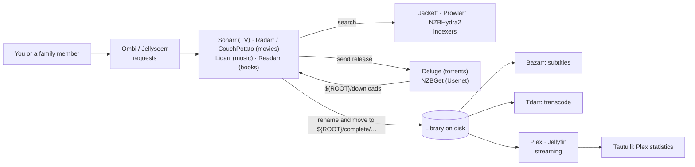

[](https://github.com/antoinebou12/MediaBoxDockerCompose)

[Repository](https://github.com/antoinebou12/MediaBoxDockerCompose) · [MIT License](https://github.com/antoinebou12/MediaBoxDockerCompose/blob/master/LICENSE)

Compose-first homelab media stack: fetch content (torrents and Usenet), route it through *Arr apps, add subtitles where needed, then serve libraries with **Plex** or **Jellyfin**, with request UIs and monitoring. Configuration is meant to live under a shared `ROOT` tree on disk as in the repo’s `docker-compose.yml`.

**Blog:** what I run in compose, Proxmox helper-scripts, and where the full wish list lives — [MediaBox homelab notes]().

For hosts that are not ready for the full stack yet, the companion [**another-install-script**](https://github.com/antoinebou12/another-install-script) repo offers menu-driven bash installers to pull up individual containers (and related dashboards) on a fresh Linux machine before you adopt this compose file.

## How the pieces connect

Everything in `docker-compose.yml` hangs off one directory, `${ROOT}` (`/media/MediaBox` in `.env`), with the same `PUID`, `PGID` and `TZ` for every container. Downloads land in `${ROOT}/downloads`, finished libraries live in `${ROOT}/complete/{tv,movies,music,books}`, and each app keeps its own state in `${ROOT}/config/<app>`.



The *Arr apps are the centre: they watch for wanted episodes or films, ask the indexers for a matching release, hand it to a download client, then import the finished file into the library with a clean name. Plex and Jellyfin only read the library; Bazarr and Tdarr work on it in place.

## Service by service

Ports are host ports from the compose file. "host" means the container uses the host's network directly, so it listens on its application's default port.

| Service | Image | Port | What it does | Mounted from `${ROOT}` |
| --- | --- | --- | --- | --- |
| Deluge | `linuxserver/deluge` | host (web UI 8112) | BitTorrent client | `downloads`, `config/deluge` |
| NZBGet | `linuxserver/nzbget` | host (6789) | Usenet downloader | `downloads`, `config` |
| Jackett | `linuxserver/jackett` | 9117 | Turns torrent sites into a Torznab API the *Arr apps can query | `downloads/torrent-blackhole`, `config/jackett` |
| NZBHydra2 | `linuxserver/hydra2` | 5076 | Meta-search across Usenet indexers | `downloads`, `config/hydra2` |
| Prowlarr | `hotio/prowlarr` | 9696 | Indexer manager that pushes indexers to the *Arr apps | `downloads`, `config/prowlarr` |
| Sonarr | `linuxserver/sonarr:preview` | 8989 | TV series automation | `complete/tv`, `downloads`, `config/sonarr` |
| Radarr | `linuxserver/radarr` | 7878 | Film automation | `complete/movies`, `downloads`, `config/radarr` |
| CouchPotato | `linuxserver/couchpotato` | 5050 | Older film automation, overlaps Radarr | `complete/movies`, `downloads` |
| Lidarr | `linuxserver/lidarr` | 8686 | Music automation | `complete/music`, `downloads/complete` |
| Readarr | `hotio/readarr` | 8787 | Book automation | `complete/books` |
| Whisparr | `ghcr.io/hotio/whisparr` | 6969 | Adult-content automation | `downloads` |
| Bazarr | `linuxserver/bazarr` | host (6767) | Fetches subtitles for the TV and film libraries | `complete/tv`, `complete/movies` |
| Tdarr | `haveagitgat/tdarr_aio` | 8265 | Transcodes the library in batches with FFmpeg/HandBrake rules | `complete`, `config/tdarr` (+ its MongoDB) |
| Plex | `plexinc/pms-docker` | 32400 + discovery ports | Media server; `PLEX_CLAIM` links it to a Plex account on first start | `complete` as `/data`, `config/plex/{db,transcode}` |
| Jellyfin | `linuxserver/jellyfin` | 8096, 8920 | Open-source media server | `complete/{tv,movies,music}` |
| Tautulli | `linuxserver/tautulli` | 8063 → 8181 | Plex watch history and statistics | `config/tautulli` |
| Ombi | `linuxserver/ombi` | 3579 | Request portal for Plex users | `config/ombi` |
| Jellyseerr | `hotio/jellyseerr` | 8097 | Request portal for Jellyfin users | `complete` |
| Stash | `hotio/stash` | 9999 | Organizer for an adult library | `complete/adult` |
| Netdata | `netdata/netdata` | 19999 | Live host metrics (reads `/proc`, `/sys`, users and groups read-only) | none |
| Dashmachine | `rmountjoy/dashmachine` | 5000 | Start page with links to every app (`dashmachine/config.ini`) | `config/dashmachine` |
| Filebrowser | `filebrowser/filebrowser` | 8999 → 80 | Web file manager over the whole `${ROOT}` tree | `${ROOT}` as `/srv` |

The `department` labels (`Media`, `System`) group the containers for dashboards that read Docker labels.

## Disk layout

```text
${ROOT}/                     /media/MediaBox by default
├── downloads/               Deluge, NZBGet, the *Arr apps, Prowlarr, NZBHydra2
│   ├── torrent-blackhole/   Jackett's download folder
│   └── complete/            Lidarr's download path
├── complete/                the libraries Plex, Jellyfin, Bazarr and Tdarr read
│   ├── tv/  movies/  music/  books/  adult/
└── config/                  one folder per app (deluge, sonarr, radarr, plex/db, plex/transcode, tdarr/db …)
```

Keeping downloads and libraries on the same filesystem lets the *Arr apps move finished files instead of copying them.

## Networking

The compose file declares no network, so Compose creates one default bridge network for the project and the containers can reach each other by container name (`http://sonarr:8989` from Ombi, for example). Deluge, NZBGet and Bazarr run with `network_mode: host`: they are reached at the host's address, so the *Arr apps must be pointed at the host IP, not at a container name.

## Optional stacks

These live in separate compose files and are started on their own:

- `extra/samba/`: `dperson/samba` shares `/mnt/MediaBox` over SMB (ports 137–139 and 445) with NetBIOS name service on.
- `extra/wireguard-access-server/`: `place1/wg-access-server`, a WireGuard VPN with a web UI on 8000 and the tunnel on UDP 51820; needs `NET_ADMIN` and `/dev/net/tun`.
- `extra/portainer/`: Portainer on 9000 and 8000 with the Docker socket mounted.
- `whisper/`: `openai-whisper-asr-webservice` with the `base` model on port 9000.
- `caddy/Caddyfile`: one site per service (`deluge.{$DOMAIN}`, `jackett.{$DOMAIN}`, `nzbget.{$DOMAIN}` …), each importing snippets for logs with rotation, error pages, reverse proxy to `localhost:<port>`, caching, rate limiting, an IP allow list, basic auth and compression.

## The install script

The repository has no installer of its own; the README's steps are "install Docker and Compose, clone, `docker-compose up -d`". The companion [another-install-script](https://github.com/antoinebou12/another-install-script) is the menu-driven installer for hosts that are not ready for the full stack:

1. `sudo bash setup.sh` sources `src/menu.sh` and opens a whiptail menu: Installation, Add Container, Remove Container, Uninstall, Backup, Help.
2. Installation can add base packages, Docker and Compose, and creates a `udocker` user in the `docker` group with `/home/udocker/{config,services,volumes,backups,downloads,tv,movies,media,audio}`, and writes `UDOCKER`, `UDOCKER_ROOT`, `UDOCKER_USERID`, `UDOCKER_GROUPID` and `TZ` to `/etc/environment`.
3. Add Container lists the 92 folders under `containers/`. For each one picked, it sources `containers/<name>/<name>.sh` and calls `create_docker_<name>`, which runs `docker-compose -f containers/<name>/docker-compose.yml up -d` and prints `http://<host-ip>:<port>`.
4. The chosen names are saved in `/home/udocker/config/containers.txt`, and `manage_firewall_ports_allow_list` reads that list to open the matching firewall ports.
5. Remove Container calls the matching `remove_docker_<name>` (`docker-compose down`); `uninstall.sh` undoes the setup.

## Quick start

1. Install [Docker](https://docs.docker.com/get-docker/) and Compose on the host.
2. Clone the repository, then edit `.env`: `ROOT`, `PUID`/`PGID` (from `id`), `TZ`, and a `PLEX_CLAIM` token from plex.tv/claim if you use Plex.
3. From the project directory:

```bash
git clone https://github.com/antoinebou12/MediaBoxDockerCompose.git
cd MediaBoxDockerCompose
docker compose up -d
```

If your setup still uses the older CLI, `docker-compose up -d` matches what the [README](https://github.com/antoinebou12/MediaBoxDockerCompose#readme) describes. Then connect the pieces in the web UIs: indexers in Prowlarr or Jackett, download clients in Sonarr and Radarr (host IP for Deluge and NZBGet), and the library folders in Plex or Jellyfin.

## Things to check before running it

- Sonarr's TV mount is written `${ROOT}/complete/tv://tv`, with a stray colon and slash.
- NZBGet mounts the whole `${ROOT}/config` as its config folder, so it sees every other app's configuration.
- Lidarr reads downloads from `${ROOT}/downloads/complete` while the download clients write to `${ROOT}/downloads`, so Lidarr may not find finished files without a remote path mapping.
- Dashmachine, Filebrowser, NZBHydra2 and Tdarr write `PUID='${PUID}'` with quotes inside the value, so the containers receive `'1000'` rather than `1000`.
- Jellyseerr's container listens on 5055 by default; the mapping `8097:8097` only works if its port is changed.
- `filebrowser/database.db` is committed; reset its users before exposing Filebrowser, which can read and write all of `${ROOT}`.
- Several images use `latest` or `preview` tags, so a rebuild can change versions.
- Portainer and Whisper both publish port 9000, and Portainer and the WireGuard UI both publish 8000, so those optional stacks cannot run together as written.
- The Caddyfile's `cache` and rate-limit directives need modules that are not in the standard Caddy build, and `allow`/`deny` is not Caddy v2 syntax (it uses `remote_ip` matchers).
- In another-install-script, `create_docker_user` sets the `udocker` password from the username variable instead of the configured password, and the user is added to sudoers.

## Documentation

Default **ports**, **credentials**, **backup/restore** notes, and **contributing** are maintained in the [README](https://github.com/antoinebou12/MediaBoxDockerCompose#readme); this page explains what the compose file does.
