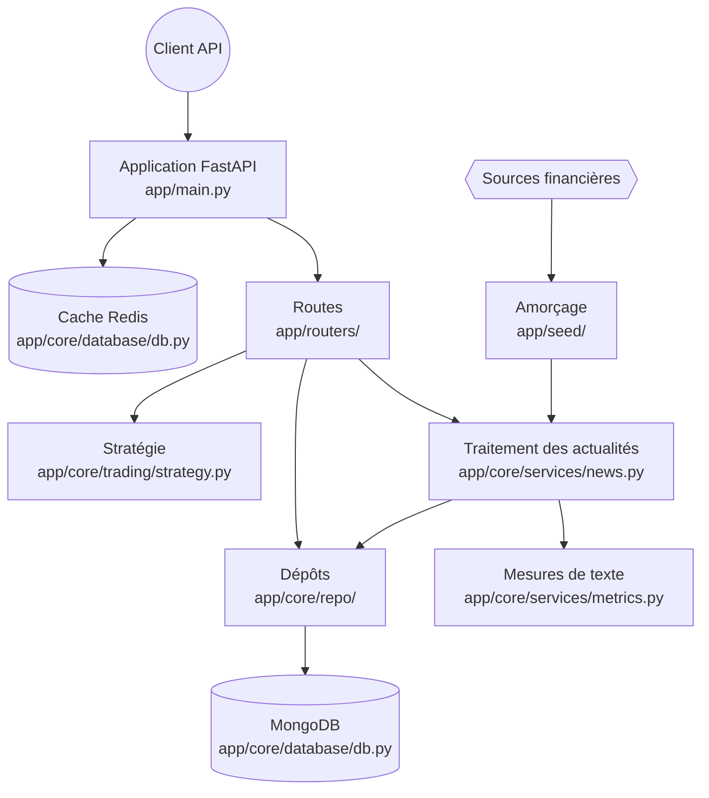

# AINewsTracker

<div class="repo-status-row"><span class="repo-badge kind">API web</span><span class="repo-badge api">API</span><span class="repo-badge docker">Docker</span></div>

<div class="repo-tech-badges"><span class="tag tool">Python</span><span class="tag tool">FastAPI</span><span class="tag tool">MongoDB</span><span class="tag tool">Redis</span><span class="tag tool">Poetry</span><span class="tag tool">Pytest</span></div>

AINewsTracker collecte des actualités financières, analyse le texte des articles et expose les données obtenues avec FastAPI. Un parcours distinct utilise les informations enregistrées pour des backtests historiques.

[Code source](https://github.com/AlgoETS/AINewsTracker) · [Documentation publiée](https://algoets.github.io/AINewsTracker/) · [GitDiagram interactif](https://gitdiagram.com/algoets/ainewstracker) · [English]()

## Aperçu {#overview}

`app/main.py` assemble le service, enregistre les groupes de routes et configure le cache Redis. Le traitement des actualités passe par un service, les mesures de texte et le dépôt d’articles avant d’atteindre MongoDB.

L’article associé, [Suivre l’actualité financière avec AINewsTracker](), suit ce parcours depuis un flux entrant jusqu’à l’article enregistré.

## Démarrage {#installation}

```shell
cp .env.example .env
pip install poetry
poetry shell
poetry install
poetry run pytest
poetry run uvicorn app.main:app --reload
```

La documentation FastAPI est disponible à `http://localhost:8000/api/v1/docs` selon le guide du projet. Avec Docker :

```shell
docker-compose up --build
```

## Guide du dépôt {#reader-guide}

- `app/main.py` crée l’application, enregistre les routes et configure le cache.
- `app/routers/` définit les routes des actualités, articles, entreprises, utilisateurs, données initiales et stratégies.
- `app/core/services/` contient le traitement des actualités et les mesures de texte.
- `app/core/repo/` contient les opérations de persistance regroupées par domaine.
- `app/models/` définit les enregistrements acceptés et retournés.
- `app/seed/` charge les entreprises et actualités depuis des sources externes.
- `app/core/trading/strategy.py` traite les demandes de stratégie.

## Fonctions {#features}

- ingérer des actualités depuis RSS, GNews et des flux configurés;
- analyser le sentiment, les sujets et l’attribution de tickers;
- gérer les articles, entreprises, actualités et utilisateurs;
- amorcer les données d’entreprises et d’actualités;
- exécuter des stratégies pour une ou plusieurs entreprises;
- fonctionner avec Poetry ou Docker Compose.

## Architecture {#architecture}

Cette vue résume les frontières d’exécution vérifiées par GitDiagram. Le [diagramme interactif complet](https://gitdiagram.com/algoets/ainewstracker) développe le modèle et relie les composants à leur code.



| Frontière | Responsabilité | Preuve |
| :-- | :-- | :-- |
| Application | Cycle FastAPI, enregistrement des routes et cache | `app/main.py` |
| Interface HTTP | Routes des actualités, articles, entreprises, utilisateurs, données initiales et stratégies | `app/routers/` |
| Analyse | Traitement des flux et mesures de texte | `app/core/services/news.py`, `app/core/services/metrics.py` |
| Données | Modèles Article, Company, News et User | `app/models/` |
| Persistance | Opérations MongoDB regroupées par domaine | `app/core/repo/` |
| Opérations | Amorçage des données et exécution de stratégies | `app/seed/`, `app/core/trading/strategy.py` |

## Contrat API {#api-contract}

| Domaine | Opérations documentées |
| :-- | :-- |
| Actualités | Créer et lire; récupérer RSS, GNews et les entrées d’un flux |
| Articles | Créer, lister, lire et supprimer; consulter le score d’un article |
| Entreprises | Créer, lister et rechercher par ticker |
| Stratégies | Exécuter une stratégie pour une entreprise ou une liste soumise |

Le document OpenAPI de l’application en cours d’exécution fait autorité pour les schémas exacts.

## Déploiement {#deployment}

Le dépôt contient un `Dockerfile` à la racine, un `docker-compose.yml` de développement et un répertoire `deploy/`. L’ordre des dépendances Compose est un ordre de démarrage, pas une garantie de disponibilité.

## Structure du code {#code-structure}

```text
app/
├── main.py
├── core/{database,repo,services,telemetry,trading}/
├── models/
├── routers/
└── seed/
tests/
deploy/
monitoring/
```

## Limites {#constraints}

- Les scores de sentiment et sujets sont des données d’analyse, pas des conseils financiers ni une preuve de causalité.
- Les backtests historiques ne garantissent pas les résultats futurs.
- Les flux et API externes ont leurs propres identifiants, disponibilités et conditions d’utilisation.
- Les routes peuvent changer; le code et le document OpenAPI actuels ont priorité.

## Sources {#source-files}

- [Dépôt GitHub](https://github.com/AlgoETS/AINewsTracker)
- [Documentation du projet](https://algoets.github.io/AINewsTracker/)
- [Architecture GitDiagram](https://gitdiagram.com/algoets/ainewstracker)
- [`app/main.py`](https://github.com/AlgoETS/AINewsTracker/blob/main/app/main.py)
- [`app/routers/news.py`](https://github.com/AlgoETS/AINewsTracker/blob/main/app/routers/news.py)
- [`app/core/services/news.py`](https://github.com/AlgoETS/AINewsTracker/blob/main/app/core/services/news.py)
- [`app/core/services/metrics.py`](https://github.com/AlgoETS/AINewsTracker/blob/main/app/core/services/metrics.py)
