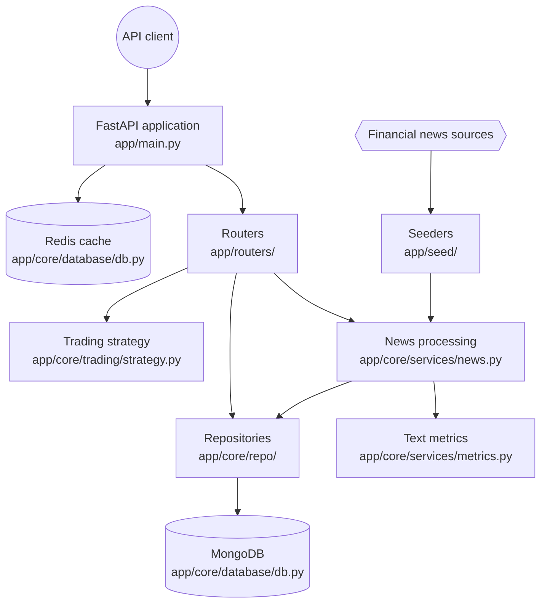

# AINewsTracker

<div class="repo-status-row"><span class="repo-badge kind">Web API</span><span class="repo-badge api">API</span><span class="repo-badge docker">Docker</span></div>

<div class="repo-tech-badges"><span class="tag tool">Python</span><span class="tag tool">FastAPI</span><span class="tag tool">MongoDB</span><span class="tag tool">Redis</span><span class="tag tool">Poetry</span><span class="tag tool">Pytest</span></div>

AINewsTracker collects financial news, analyses article text and exposes the resulting data through FastAPI. A separate strategy path uses stored information for historical backtests.

[Source code](https://github.com/AlgoETS/AINewsTracker) · [Published documentation](https://algoets.github.io/AINewsTracker/) · [Interactive GitDiagram](https://gitdiagram.com/algoets/ainewstracker) · [Français]()

## Overview {#overview}

`app/main.py` assembles the service, registers the route groups and configures Redis caching. News processing moves through a service, text metrics and the article repository before reaching MongoDB.

The companion article, [Following financial news through AINewsTracker](), follows that path from an incoming feed to a stored article.

## Getting started {#installation}

```shell
cp .env.example .env
pip install poetry
poetry shell
poetry install
poetry run pytest
poetry run uvicorn app.main:app --reload
```

FastAPI documentation is available at `http://localhost:8000/api/v1/docs` according to the project guide. Docker users can start the documented stack with:

```shell
docker-compose up --build
```

## Repository guide {#reader-guide}

- `app/main.py` creates the application, registers routers and configures caching.
- `app/routers/` defines news, article, company, user, seed and strategy endpoints.
- `app/core/services/` contains news processing and text metrics.
- `app/core/repo/` contains persistence operations grouped by domain.
- `app/models/` defines records accepted and returned by the service.
- `app/seed/` loads company and news data from external sources.
- `app/core/trading/strategy.py` handles strategy requests.

## Features {#features}

- ingest news through RSS, GNews and configured feeds;
- analyse sentiment, topics and ticker allocation;
- manage article, company, news and user records;
- seed company and news data;
- execute strategy requests for one or more companies;
- run through Poetry or Docker Compose.

## Architecture {#architecture}

This view condenses the runtime boundaries verified by GitDiagram. The [full interactive diagram](https://gitdiagram.com/algoets/ainewstracker) expands the model and links components to their source.



| Boundary | Responsibility | Evidence |
| :-- | :-- | :-- |
| Application | FastAPI lifecycle, router registration and cache setup | `app/main.py` |
| HTTP interface | News, article, company, user, seed and strategy routes | `app/routers/` |
| Analysis | Feed processing and text metrics | `app/core/services/news.py`, `app/core/services/metrics.py` |
| Domain data | Article, company, news and user models | `app/models/` |
| Persistence | MongoDB operations grouped by domain | `app/core/repo/` |
| Operations | Data seeding and strategy execution | `app/seed/`, `app/core/trading/strategy.py` |

## API contract {#api-contract}

| Area | Documented operations |
| :-- | :-- |
| News | Create and read news; fetch RSS, GNews and feed entries |
| Articles | Create, list, read and delete articles; read an article score |
| Companies | Create companies, list companies and find one by ticker |
| Strategies | Execute a strategy for one company or a submitted company list |

The running FastAPI OpenAPI document is the authority for exact request and response schemas.

## Deployment {#deployment}

The repository includes a root `Dockerfile`, a development `docker-compose.yml` and a separate `deploy/` directory. Compose dependency ordering is a startup order, not a readiness guarantee.

## Code structure {#code-structure}

```text
app/
├── main.py
├── core/{database,repo,services,telemetry,trading}/
├── models/
├── routers/
└── seed/
tests/
deploy/
monitoring/
```

## Limits {#constraints}

- Sentiment and topic labels are analytical inputs, not financial advice or proof of causation.
- Historical backtests do not guarantee future performance.
- External feeds and market APIs have their own credentials, availability and usage terms.
- Endpoint details can change; current source and OpenAPI take precedence.

## Sources {#source-files}

- [GitHub repository](https://github.com/AlgoETS/AINewsTracker)
- [Project documentation](https://algoets.github.io/AINewsTracker/)
- [GitDiagram architecture](https://gitdiagram.com/algoets/ainewstracker)
- [`app/main.py`](https://github.com/AlgoETS/AINewsTracker/blob/main/app/main.py)
- [`app/routers/news.py`](https://github.com/AlgoETS/AINewsTracker/blob/main/app/routers/news.py)
- [`app/core/services/news.py`](https://github.com/AlgoETS/AINewsTracker/blob/main/app/core/services/news.py)
- [`app/core/services/metrics.py`](https://github.com/AlgoETS/AINewsTracker/blob/main/app/core/services/metrics.py)
