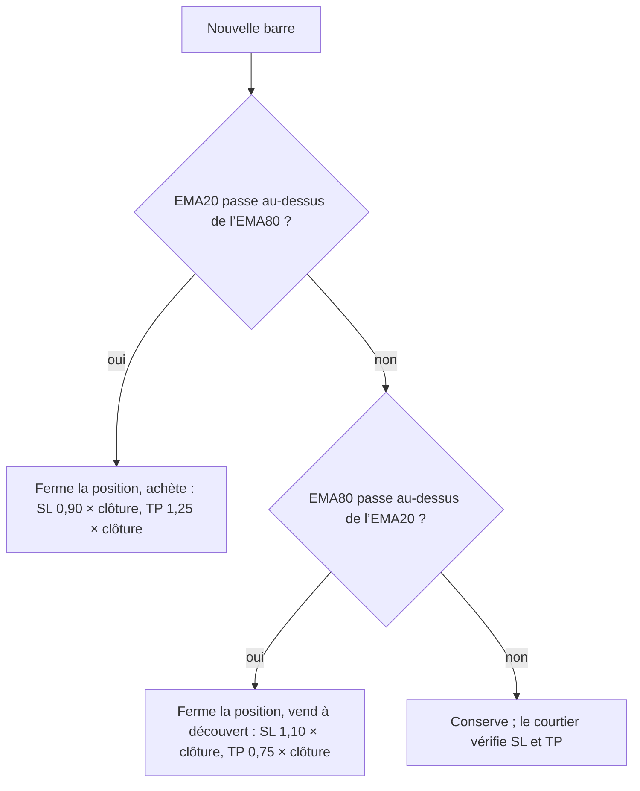
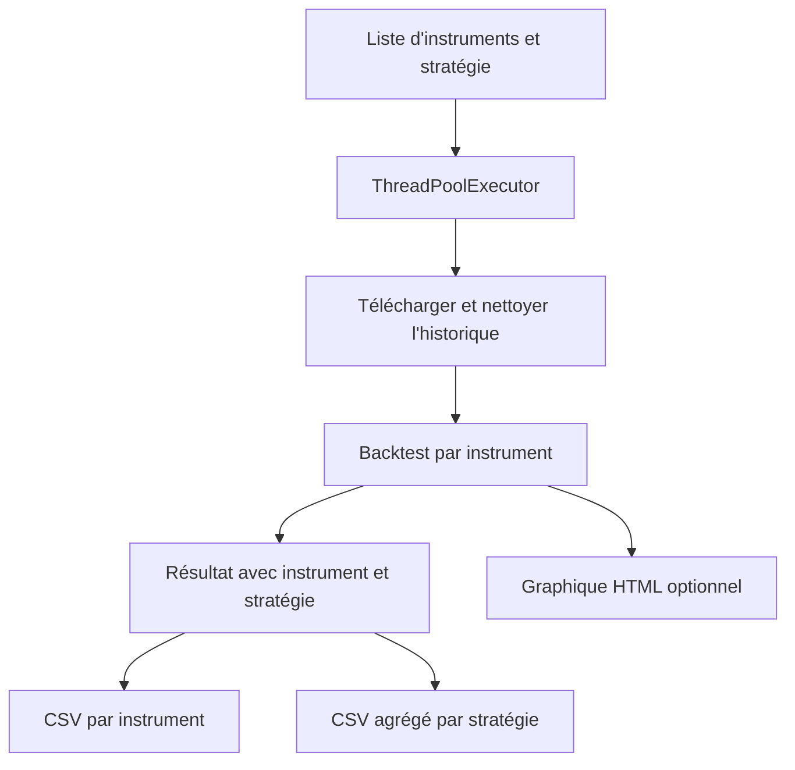

# BatchBacktesting

BatchBacktesting transforme un backtest en traitement reproductible : choisir les instruments, obtenir et nettoyer les prix, exécuter une stratégie, puis conserver des résultats comparables. C'est un dépôt [AlgoÉTS](https://github.com/AlgoETS) ; les faits ci-dessous viennent de ses fichiers source et de son README, lus pour l'[article associé]().

## Aperçu

**Pourquoi il existe.** Un backtest par lots est un petit pipeline de données, et le projet garde chaque étape visible en Python plutôt que derrière un tableau de bord.

**Cas d'usage.** Comparer une stratégie sur plusieurs instruments avec les mêmes hypothèses enregistrées, puis lire côte à côte les CSV par instrument et agrégés.

## Démarrage

Le README pointe vers un exemple publié plutôt qu'une installation en une commande ; le point d'entrée est le runner.

- Runner : [`src/BatchBacktesting.py`](https://github.com/AlgoETS/BatchBacktesting/blob/main/src/BatchBacktesting.py) — `process_instrument` choisit l'adaptateur de prix (actions ou crypto), nettoie les données et construit un `Backtest`.
- Stratégies : [`src/strategies.py`](https://github.com/AlgoETS/BatchBacktesting/blob/main/src/strategies.py).
- Outils d'analyse : [`src/analyse.py`](https://github.com/AlgoETS/BatchBacktesting/blob/main/src/analyse.py).
- Graphique AAPL EMA publié (2018-04-04 au 2023-04-03) : [output/charts/EMA](https://algoets.github.io/BatchBacktesting/output/charts/EMA/AAPL-2018-04-04-2023-04-03.html).

## Fonctions et composants

| Composant | Rôle |
| --- | --- |
| Runner par instrument | Choisit l'adaptateur de prix, nettoie les observations, exécute un `Backtest`, étiquette le résultat avec l'instrument et la stratégie |
| Pool de workers | `ThreadPoolExecutor`, quatre workers par défaut pour une stratégie ; l'aide multi-stratégies imbrique un pool externe autour des pools internes |
| Paramètres par défaut | 100 000 de capital initial, commission de 0,002 (0,2 %), ordres exclusifs |
| Stratégie EMA | EMA de 20, 80 et 150 périodes calculées ; les entrées comparent les courbes 20 et 80 ; côté long, fermeture de la position précédente puis achat avec stop à 90 % et cible à 125 % |
| Sorties | CSV par instrument, CSV agrégé par stratégie, graphique HTML optionnel |

## Comment les stratégies décident {#algorithm}

**Croisement de moyennes mobiles exponentielles.** La stratégie par défaut calcule des moyennes mobiles exponentielles de la clôture, `EMAₜ = α · Pₜ + (1 − α) · EMAₜ₋₁` avec `α = 2 / (n + 1)` : 0,095 pour la moyenne sur 20 périodes et 0,025 pour celle sur 80, si bien que la courte réagit environ quatre fois plus vite. À chaque barre :

- quand l’EMA 20 passe au-dessus de l’EMA 80, la stratégie ferme toute position et achète, avec un stop à 90 % et un objectif à 125 % de la clôture ;
- quand l’EMA 80 passe au-dessus de l’EMA 20, elle ferme et vend à découvert, avec un stop à 110 % et un objectif à 75 %.

La moyenne sur 150 périodes est calculée mais jamais utilisée.

**Ce qu’impliquent les sorties.** Avec un stop à 10 % et un objectif à 25 %, un achat risque 10 pour gagner 25. Hors frais, il est à l’équilibre si plus de 10 / (10 + 25) ≈ 28,6 % des transactions atteignent l’objectif avant le stop. Chaque aller-retour paie aussi deux fois la commission de 0,2 %, ce qui relève un peu ce seuil. Comme le croisement suivant ferme d’abord la position, beaucoup de transactions se terminent sur un croisement plutôt que sur le stop ou l’objectif.

**Les autres stratégies.** `src/strategies.py` définit vingt-trois stratégies d’indicateurs (RSI, bandes de Bollinger, MACD, régression linéaire, ADX, OBV, Aroon, DEMA, ALMA, SMA …). La plupart suivent le même modèle, et quatorze d’entre elles utilisent les mêmes sorties 90/125 % et 110/75 %. Deux d’entre elles ne testent pas ce que leur nom suggère. Dans `RSI`, `rsi30` et `rsi70` sont des RSI calculés sur 30 et 70 barres, pas les niveaux 30 et 70 : la stratégie négocie les croisements entre trois courbes de RSI. `BollingerBands` n’utilise que la première colonne de `pandas_ta.bbands`, la bande inférieure.

**Agrégation.** `process_instrument` marque chaque résultat de `Backtest.run()` avec l’instrument et la stratégie, l’exécuteur les concatène en un CSV par stratégie, et `analyse.py` classe les instruments. `get_max_return` regroupe par instrument et prend `max()` colonne par colonne : la « meilleure » ligne mélange le meilleur rendement et la meilleure valeur de chacune des autres colonnes.

## Architecture

## Limites et points à vérifier

- Un instrument en échec renvoie `None` ; si tous échouent, la concaténation finale n'a aucun tableau.
- `groupby("Instrument").max()` dans `analyse.py` prend le maximum de chaque colonne séparément : une ligne de synthèse peut mélanger des métriques de runs différents. Choisissez une vraie ligne par rendement avant de citer son drawdown.
- Les paramètres par défaut n'incluent ni le slippage, ni la disponibilité des ventes à découvert, ni les titres radiés, ni les opérations sur titres.
- Les nombres de workers et les dates ci-dessus sont des valeurs par défaut du code et des dates d'exemple, pas un débit mesuré ni une plage fixe.

## Liens

- [Dépôt](https://github.com/AlgoETS/BatchBacktesting)
- [Exemple publié](https://algoets.github.io/BatchBacktesting/)
- [Workshop1](), les notebooks d'initiation qui mènent à ce runner par lots
