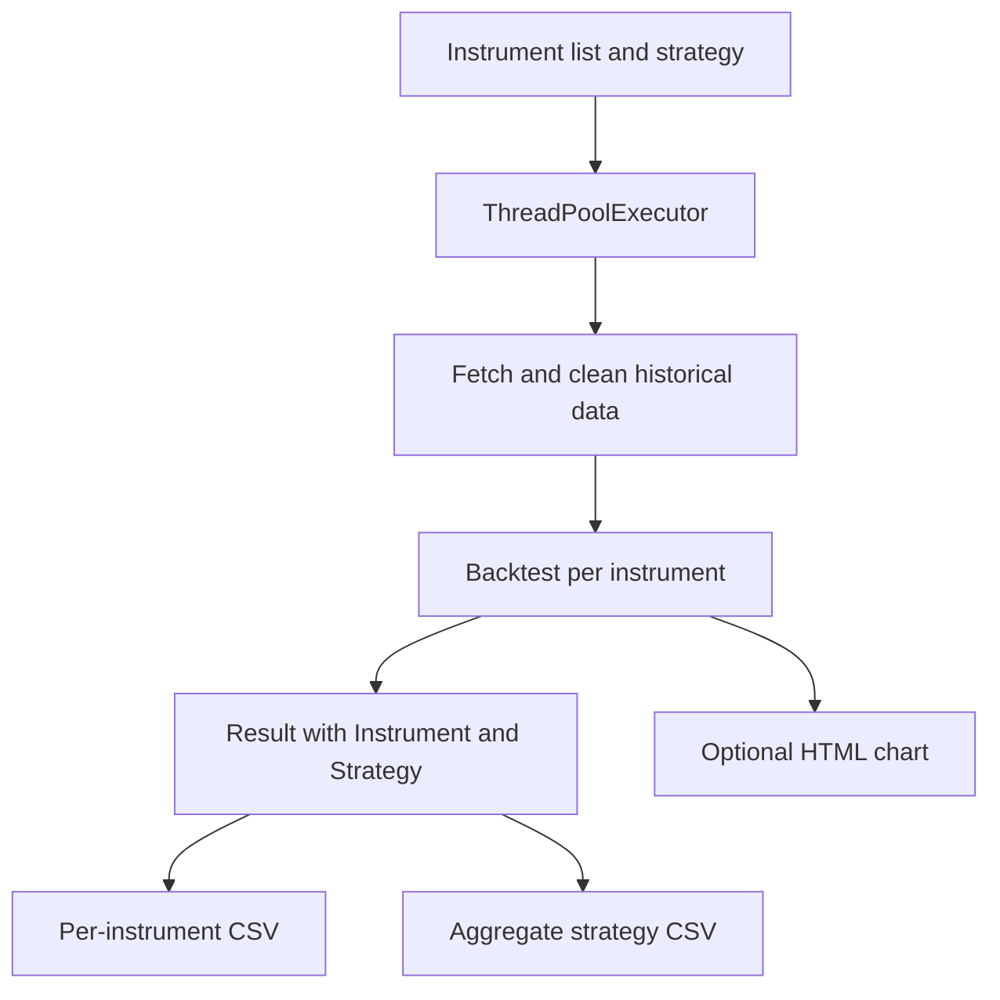

# BatchBacktesting

BatchBacktesting turns a backtest into a repeatable batch: choose instruments, obtain and clean prices, run a strategy, and save comparable results. It is an [AlgoÉTS](https://github.com/AlgoETS) repository; the facts below come from its source files and README as read for the [companion article]().

## Overview

**Why it exists.** A batch backtest is a small data pipeline, and the project keeps every step visible in Python instead of behind a dashboard.

**Best fit.** Comparing one strategy across many instruments with the same recorded assumptions, then reading the per-instrument and aggregate CSVs side by side.

## Getting started

The README links a published example rather than a one-command install; the runner is the entry point.

- Runner: [`src/BatchBacktesting.py`](https://github.com/AlgoETS/BatchBacktesting/blob/main/src/BatchBacktesting.py) — `process_instrument` selects a stock or crypto price adapter, cleans the data and constructs a `Backtest`.
- Strategies: [`src/strategies.py`](https://github.com/AlgoETS/BatchBacktesting/blob/main/src/strategies.py).
- Analysis helpers: [`src/analyse.py`](https://github.com/AlgoETS/BatchBacktesting/blob/main/src/analyse.py).
- Published AAPL EMA chart (2018-04-04 to 2023-04-03): [output/charts/EMA](https://algoets.github.io/BatchBacktesting/output/charts/EMA/AAPL-2018-04-04-2023-04-03.html).

## Features and components

| Component | What it does |
| --- | --- |
| Instrument runner | Picks the price adapter, cleans observations, runs one `Backtest`, tags the result with instrument and strategy names |
| Worker pool | `ThreadPoolExecutor`, four workers by default for the single-strategy runner; the multi-strategy helper nests an outer pool around inner pools |
| Strategy defaults | 100,000 starting cash, 0.002 commission (0.2%), exclusive orders |
| EMA strategy | 20-, 80- and 150-period EMAs computed; entries compare the 20 and 80 curves; long side closes the prior position and buys with a 90% stop and a 125% target |
| Outputs | Per-instrument CSV, aggregate CSV per strategy, optional HTML chart |

## Architecture

## Constraints and checks

- A failed instrument returns `None`; if every instrument fails, the later concatenation has no frames.
- `groupby("Instrument").max()` in `analyse.py` takes each column's maximum independently, so a summary row can mix metrics from different runs. Select a real row by return before quoting its drawdown.
- The defaults do not cover slippage, short availability, delisted securities or corporate actions.
- Worker counts and dates above are code defaults and example dates, not measured throughput or a fixed range.

## Links

- [Repository](https://github.com/AlgoETS/BatchBacktesting)
- [Published example](https://algoets.github.io/BatchBacktesting/)
- [Workshop1](), the beginner notebooks that lead into this batch runner
